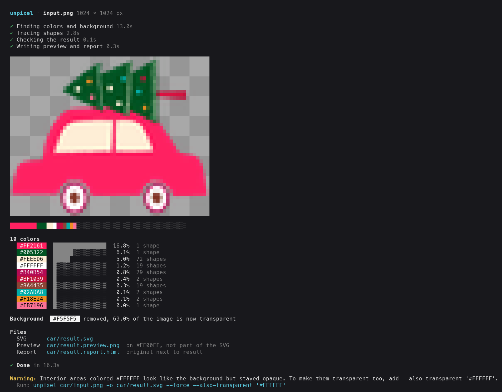

<p align="center"></p>

# unpixel

Turn flat-color raster artwork (logos, stickers, illustrations, posters) into clean, layered SVG, with the background made transparent.

```sh
unpixel artwork.png
```

The command writes `artwork.svg`, plus a report and a preview so you can check the result by eye. It detects the colors and the background by itself, and it works on upscaled or slightly blurry sources.

The logo above is a transparent SVG vectorized by unpixel itself, with `--colors 8`. [See how](examples/README.md#an-illustration-with-soft-shading).

These results use no options at all:

| Original | Result, shown on a check color |
|---|---|
|  |  |
|  |  |
|  |  |

**[All examples and use cases](examples/README.md)**, each with its input, output and exact command · [En español](examples/README.es.md)

## Install

Requires Python 3.15 or newer, and `git`. Nothing else: there are no system libraries to install. If your system Python is older, `uv tool install` below fetches 3.15 by itself; with pip, install 3.15 first (`uv python install 3.15` also works).

**With [uv](https://docs.astral.sh/uv/) (recommended):**

```sh
uv tool install git+https://github.com/jotadrilo/unpixel
```

**With pip, in a virtual environment:**

```sh
python3.15 -m venv ~/.venvs/unpixel
~/.venvs/unpixel/bin/pip install git+https://github.com/jotadrilo/unpixel
~/.venvs/unpixel/bin/unpixel --version   # or add that bin directory to your PATH
```

**From a clone, for development:**

```sh
git clone https://github.com/jotadrilo/unpixel
cd unpixel
uv venv && uv pip install -e '.[dev]'
.venv/bin/pytest
```

Check it works with `unpixel --version`.

### With the locked dependency versions

`pyproject.toml` accepts a range of numpy, Pillow and SciPy versions, so a plain install gets whatever is newest that day. A different version of one of them can change the SVG slightly. To get the exact versions unpixel is tested and its output checked with, the ones in `uv.lock`, install the dependencies from `requirements.lock` (the same versions, exported for pip, with hashes) at the same commit as unpixel, then unpixel itself without dependencies:

```sh
commit=abc1234   # the unpixel commit to install
python3.15 -m venv ~/.venvs/unpixel
~/.venvs/unpixel/bin/pip install --require-hashes --no-deps \
  -r "https://raw.githubusercontent.com/jotadrilo/unpixel/$commit/requirements.lock"
~/.venvs/unpixel/bin/pip install --no-deps "unpixel @ git+https://github.com/jotadrilo/unpixel@$commit"
~/.venvs/unpixel/bin/pip check
```

`--require-hashes` makes pip refuse any file whose hash differs from the lock. The lock holds one version set, for Python 3.15. With uv, the same two steps are `uv pip install --require-hashes --no-deps -r <url>` and `uv pip install --no-deps "unpixel @ git+…"`. pip cannot take `requirements.lock` as a constraints file (`-c`): its hashes would make pip demand a hash for unpixel too, which a git install does not have.

On x86_64, also set `OPENBLAS_CORETYPE` and `NPY_DISABLE_CPU_FEATURES` as in [Same output on every x86_64 host](#same-output-on-every-x86_64-host): without them the output depends on the CPU model.

## Update

Use the command that matches how you installed unpixel.

**With uv:**

```sh
uv tool upgrade unpixel
```

uv lists the old and new commits when there is an update, and prints `Nothing to upgrade` when you already have the latest. The version number does not always change between commits, so `unpixel --version` may not show the difference.

**With pip, in a virtual environment:**

```sh
~/.venvs/unpixel/bin/pip install --upgrade --force-reinstall git+https://github.com/jotadrilo/unpixel
```

**From a clone, for development:**

```sh
git pull
uv pip install -e '.[dev]'
```

An install pinned to a commit, such as `git+https://github.com/jotadrilo/unpixel@abc1234`, stays on that commit. To follow the latest version instead:

```sh
uv tool install --force --reinstall git+https://github.com/jotadrilo/unpixel
```

## Usage

```
unpixel INPUT [options]
```

`INPUT` is a PNG, JPEG, WebP or any other format Pillow reads. Transparent pixels in the input count as white.

| Option | Values | Default | Use it when |
|---|---|---|---|
| `--colors SPEC` | A number (`3`) or a palette (`'#04162E,#BB100F'`) | detected | Too many colors were detected, you need exact brand colors, or you want to recolor. Each detected color becomes the closest one listed, so one value recolors the whole design. The removed background does not count. |
| `--background MODE` | `auto`, `keep`, `'#RRGGBB'` | `auto` | `auto` removes the uniform color touching the image border. `keep` removes nothing. A color removes that color where it touches the border. |
| `--also-transparent '#RRGGBB'` | A color. Repeatable | none | Enclosed areas should be see-through too, such as white inside letters. Only colors close to that value go: a thin grey line on white stays, as a color of its own, and you can name it too. Use the exact value from the warning or from `layers`. |
| `--layers MODE` | `stacked`, `cutout` | `stacked` | `stacked` overlaps colors slightly so no seams show (print, screen). `cutout` makes colors never overlap (plotters, screen printing). |
| `--detail LEVEL` | `low`, `medium`, `high` | `medium` | `low` if edges look jagged. `high` if thin lines or small shapes get lost. |
| `--outline MODE` | `lines`, `edges` | off | You want only lines. `lines` keeps the darkest color's own shapes, for artwork that already has outlines. `edges` draws a line wherever two colors meet, for flat artwork with none. |
| `--outline-width PIXELS` | A number above 0 | `2` | The line width for `--outline edges`, in source pixels. Pixel art draws at least one of its blocks, and above 12 MP lines come out wider, about 11 for 8 at 24 MP. |
| `--outline-color '#RRGGBB'` | A color | `#000000` | The line color for `--outline`. |
| `--preview-background '#RRGGBB'` | A color | contrasting color | You know the surface the design goes on: check it there. It only affects the preview and report, not the SVG. |
| `-o`, `--output FILE.svg` | Path | next to the input | You want the output elsewhere. The report and preview go beside it, and missing folders are created. |
| `--force` | | off | Overwrite existing output files. Without it, unpixel refuses to overwrite and changes nothing. |
| `--no-report` | | off | You want only the SVG. |
| `--open` | | off | See the preview right away, in your default image viewer. If it cannot open, you get a warning and the SVG is still written. Cannot be combined with `--no-report`. |
| `--json` | | off | A program or AI reads the result. |
| `--color WHEN` | `auto`, `always`, `never` | `auto` | Color in the terminal. `auto` uses it on a terminal only, follows `NO_COLOR` and `FORCE_COLOR`, and `--json` output never contains color. |

Always quote colors: an unquoted `#` starts a comment in many shells.

### What you see

On a terminal, unpixel shows its progress, a miniature of the result with transparency as a checkerboard, each color on itself with its share of the image, and any warning with the exact command to run next. Piped output has no color codes, and `--json` prints only JSON.



### What is written

| File | Contents |
|---|---|
| `NAME.svg` | The result: one `<g id="color-N" fill="#RRGGBB">` per color, bottom to top. With `stacked`, thick shapes go at the bottom and thin strokes on top; with `cutout`, the largest area goes first. Each shape is a `<path>`, with holes included in it. With `stacked`, a group can also hold `<path class="trap">` strokes, which keep seams from showing. Text becomes outlines. |
| `NAME.preview.png` | The result on a check color chosen to contrast with the artwork, so halos and gaps are visible. The check color is not in the SVG. |
| `NAME.report.html` | One self-contained page: original next to result, close-ups of the busiest areas and largest differences, metrics and warnings. |

Illustrator, Inkscape, Figma and browsers open the SVG directly. To get an `.ai` file, open the SVG in Illustrator and save from there.

The SVG's `width` and `height` match the source image in pixels, but it scales to any print size without loss: set the size in your design program. To change a color by hand, edit the `fill` of its `<g>` group, and the `stroke` of any `class="trap"` path in it. In `cutout` there are no such paths.

### Exit codes

| Code | Meaning | What to do |
|---|---|---|
| `0` | SVG written. There may be warnings | Read the warnings and check the preview |
| `2` | Bad arguments, unreadable input, output already exists, or `--also-transparent` would remove every color | Fix the command, or add `--force` if overwriting is intended |

unpixel does not refuse an image for what it shows. A photo or heavy shading gets an SVG too, flattened into bands, so judge the preview.

## Using unpixel from an AI assistant

This section is everything an AI agent needs. Follow it in order.

1. **Install** if `unpixel --version` fails, using the commands above.
2. **Run once** with `--json`, adding only flags that need no measured value. Do not add `--open` unless the user asks, because it opens a window on their screen:
   ```sh
   unpixel input.png --json
   ```
   - "keep the background": `--background keep`.
   - "for a sticker cutter", "vinyl", "plotter" or "screen printing": `--layers cutout`. A printed sticker uses the default.
   - "only these colors" or "make it this color": `--colors '#AAAAAA,#BBBBBB'`.
   - The user named the surface, such as "for a dark laptop" or "on a red shirt": `--preview-background` with your best estimate of its color.
3. **Read the JSON on stdout**, described below. On an error it holds `status: "error"`, `exit_code` and `error`.
4. **Run again if the request needs a measured color.** For "remove the white too" or "white should be see-through everywhere", take the value from the warning or from `layers`, since scans are rarely pure white, and rerun with `--also-transparent '#HEX' --force`. Keep the other flags.
5. **Act on `warnings`.** When one names a flag, it gives the exact value to use: rerun with it if it matches the request. A warning that names no flag is information for step 6 and step 7. It does not mean the run failed.
6. **Look at the result before reporting success.** Open `preview` as an image. Use `report` too if you can open HTML with images. If you cannot, the preview and metrics are enough. Unless you set `--preview-background`, the check color in the preview is not the real surface. Metrics alone are not enough: they can look fine while a thin line is broken. Look for:
   - see-through areas that should be solid, or the reverse;
   - colored fringes along edges;
   - broken thin lines, and fine detail clogged into blobs;
   - low contrast against the surface the design is going on, which unpixel does not check.

   For lost detail, try `--detail high`, which can also make outlines wobblier and add specks. For jagged edges or specks, try `--detail low`, which can lose fine detail. Try each at most once, with `--force` or a different `-o`, and keep the better one. If neither helps, the limit is the source image: say so and ask for a larger one.
7. **Report** the SVG path to the user, along with the colors and any limitation you saw. Do not delete the report or preview unless asked.

### JSON output

```json
{
  "status": "ok",
  "svg": "art.svg",
  "report": "art.report.html",
  "preview": "art.preview.png",
  "input_size": [1600, 865],
  "background_removed": "#FEFEFE",
  "working_scale": 2.0,
  "layers_mode": "stacked",
  "outline": null,
  "layers": [
    {"layer": "color-1", "color": "#FBFBFB", "shapes": 101, "area_percent": 5.7, "class": 1},
    {"layer": "color-2", "color": "#020202", "shapes": 83, "area_percent": 20.16, "class": 0}
  ],
  "metrics": {
    "transparent_percent": 73.28,
    "expected_transparent_percent": 74.14,
    "opaque_pixels_in_background": 0,
    "transparent_pixels_in_artwork": 0,
    "holes_in_artwork": 0,
    "edge_difference_percent": 5.96,
    "large_difference_pixels": 0,
    "flat_area_mismatch_percent": 0.0
  },
  "preview_background": "#FF00FF",
  "warnings": ["Interior areas colored #FBFBFB look like the background but stayed opaque. To make them transparent too, add --also-transparent '#FBFBFB'."]
}
```

| Field | Meaning | Healthy value |
|---|---|---|
| `background_removed` | Background color removed, or `null` | The expected color |
| `opaque_pixels_in_background` | Painted pixels well inside the background | `0` |
| `transparent_pixels_in_artwork` | Pixels well inside the artwork that are not fully opaque | `0`, or a few along a wall, which are antialiasing |
| `holes_in_artwork` | See-through pixels well inside the artwork. From 20, unpixel warns | Below `20` |
| `transparent_percent`, `expected_transparent_percent` | Measured against planned transparency | Within about 2 points. Small sources can differ a little more, because edges weigh more. Look at the preview if so |
| `flat_area_mismatch_percent` | Flat areas that came out in the wrong color | Below `0.5` |
| `large_difference_pixels` | Differences thicker than normal edge wobble | Small next to the image size |
| `edge_difference_percent` | All differences, mostly edge smoothing. Higher on small sources | For information |

## Limits

- **It is for flat color.** Detection usually stops at 16 colors and keeps up to 24 when a color is far from the rest. Colors close to another are dropped, with no warning, so pass `--colors` to decide. Soft edges can become colors of their own, and a reduced palette can bring back marks that were dropped, as the stray lines in the [leaves example](examples/README.md#7-reduce-the-number-of-colors) show. Nothing is refused: a photo gets an SVG in flat bands, and an image too busy to trace, like noise, is smoothed first, with a warning. Real gradients come out as bands with wavy edges: see the sky in the [sunset example](examples/README.md#9-photos-paintings-and-noise).
- **It only sees what the image contains.** Text smaller than about 10 source pixels turns into blobs, as on the diver's suit in `battery/diver.png`, and very small sources lose their fine parts, as in the [small logo example](examples/README.md#3-rescue-a-small-or-blurry-logo). Windows of a few pixels come out as rounded dots. Use the largest source you have.
- **"Connected to the border" is the rule for background.** Enclosed white stays opaque unless you use `--also-transparent`. A pale area that touches the outside with no strong outline disappears with the background, such as the white border of the [leaves sticker](examples/README.md#1-remove-the-background-and-keep-everything-else). No option separates them. Use `--background keep` for an opaque copy.
- **It does not judge contrast.** A dark logo stays dark, even if it is going on a dark surface. Check with `--preview-background`, and recolor with `--colors` if needed.
- **It is not a watermark remover.** Faint overlays tend to vanish, stronger ones stay, in pieces or whole, with no warning. See [the use case](examples/README.md#11-artwork-with-a-watermark).
- **Cutout layers meet edge to edge,** so a faint seam can show where colors meet in a renderer that antialiases each shape. Expect a warning when the check finds one.
- **Output is filled shapes.** Text stays as outlines rather than editable text, and lines are not strokes. The only strokes are the `stacked` trap paths, which follow walls between colors.
- **Memory and time depend on the working size.** Images up to 4 MP are worked on at twice their size, up to 12 MP at their own size, and larger ones are reduced to 12 MP first, so on a 24 MP image a line of 1 source pixel is lost. Measured on an Apple Silicon Mac: 1379 × 752 px took 4 seconds and 0.6 GB, and 6634 × 3618 px (24 MP) took about 30 seconds and 4.9 GB. Allow at least 5 GB of free memory for large images.

## How it works

1. Decide what kind of image it is. Pixel art keeps its grid and its straight edges, at one class per logical pixel. Anything else is worked on at twice its size up to 4 MP, at its own size up to 12 MP, and reduced to 12 MP above that.
2. Denoise, and mark transition pixels: those explained as a mix of the pixels on either side. They say nothing about the palette, which keeps a navy-to-white edge from growing a third color.
3. Flood from the image border to find the background, so interior whites stay.
4. Choose the palette by farthest-point selection over a color histogram, so a small color far from everything is kept and a large one is not split. Then assign each pixel to a color and dissolve false colors along edges and specks.
5. Build a map of shared walls between regions. Each wall gets one curve, with corners only where the source has an abrupt cut, placed where the color crosses halfway between its two sides.
6. Write the paths. Two neighboring colors use the same numbers along their wall, and in `stacked` the color below also strokes that wall, so no seam shows.
7. Read the written SVG back, measure it against the color map, and produce the report.

## Development

```sh
uv sync --locked --all-extras        # the locked versions from uv.lock, plus pytest
.venv/bin/pytest                     # about two minutes
PATH="$PWD/.venv/bin:$PATH" examples/build.sh    # regenerate the examples
```

After changing a dependency, run `uv lock` and then `uv export --locked --no-dev --no-emit-project --format requirements-txt -o requirements.lock`: a test fails while `requirements.lock` is not the export of `uv.lock`.

Tests use synthetic images built in `tests/conftest.py`. A few need `rsvg-convert`, and are skipped without it. `tools/engine/` runs the engine over a folder of images and measures the SVGs it writes.

### Same output on every x86_64 host

On x86_64, the same code, Python and locked libraries still give a slightly different SVG on different CPU models: OpenBLAS picks its kernels by CPU (Nehalem, Haswell, SkylakeX...) and numpy uses AVX-512 where the CPU has it, and either moves some coordinates by up to about 2 pixels. Across GitHub's runners, an AMD EPYC 7763 gave one output and the EPYC 9V45/9V74 and Intel Xeon models another. To get one output everywhere, run unpixel with these two variables set, which is what production does and what the goldens are recorded with:

```sh
OPENBLAS_CORETYPE=Haswell
NPY_DISABLE_CPU_FEATURES="X86_V4 AVX512_ICL AVX512_SPR"
```

Haswell kernels and at most AVX2 exist on every x86_64 server CPU in use, so these make AMD and Intel hosts give the same bytes, byte for byte the `linux-x86_64` goldens. They change nothing on arm64.

### Golden outputs

`tests/test_golden.py` runs the CLI on every image in `battery/` and on `examples/axolotl/input.png`, with no options and with the options that take other paths (`--colors`, `--layers cutout`, `--also-transparent`, `--background keep`, `--detail`, `--outline edges`), and checks that each SVG has the SHA-256 recorded in `tests/golden.json`. CI runs it on every push and pull request, so any change to the output fails there, whether it comes from the code or from a dependency update, with the cases that changed and how (size, palette). Add `-m 'not golden'` to pytest to skip it while working.

The goldens are exact hashes, per platform. The same code and locked libraries do not give the same bytes everywhere: float32 math in OpenBLAS, numpy's SIMD kernels and the C library moves a few coordinates, by 0.01 to about 4 pixels, and on 10 of the 17 cases macOS arm64 and the Linux x86_64 runners differ. Linux x86_64 under Docker on a Mac differs from both. So `tests/golden.json` holds one set per platform (`darwin-arm64` for local work, `linux-x86_64` for CI), with the Python minor and library versions they were made with. On x86_64, `tools/golden.py` pins the CPU kernels (`OPENBLAS_CORETYPE=Haswell`, no AVX-512 in numpy), and with that, AMD EPYC 7763, AMD EPYC 9V74 and Intel Xeon 8573C runners give the same bytes. The test skips a platform with no goldens, and a Python minor other than the recorded one, because the lock picks different library versions for it.

Refresh the goldens only on purpose, **after the owner has validated the new output on the battery** (`battery/README.md`). Then record both platforms:

1. On a Mac: `.venv/bin/python tools/golden.py --update` records `darwin-arm64`.
2. On GitHub: run the **Record goldens** workflow (Actions tab, or `gh workflow run goldens.yml --ref <branch>`) on the branch with the change. It records `linux-x86_64` on a runner and uploads `golden.json` plus the SVGs as an artifact. Copy its `linux-x86_64` entry into `tests/golden.json` (`gh run download` fetches the artifact).

Commit `tests/golden.json` with the change. Without `--update`, `tools/golden.py` checks and lists what changed; `--out DIR` keeps the SVGs to look at.

## License

GPL-2.0-or-later. SVG files you generate are yours: this license does not apply to the program's output.
