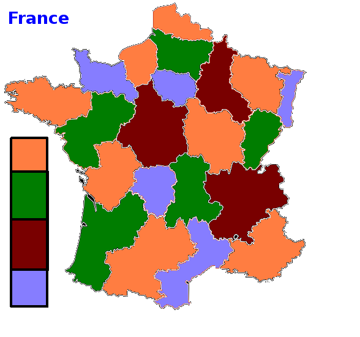
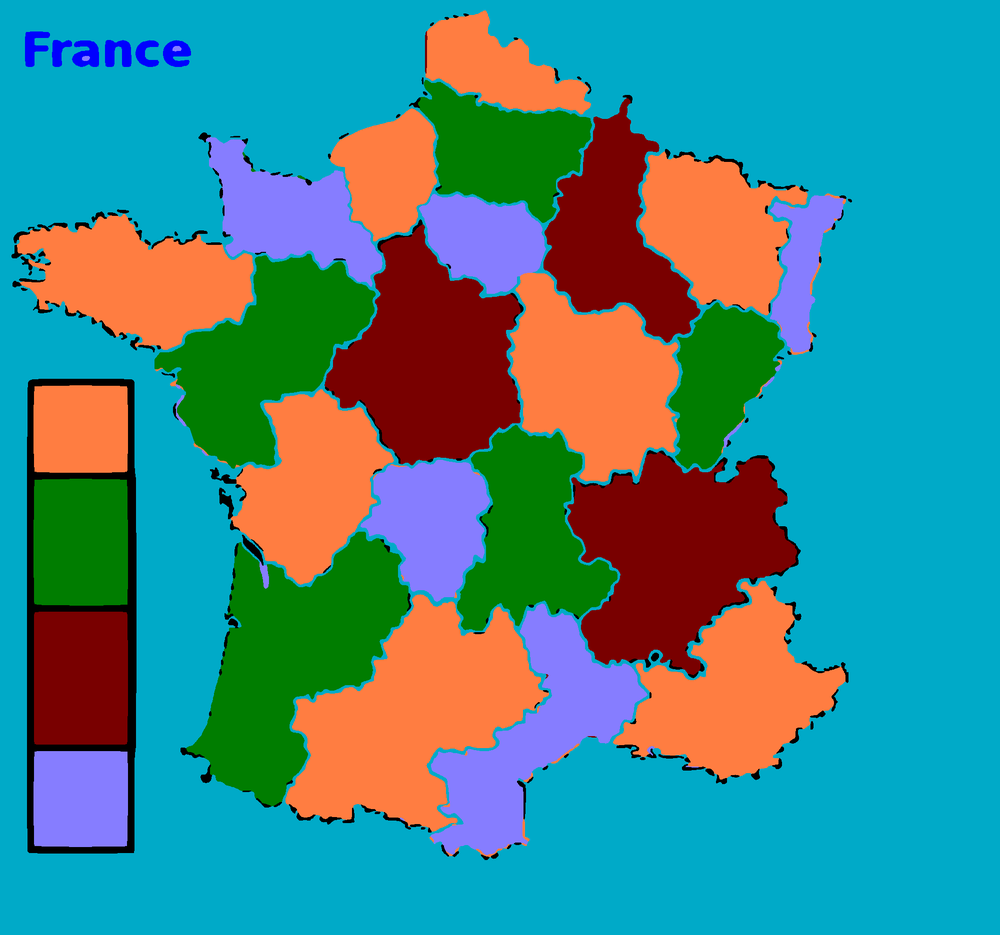
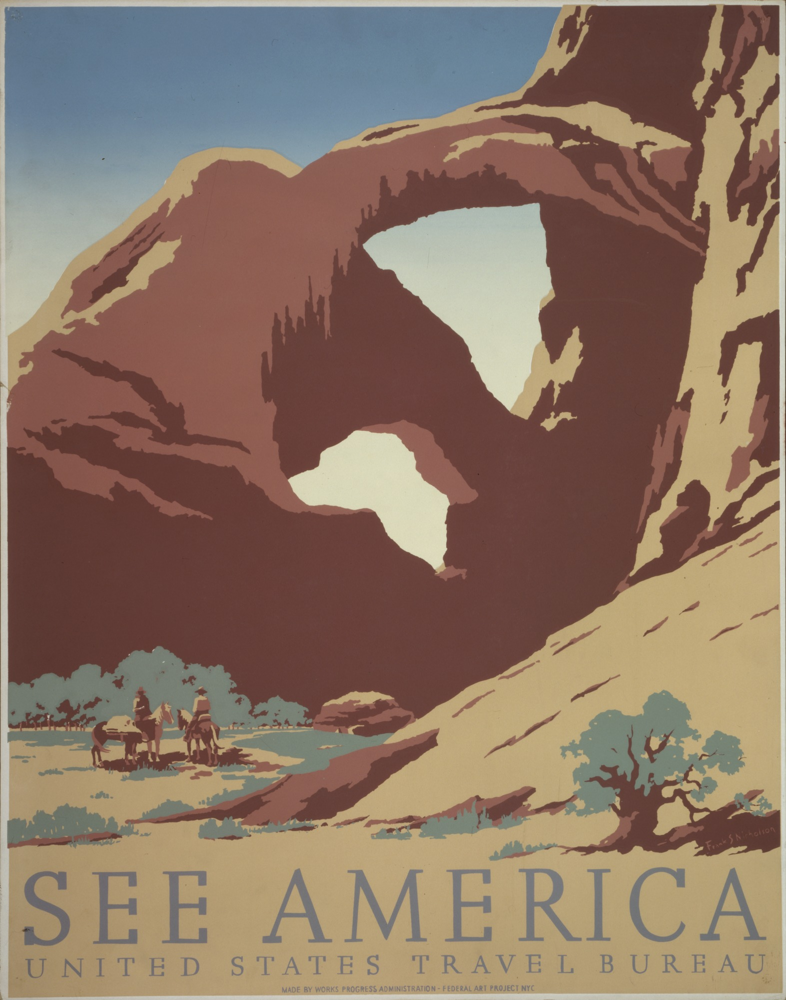
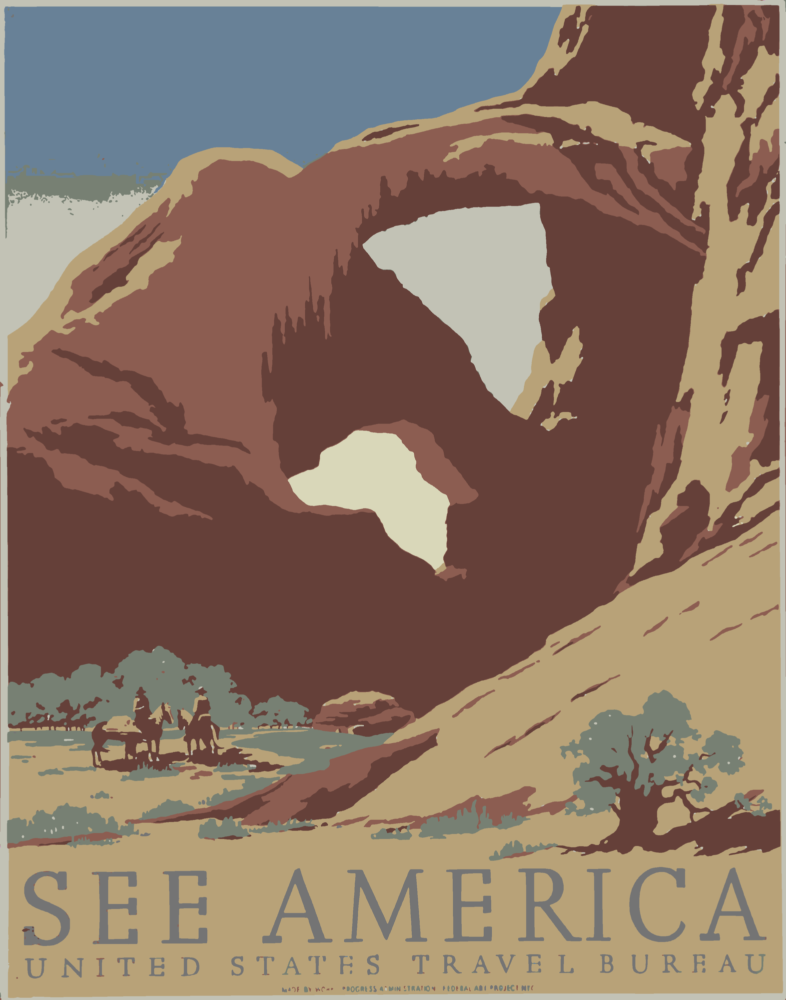

# flattrace

Turn flat-color raster artwork (logos, stickers, illustrations, posters) into clean, layered SVG, with the background made transparent.

```sh
flattrace artwork.png
```

The command writes `artwork.svg`, plus a report and a preview so you can check the result by eye. It detects the colors and the background by itself, and it works on upscaled or slightly blurry sources.

| Original | Result, shown on a check color | Notes |
|---|---|---|
|  |  | 588 px source. Six exact colors. Background removed. |
|  |  | Screen-printed poster reduced to eight flat tones, kept opaque with `--background keep`. |
|  |  | 113 px source. White areas removed with `--also-transparent '#FDFDFD'`. All commands are in [examples/build.sh](examples/build.sh). |

Example images are in the public domain. See [examples/CREDITS.md](examples/CREDITS.md).

Use cases in detail: [English](docs/use-cases.en.md) · [Español](docs/use-cases.es.md)

## Install

Requires Python 3.10 or newer, and `git`. Nothing else: there are no system libraries to install.

**With [uv](https://docs.astral.sh/uv/) (recommended):**

```sh
uv tool install git+https://github.com/jotadrilo/flattrace
```

**With pip, in a virtual environment:**

```sh
python3 -m venv ~/.venvs/flattrace
~/.venvs/flattrace/bin/pip install git+https://github.com/jotadrilo/flattrace
~/.venvs/flattrace/bin/flattrace --version   # or add that bin directory to your PATH
```

**From a clone, for development:**

```sh
git clone https://github.com/jotadrilo/flattrace
cd flattrace
uv venv && uv pip install -e '.[dev]'
.venv/bin/pytest
```

Check it works with `flattrace --version`.

If `git` reports `Repository not found`, the repository is private and your account needs access to it. With the GitHub CLI, run `gh auth login` and then `gh auth setup-git`, and try again.

## Usage

```
flattrace INPUT [options]
```

`INPUT` is a PNG, JPEG, WebP or any other format Pillow reads. Transparent pixels in the input count as white.

| Option | Values | Default | Use it when |
|---|---|---|---|
| `--colors SPEC` | A number (`3`) or a palette (`'#04162E,#BB100F'`) | detected | Too many colors were detected, you need exact brand colors, or you want to recolor. Each detected color becomes the closest one listed, so one value recolors the whole design. The removed background does not count. |
| `--background MODE` | `auto`, `keep`, `'#RRGGBB'` | `auto` | `auto` removes the uniform color touching the image border. `keep` removes nothing. A color removes that color where it touches the border. |
| `--also-transparent '#RRGGBB'` | A color. Repeatable | none | Enclosed areas should be see-through too, such as white inside letters. Thin marks that blend into that color go with it, such as fine grey lines on white. Use the exact value from the warning or from `layers`. |
| `--layers MODE` | `stacked`, `cutout` | `stacked` | `stacked` overlaps colors slightly so no seams show (print, screen). `cutout` makes colors never overlap (plotters, screen printing). |
| `--detail LEVEL` | `low`, `medium`, `high` | `medium` | `low` if edges look jagged. `high` if thin lines or small shapes get lost. |
| `--preview-background '#RRGGBB'` | A color | contrasting color | You know the surface the design goes on: check it there. It only affects the preview and report, not the SVG. |
| `-o`, `--output FILE.svg` | Path | next to the input | You want the output elsewhere. The report and preview go beside it, and missing folders are created. |
| `--force` | | off | Overwrite existing output files. Without it, flattrace refuses to overwrite and changes nothing. |
| `--no-report` | | off | You want only the SVG. |
| `--json` | | off | A program or AI reads the result. |

Always quote colors: an unquoted `#` starts a comment in many shells.

### What is written

| File | Contents |
|---|---|
| `NAME.svg` | The result: one `<g id="color-N" fill="#RRGGBB">` per color, bottom to top, largest area first. Each shape is a `<path>`, with holes included in it. Text becomes outlines. |
| `NAME.preview.png` | The result on a check color chosen to contrast with the artwork, so halos and gaps are visible. The check color is not in the SVG. |
| `NAME.report.html` | One self-contained page: original next to result, close-ups of the busiest areas and largest differences, metrics and warnings. |

Illustrator, Inkscape, Figma and browsers open the SVG directly. To get an `.ai` file, open the SVG in Illustrator and save from there.

The SVG's `width` and `height` match the source image in pixels, but it scales to any print size without loss: set the size in your design program. To change a color by hand, edit the `fill` of its `<g>` group.

### Exit codes

| Code | Meaning | What to do |
|---|---|---|
| `0` | SVG written. There may be warnings | Read the warnings and check the preview |
| `2` | Bad arguments, unreadable input, output already exists, or `--also-transparent` would remove every color | Fix the command, or add `--force` if overwriting is intended |
| `3` | Image unsuitable: a photo, or heavy shading | Do not retry with other flags, unless a reduced palette is what is wanted (`--colors N`) |

## Using flattrace from an AI assistant

This section is everything an AI agent needs. Follow it in order.

1. **Install** if `flattrace --version` fails, using the commands above.
2. **Run once** with `--json`, adding only flags that need no measured value:
   ```sh
   flattrace input.png --json
   ```
   - "keep the background": `--background keep`.
   - "for a sticker cutter", "vinyl", "plotter" or "screen printing": `--layers cutout`. A printed sticker uses the default.
   - "only these colors" or "make it this color": `--colors '#AAAAAA,#BBBBBB'`.
   - The user named the surface, such as "for a dark laptop" or "on a red shirt": `--preview-background` with your best estimate of its color.
3. **Read the JSON on stdout**, described below. On an error it holds `status: "error"`, `exit_code` and `error`.
4. **Run again if the request needs a measured color.** For "remove the white too" or "white should be see-through everywhere", take the value from the warning or from `layers`, since scans are rarely pure white, and rerun with `--also-transparent '#HEX' --force`. Keep the other flags.
5. **Act on `warnings`.** When one names a flag, it gives the exact value to use: rerun with it if it matches the request. A warning that names no flag is information for step 6 and step 7. It does not mean the run failed.
6. **Look at the result before reporting success.** Open `preview` as an image. Use `report` too if you can open HTML with images. If you cannot, the preview and metrics are enough. Unless you set `--preview-background`, the check color in the preview is not the real surface. Metrics alone are not enough: they can look fine while a thin line is broken. Look for:
   - see-through areas that should be solid, or the reverse;
   - colored fringes along edges;
   - broken thin lines, and fine detail clogged into blobs;
   - low contrast against the surface the design is going on, which flattrace does not check.

   For lost detail, try `--detail high`, which can also make outlines wobblier and add specks. For jagged edges or specks, try `--detail low`, which can lose fine detail. Try each at most once, with `--force` or a different `-o`, and keep the better one. If neither helps, the limit is the source image: say so and ask for a larger one.
7. **Report** the SVG path to the user, along with the colors and any limitation you saw. Do not delete the report or preview unless asked.

### JSON output

```json
{
  "status": "ok",
  "svg": "art.svg",
  "report": "art.report.html",
  "preview": "art.preview.png",
  "input_size": [1600, 865],
  "background_removed": "#FEFEFE",
  "working_scale": 4.0,
  "layers_mode": "stacked",
  "layers": [
    {"layer": "color-1", "color": "#020202", "shapes": 83, "area_percent": 20.16},
    {"layer": "color-2", "color": "#FBFBFB", "shapes": 101, "area_percent": 5.7}
  ],
  "metrics": {
    "transparent_percent": 73.28,
    "expected_transparent_percent": 74.14,
    "opaque_pixels_in_background": 0,
    "transparent_pixels_in_artwork": 0,
    "edge_difference_percent": 5.96,
    "large_difference_pixels": 0,
    "flat_area_mismatch_percent": 0.0
  },
  "preview_background": "#FF00FF",
  "warnings": ["Interior areas colored #FBFBFB look like the background but stayed opaque. To make them transparent too, add --also-transparent '#FBFBFB'."]
}
```

| Field | Meaning | Healthy value |
|---|---|---|
| `background_removed` | Background color removed, or `null` | The expected color |
| `opaque_pixels_in_background` | Painted pixels well inside the background | `0` |
| `transparent_pixels_in_artwork` | See-through pixels well inside the artwork | `0` |
| `transparent_percent`, `expected_transparent_percent` | Measured against planned transparency | Within about 2 points. Small sources can differ a little more, because edges weigh more. Look at the preview if so |
| `flat_area_mismatch_percent` | Flat areas that came out in the wrong color | Below `0.5` |
| `large_difference_pixels` | Differences thicker than normal edge wobble | Small next to the image size |
| `edge_difference_percent` | All differences, mostly edge smoothing. Higher on small sources | For information |

## Limits

- **It is for flat color.** Photos and shaded paintings are refused with exit code 3. Real gradients come out as bands, sometimes with a noisy edge: see the sky in the poster example.
- **It only sees what the image contains.** Text smaller than about 10 source pixels turns into blobs, as on the clapperboard. Windows of a few pixels come out as rounded dots. Use the largest source you have.
- **"Connected to the border" is the rule for background.** Enclosed white stays opaque unless you use `--also-transparent`. Light areas that reach the outside through a gap in the outline become transparent: if that is wrong, name the outside color, or use `--background keep`.
- **It does not judge contrast.** A dark logo stays dark, even if it is going on a dark surface. Check with `--preview-background`, and recolor with `--colors` if needed.
- **Output is filled shapes.** Text stays as outlines rather than editable text, and lines are not strokes.
- **Memory and time depend on the working size.** Images are enlarged up to 4× towards a 6400 px long side, so memory is not proportional to the source size. Measured on an Apple Silicon Mac: 588 × 550 px took 9 seconds and 1.2 GB, 3206 × 4075 px took 86 seconds and 6.7 GB, and 7945 × 3973 px took 92 seconds and 6.6 GB. Allow at least 8 GB of free memory for anything over about 1300 px.

## How it works

1. Work at a fixed artwork resolution, enlarging small images, so the same settings suit a small icon and a large poster.
2. Find the dominant colors among pixels away from any edge. Close colors, such as white and cream, form one group.
3. Sharpen, to recover thin lines in soft sources, and classify each pixel in Lab color space. This keeps a navy-to-white edge from being mistaken for red.
4. Find connected regions, and give each its own color. This separates white from cream without leaving a false ring around dark outlines.
5. Mark regions connected to the border and matching the dominant border color as background.
6. Remove false colors along edges, using a rule that keeps real thin lines. Smooth outlines, and trace each color with [potrace](https://potrace.sourceforge.net/).
7. Read the written SVG back, measure it against the segmentation, and produce the report.

## Development

```sh
uv venv && uv pip install -e '.[dev]'
.venv/bin/pytest                     # about a minute
PATH="$PWD/.venv/bin:$PATH" examples/build.sh    # regenerate the examples
```

Tests use synthetic images built in `tests/conftest.py`.

## License

GPL-2.0-or-later, because flattrace depends on [potracer](https://github.com/tatarize/potrace), a GPL-licensed port of potrace. SVG files you generate are yours: this license does not apply to the program's output.
