# Use cases

Each case gives the situation, the command, and what to check, with the real input and output. Installation and the full list of options are in the [README](../README.md). [Versión en español](use-cases.es.md).

Outputs are shown on a check color, which is not part of the SVG. Commands run from the `examples/` folder, and [`build.sh`](../examples/build.sh) regenerates all of them. Image credits are in [`CREDITS.md`](../examples/CREDITS.md).

## Choosing a case

| You have | You want | Go to |
|---|---|---|
| A design on a white or plain background | The design alone, for any background | [1](#1-remove-the-background-and-keep-everything-else) |
| Black or one-color lettering, with white inside it | Nothing but the ink | [2](#2-make-enclosed-white-see-through-too) |
| A small logo or a screenshot of one | A version that scales | [3](#3-rescue-a-small-or-blurry-logo) |
| A design with exact brand colors | Those exact values in the file | [4](#4-use-exact-brand-colors) |
| A poster or full-bleed design | A vector copy, background included | [5](#5-keep-a-full-image-with-no-background-to-remove) |
| A file for a cutter, plotter or screen printer | Colors that never overlap | [6](#6-prepare-a-file-for-a-cutter-plotter-or-screen-printing) |
| Too many similar tones | A simpler palette | [7](#7-reduce-the-number-of-colors) |
| A broken or jagged result | A better one | [8](#8-fix-lost-detail-or-jagged-edges) |
| A photo or painting | To know what to expect | [9](#9-when-unpixel-is-the-wrong-tool) |
| A design for a dark or colored surface | To see it there, and recolor it | [10](#10-check-and-recolor-for-the-surface-it-goes-on) |
| Your own artwork with a draft watermark | To know what will happen to it | [11](#11-artwork-with-a-watermark) |

Before sending anything to print or production, open the preview, and the report if the design has fine detail.

## 1. Remove the background and keep everything else

**Situation.** A stamp, ticket or invitation with pale areas, on a white page. You want the design without the page. Removing "all light pixels" would destroy the pale frame and anything light inside it.

```sh
unpixel stamp/input.jpg -o stamp/result.svg
unpixel badge/input.png -o badge/result.svg
```

| Input | Output |
|---|---|
| 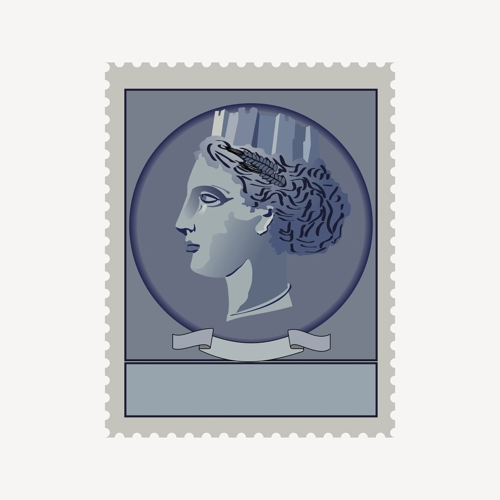 | 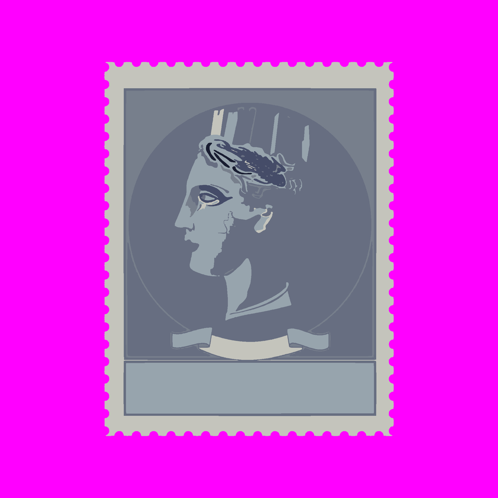 |
| 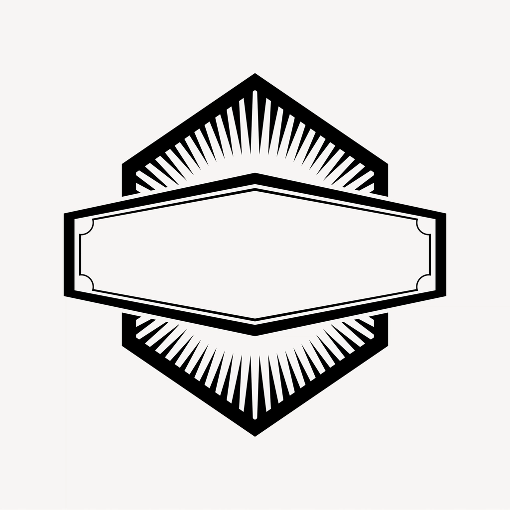 | 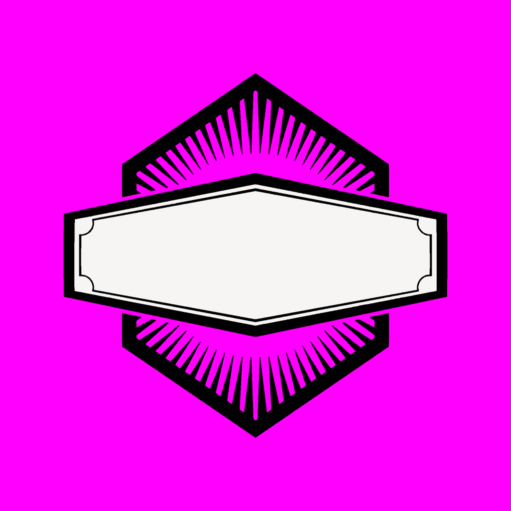 |

Only the color connected to the image border is removed. The stamp keeps its pale frame and six detected colors. On the badge, the near-white center stays opaque because the outline encloses it, even though it is the same color as the page, while the gaps between the rays reach the outside and disappear.

**Check.** The outside should show the check color, and enclosed pale areas should be solid.

## 2. Make enclosed white see-through too

**Situation.** Black lettering for a T-shirt or a sticker. White inside the letters must disappear too, or the design shows white patches on a colored shirt.

```sh
unpixel family/input.png -o family/result.svg
```

unpixel keeps enclosed areas that look like the background opaque, and tells you what to do:

```
Warning: Interior areas colored #F8F6F5 look like the background but stayed opaque.
To make them transparent too, add --also-transparent '#F8F6F5'.
```

```sh
unpixel family/input.png --also-transparent '#F8F6F5' -o family/knockout.svg
```

| Input | Default: enclosed white stays | With `--also-transparent` |
|---|---|---|
|  |  | 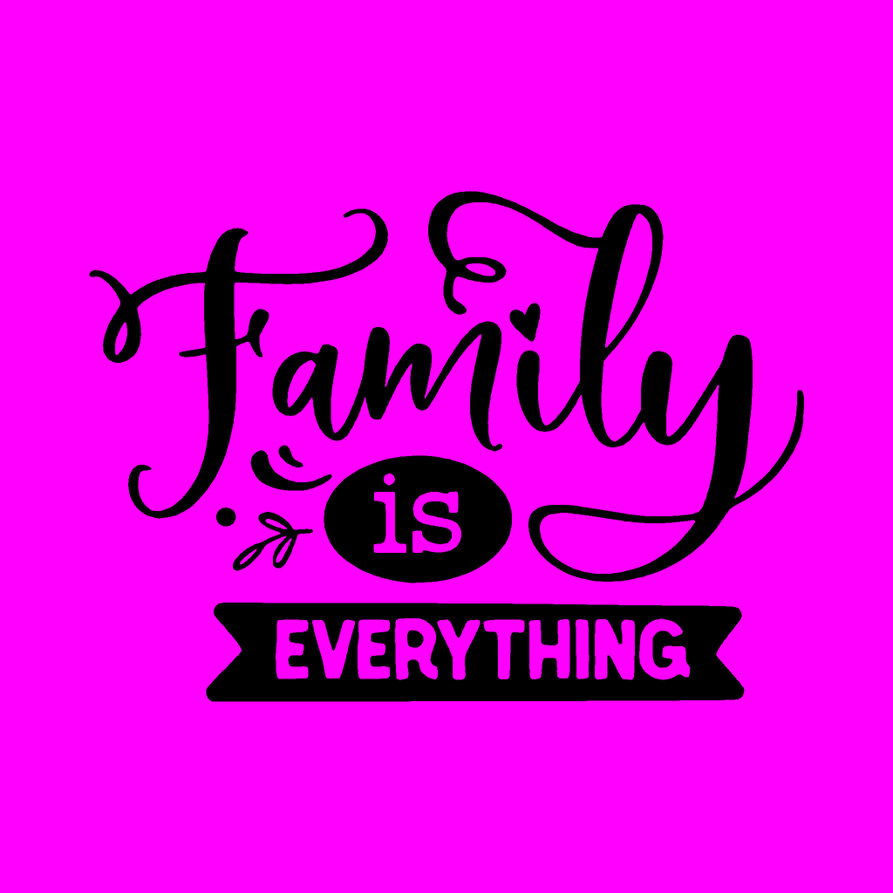 |

Look at "is" and "EVERYTHING": in the last image, the letters are holes.

**Check.** Inside the letters, the preview should show the check color. Thin marks that blend into the white go with it.

## 3. Rescue a small or blurry logo

**Situation.** All you have is a small PNG from an old website, or a JPEG screenshot.

```sh
unpixel clapperboard/input.png -o clapperboard/result.svg
```

| Input, 113 px wide, enlarged here | Output |
|---|---|
|  |  |

Small images are enlarged before tracing and edges are smoothed, so the result scales cleanly. unpixel cannot invent what the file does not contain: the large shapes are clean, but labels of a few pixels become blobs, and the white stripes at the top reach the outside, so they become transparent.

**Check.** Compare the close-ups in the report. Consider retyping small text over the result in a design program.

## 4. Use exact brand colors

**Situation.** You need exact values in the file, such as your brand's, instead of what was measured in the image.

```sh
unpixel france-map/input.png -o france-map/result.svg
unpixel france-map/input.png --colors '#F26A21,#0B7A3B,#7A0019,#7F77E8,#101010,#1747D1' -o france-map/brand.svg
```

| Input | Colors detected | Your colors |
|---|---|---|
| 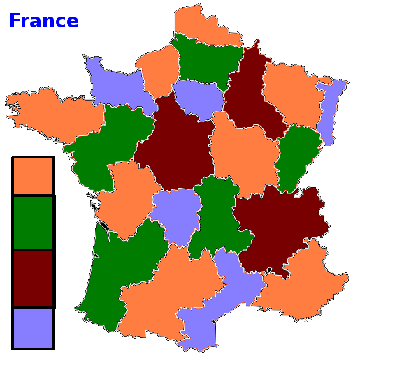 |  | 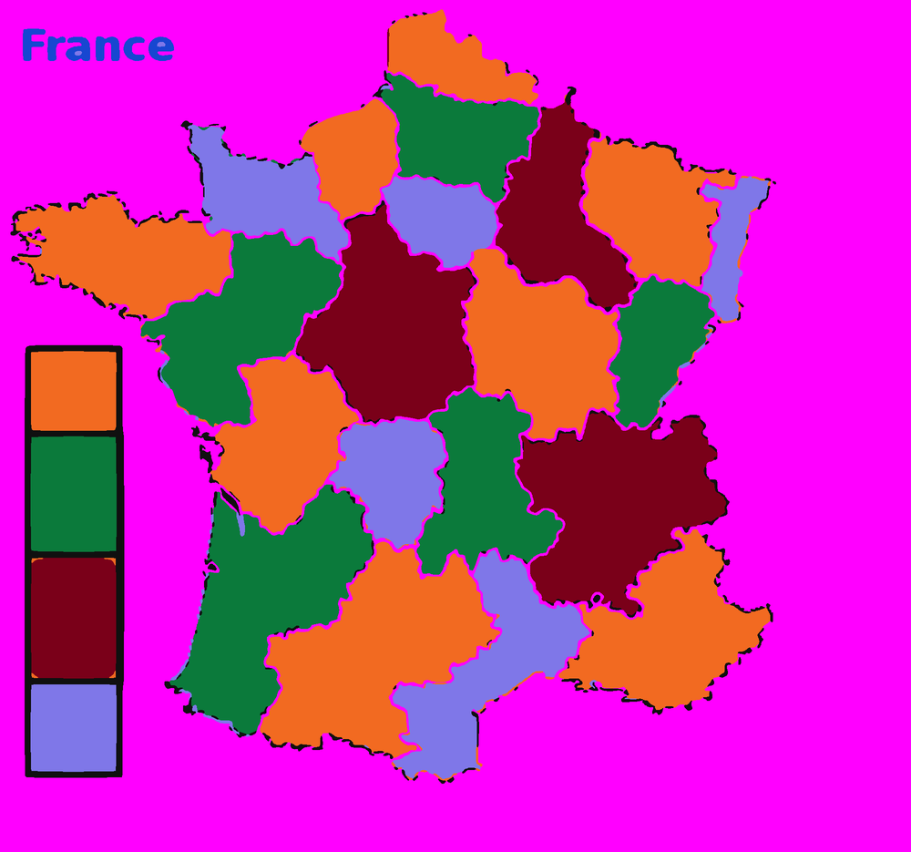 |

| Detected | `#FF7D41` | `#007D00` | `#790000` | `#867DFF` | `#000000` | `#0000FF` |
|---|---|---|---|---|---|---|
| **Output** | `#F26A21` | `#0B7A3B` | `#7A0019` | `#7F77E8` | `#101010` | `#1747D1` |

Each detected color becomes the closest in your list, and every layer uses exactly those values. Warnings appear if a detected color is far from all of yours, as blue was here, or if one of yours matched nothing, which usually means a mistyped value.

**Check.** The `layers` list in the output should show only your colors.

## 5. Keep a full image with no background to remove

**Situation.** A poster that fills the whole image, to be reprinted large.

```sh
unpixel poster/input.jpg --background keep -o poster/result.svg
```

| Input | Output: eight flat tones |
|---|---|
| 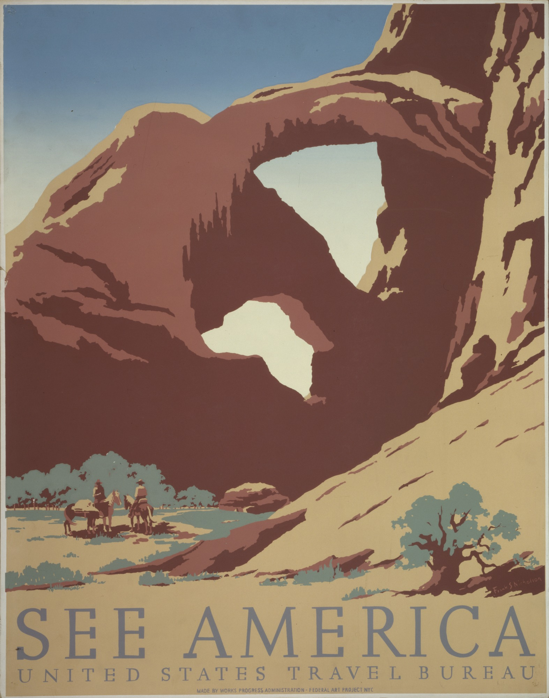 | 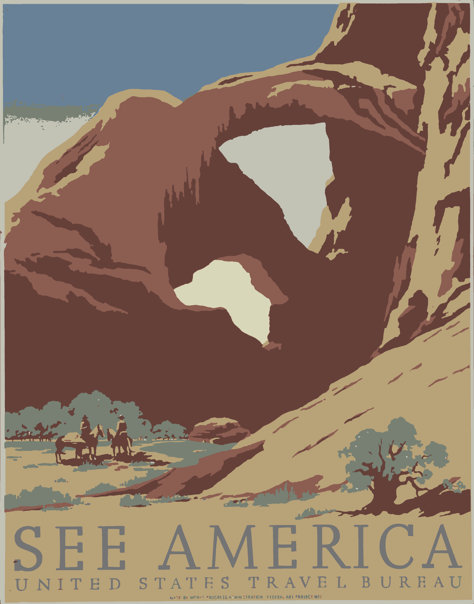 |

Without the flag, unpixel notices that the border is not one uniform color, removes nothing and warns you. Use `--background keep` to say that this is what you want.

**Check.** Real gradients become bands. On the left of the sky, the transition has a noisy edge, which is fine at a distance but may need retouching.

## 6. Prepare a file for a cutter, plotter or screen printing

**Situation.** Each color will be cut from vinyl or printed as its own screen, so a color must not continue underneath another.

```sh
unpixel airmail/input.jpg --background keep --colors 4 --layers cutout -o airmail/cutout.svg
python plates.py airmail/cutout.svg airmail/plates.png
```

| Input | The four colors, each one alone |
|---|---|
| 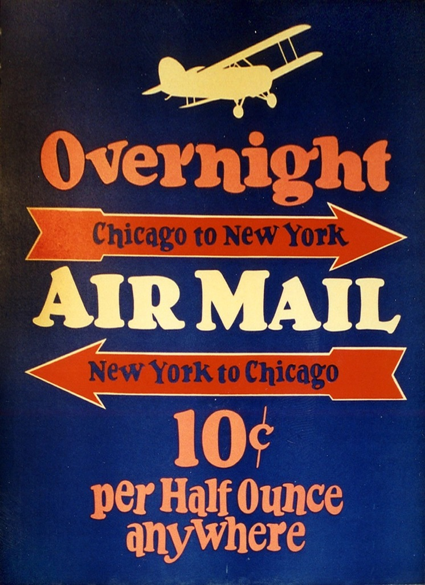 | 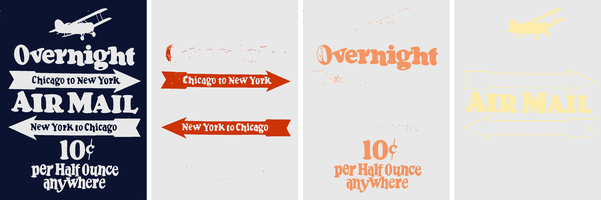 |

Each color appears only where it is visible: on the navy plate, every other shape is a hole. Each `<g id="color-N">` group in the SVG can be selected and sent separately, and [`plates.py`](../examples/plates.py) draws them like this.

**Check.** Cutout layers leave tiny gaps where colors meet, because each shape is curved separately. Here they add up to 0.06% of the image, and unpixel warns about them. Aged print also leaves specks: see the small marks on the plates, and the red in the "O", where the old paper is worn. Clean those up by hand before production, and add the trapping your print shop requires. For print or screen use, prefer the default, `stacked`.

## 7. Reduce the number of colors

**Situation.** An aged print has dozens of near-identical tones, and you are paying for four inks.

```sh
unpixel airmail/input.jpg --background keep -o airmail/result.svg
# unpixel: error: image not suitable for flat-color tracing: 17 colors found; ...
# exit code 3
unpixel airmail/input.jpg --background keep --colors 4 -o airmail/four-colors.svg
```

| Input | Output: four colors |
|---|---|
|  | 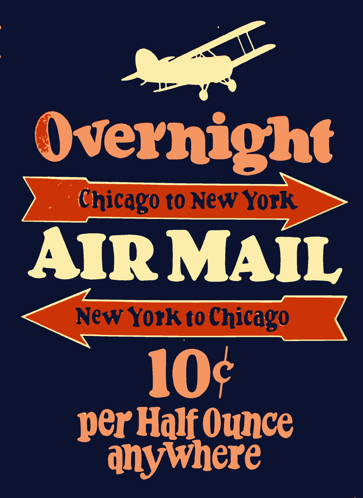 |

Paper aging makes unpixel see 17 colors, so it stops by default. With `--colors 4`, the closest colors merge until four remain. The background does not count, and the stains go with the merged tones.

**Check.** Merging can make two neighboring areas the same color, losing the boundary between them. If that happens, name the colors yourself as in case 4.

## 8. Fix lost detail or jagged edges

**Situation.** Thin lines are broken or fine detail is clogged, or else outlines are visibly wavy.

```sh
unpixel ornament/input.png --detail low -o ornament/low.svg
unpixel ornament/input.png -o ornament/medium.svg
unpixel ornament/input.png --detail high -o ornament/high.svg
```

From left to right: input, `low`, `medium` and `high`, enlarged 3×.

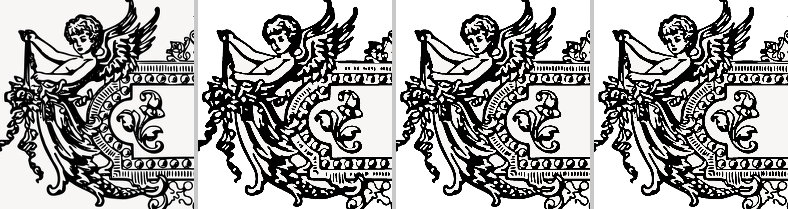

`low` gives calmer, bolder shapes and drops small marks: see the wing and the ribbon. `high` keeps more of the fine hatching and the face, and it also keeps more wobble. Here, the black layer of the whole ornament goes from 155 shapes in `low` to 293 in `medium` and 332 in `high`.

**Check.** Compare enlarged crops, as above. Metrics can miss broken lines, so look.

## 9. When unpixel is the wrong tool

**Situation.** A photo, a shaded painting, a soft airbrushed illustration.

```sh
unpixel shaded-painting/input.png -o shaded-painting/result.svg
# unpixel: error: image not suitable for flat-color tracing: 20 colors found; ...
# exit code 3
unpixel shaded-painting/input.png --colors 6 -o shaded-painting/forced.svg
```

| Input: refused by default | Forced with `--colors 6` |
|---|---|
|  |  |

unpixel stops instead of silently flattening the shading. Forcing a reduced palette works, and it can look good, but it is a stylized poster version and not a faithful copy: the soft skin shading is gone. If you need a faithful copy, keep the image as raster.

**Check.** Decide whether the poster look is what you want.

## 10. Check and recolor for the surface it goes on

**Situation.** A dark logo for a sticker on a dark laptop. The default preview uses a color chosen to show defects, so it can look fine even though the logo will barely show on the real surface.

```sh
unpixel family/input.png --also-transparent '#F8F6F5' --preview-background '#1C1C1E' -o family/on-dark.svg
unpixel family/input.png --also-transparent '#F8F6F5' --colors '#F2F2F2' --preview-background '#1C1C1E' -o family/light-on-dark.svg
```

| Input | On the real surface: barely visible | Recolored |
|---|---|---|
|  |  |  |

The first command shows the design on that surface. The second turns it light: with one value in `--colors`, every color becomes that value. With several colors, list one replacement per color, or edit each group's `fill` in the SVG. `--preview-background` never changes the SVG.

**Check.** The preview should read clearly on the real surface color. unpixel does not measure contrast.

## 11. Artwork with a watermark

**Situation.** Your own design, or one you have the rights to, still has a draft "SAMPLE" overlay, and you want to know what will happen to it.

unpixel has no watermark feature. The overlay is just more pixels, so the result depends on its strength. These inputs have an overlay added for this project, at three strengths:

```sh
unpixel watermark/faint.png -o watermark/faint.svg
unpixel watermark/medium.png -o watermark/medium.svg
unpixel watermark/strong.png -o watermark/strong.svg
```

| Overlay | Input | Output | What happened |
|---|---|---|---|
| Faint |  |  | Falls within the existing colors, so it vanishes. |
| Medium | 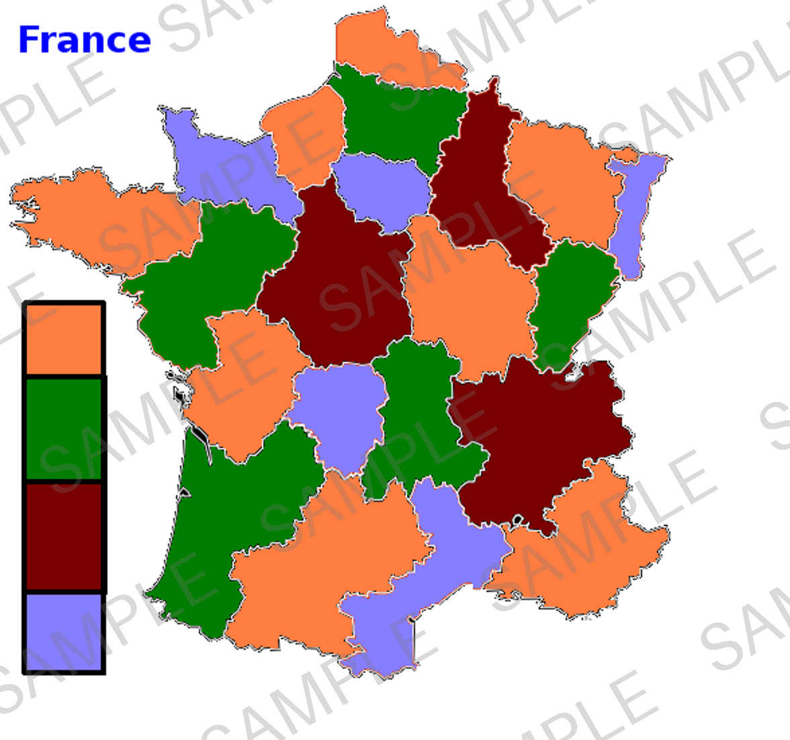 | 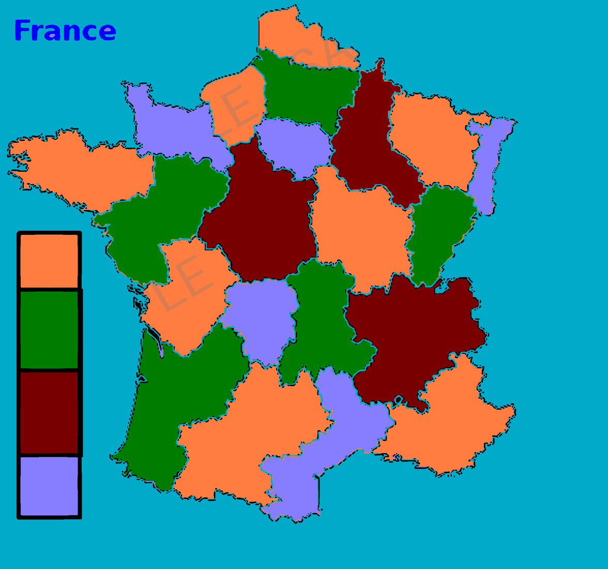 | Stays in fragments, and adds a false seventh color. |
| Strong | 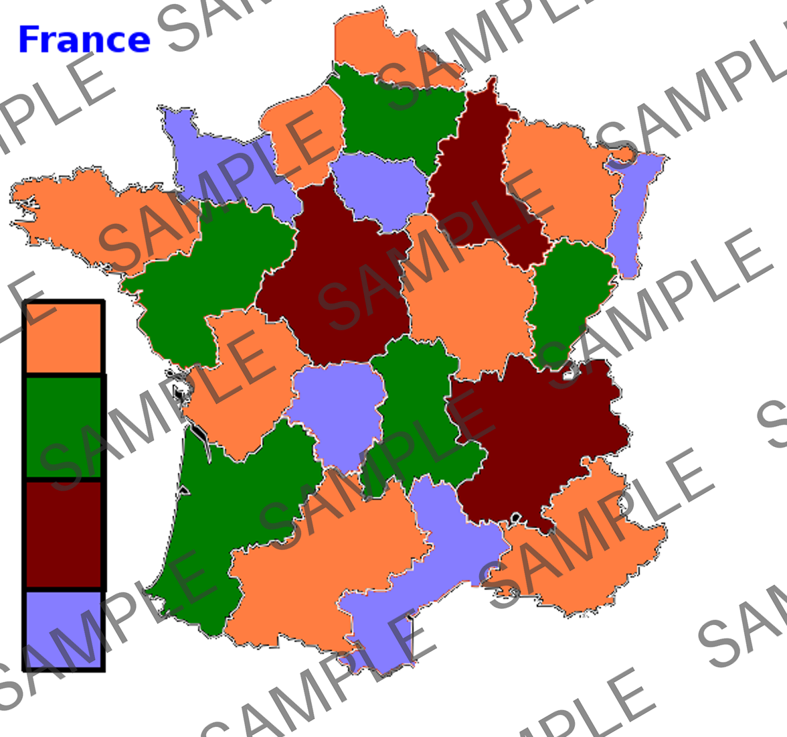 | 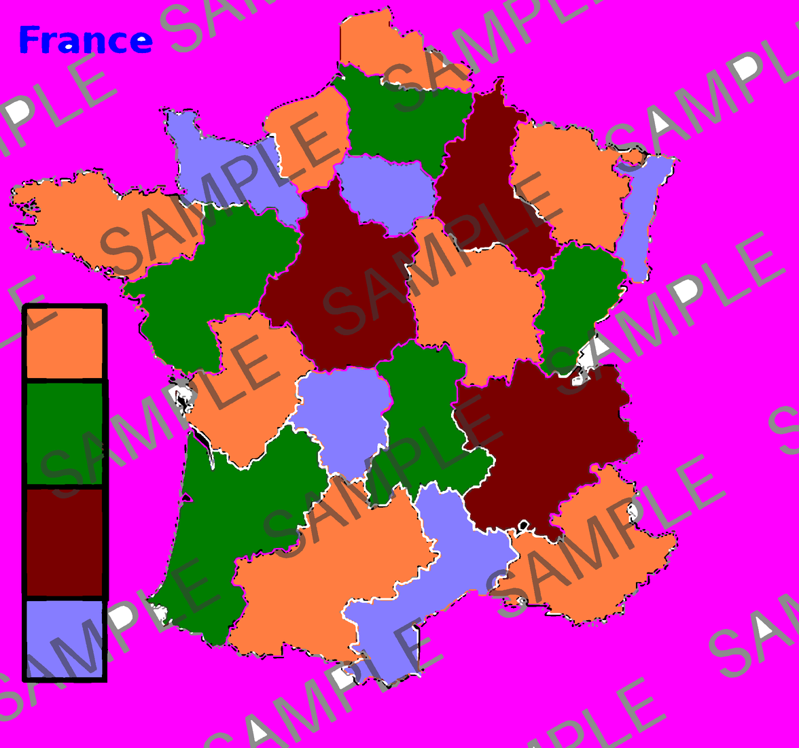 | Stays whole, traced as shapes, with twelve colors in total. |

Naming the real palette removes the false colors, though not the shape of the overlay where it is strong enough to cross into another color:

```sh
unpixel watermark/medium.png --colors '#FF7D41,#007D00,#790000,#867DFF,#000000,#0000FF' -o watermark/medium-palette.svg
```


unpixel gives no warning about any of this, because it cannot tell a watermark from artwork.

**Check.** Look at the preview. If you have the original without the overlay, use it, as that is always the better source.

**Rights.** Use this only on images you own or have permission to use. A watermark usually means the image needs a license, and losing the mark during tracing does not grant one. Removing one from someone else's work can be illegal in itself.

## For scripts and AI assistants

Add `--json` to any command, and read the exit code. The README has the [workflow to follow](../README.md#using-unpixel-from-an-ai-assistant).

```sh
for file in logos/*.png; do
  unpixel "$file" --json > "${file%.png}.result.json" || echo "failed: $file"
done
```

Review each preview. A batch that finishes cleanly is not the same as a batch that looks right.
