# Casos de uso

Cada caso indica la situación, el comando y qué comprobar, con la entrada y la salida reales. La instalación y la lista completa de opciones están en el [README](../README.md), en inglés. [English version](use-cases.en.md).

Las salidas se muestran sobre un color de prueba, que no forma parte del SVG. Los comandos se ejecutan desde la carpeta `examples/`, y [`build.sh`](../examples/build.sh) los regenera todos. Los créditos de las imágenes están en [`CREDITS.md`](../examples/CREDITS.md).

## Cómo elegir

| Tienes | Quieres | Ve a |
|---|---|---|
| Un diseño sobre fondo blanco o liso | Solo el diseño, para cualquier fondo | [1](#1-quitar-el-fondo-y-conservar-todo-lo-demás) |
| Letras negras o de un color, con blanco dentro | Solo la tinta | [2](#2-hacer-transparente-también-el-blanco-interior) |
| Un logo pequeño o una captura | Una versión que escale | [3](#3-rescatar-un-logo-pequeño-o-borroso) |
| Un diseño con colores corporativos exactos | Esos valores exactos en el archivo | [4](#4-usar-colores-corporativos-exactos) |
| Un cartel o diseño a sangre | Una copia vectorial, con su fondo | [5](#5-conservar-una-imagen-completa-sin-fondo-que-quitar) |
| Un archivo para plóter de corte o serigrafía | Colores que nunca se solapen | [6](#6-preparar-un-archivo-para-plóter-de-corte-o-serigrafía) |
| Demasiados tonos parecidos | Una paleta más simple | [7](#7-reducir-el-número-de-colores) |
| Un resultado roto o dentado | Uno mejor | [8](#8-corregir-detalle-perdido-o-bordes-dentados) |
| Una foto o una pintura | Saber qué esperar | [9](#9-cuándo-unpixel-no-es-la-herramienta-adecuada) |
| Un diseño para una superficie oscura o de color | Verlo ahí y recolorearlo | [10](#10-comprobar-y-recolorear-para-la-superficie-de-destino) |
| Tu propio diseño con una marca de agua de borrador | Saber qué le ocurrirá | [11](#11-diseños-con-marca-de-agua) |

Antes de enviar nada a imprenta o producción, abre la vista previa, y también el informe si el diseño tiene detalles finos.

## 1. Quitar el fondo y conservar todo lo demás

**Situación.** Un sello, billete o invitación con zonas pálidas, sobre una página blanca. Quieres el diseño sin la página. Quitar «todos los píxeles claros» destruiría el marco pálido y cualquier cosa clara que tenga dentro.

```sh
unpixel stamp/input.jpg -o stamp/result.svg
unpixel badge/input.png -o badge/result.svg
```

| Entrada | Salida |
|---|---|
| 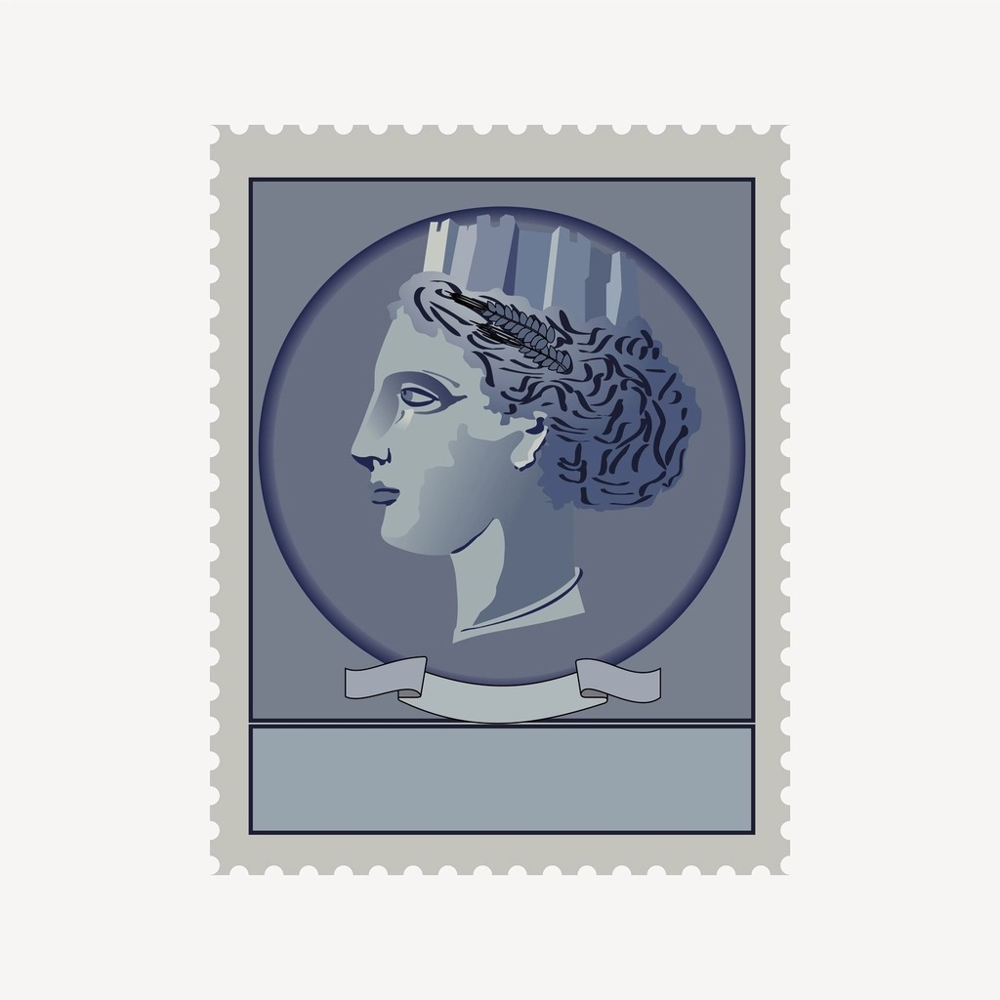 | 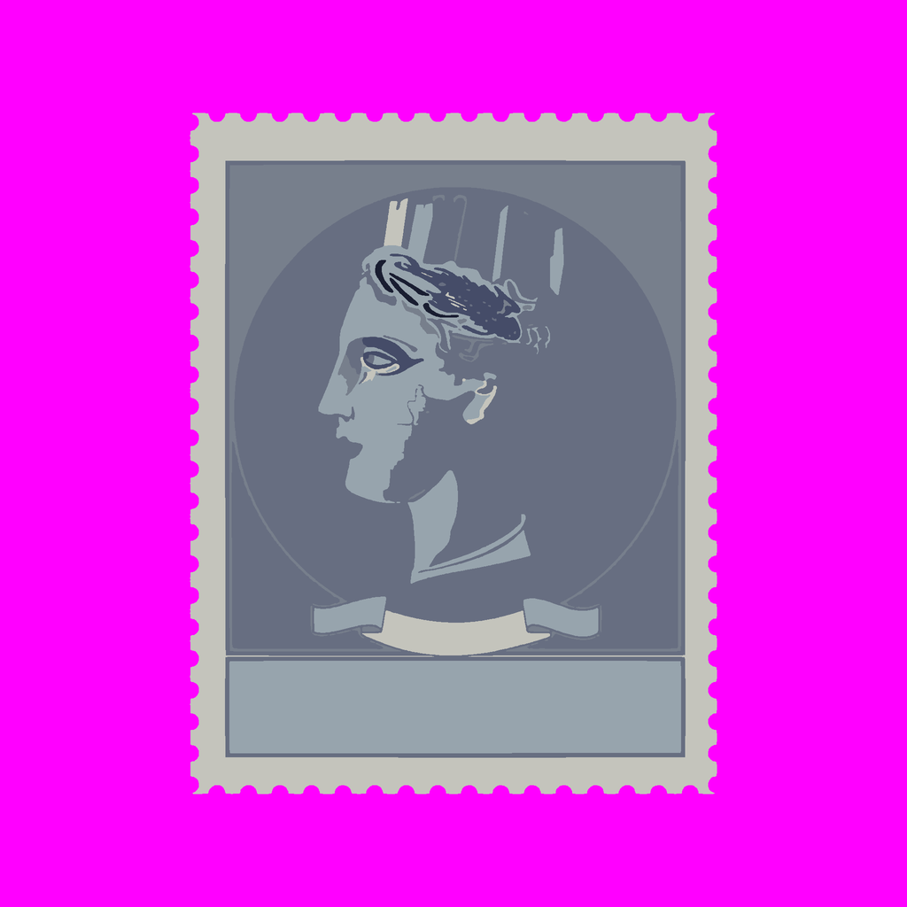 |
|  | 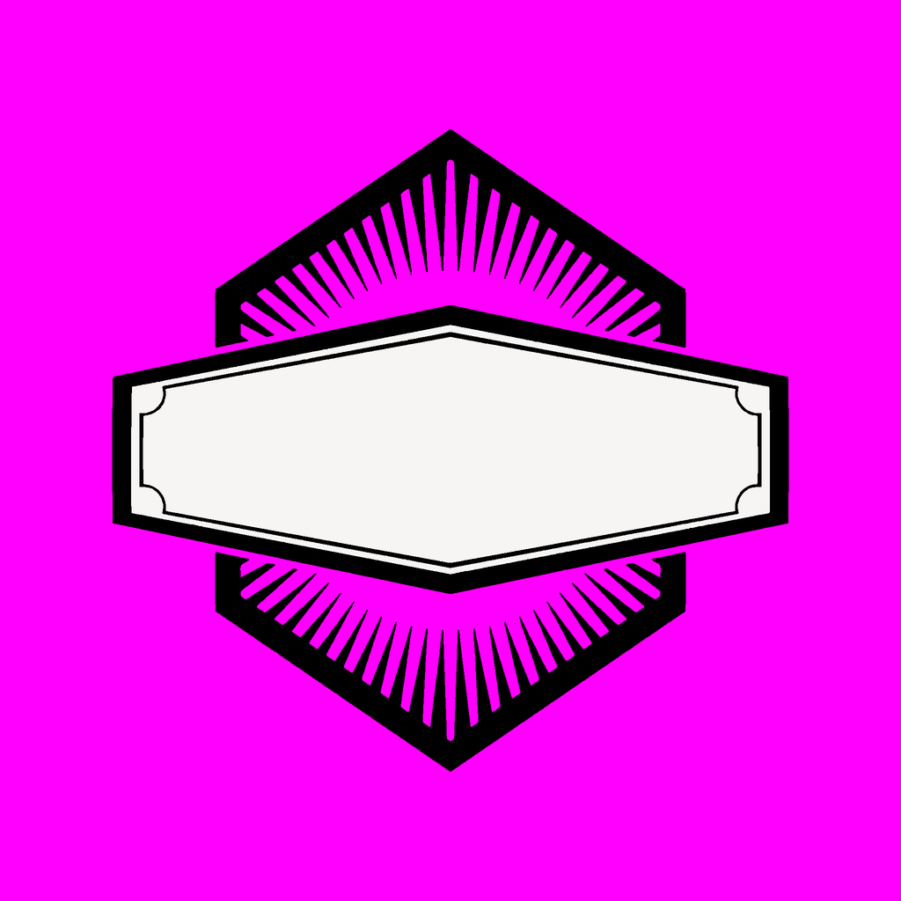 |

Solo se quita el color conectado con el borde de la imagen. El sello conserva su marco pálido y los seis colores detectados. En la insignia, el centro casi blanco sigue opaco porque lo encierra el contorno, aunque sea del mismo color que la página, mientras que los huecos entre los rayos llegan al exterior y desaparecen.

**Comprueba.** El exterior debe mostrar el color de prueba, y las zonas pálidas encerradas deben verse sólidas.

## 2. Hacer transparente también el blanco interior

**Situación.** Letras negras para una camiseta o una pegatina. El blanco de dentro de las letras también debe desaparecer; si no, se verán parches blancos sobre una camiseta de color.

```sh
unpixel family/input.png -o family/result.svg
```

unpixel mantiene opacas las zonas encerradas que parecen fondo y te dice qué hacer:

```
Warning: Interior areas colored #F8F6F5 look like the background but stayed opaque.
To make them transparent too, add --also-transparent '#F8F6F5'.
```

```sh
unpixel family/input.png --also-transparent '#F8F6F5' -o family/knockout.svg
```

| Entrada | Por defecto: el blanco encerrado se queda | Con `--also-transparent` |
|---|---|---|
|  |  |  |

Fíjate en «is» y «EVERYTHING»: en la última imagen, las letras son huecos.

**Comprueba.** Dentro de las letras, la vista previa debe mostrar el color de prueba. Las marcas finas que se confunden con el blanco desaparecen con él.

## 3. Rescatar un logo pequeño o borroso

**Situación.** Solo tienes un PNG pequeño de una web antigua, o una captura en JPEG.

```sh
unpixel clapperboard/input.png -o clapperboard/result.svg
```

| Entrada, 113 px de ancho, aquí ampliada | Salida |
|---|---|
|  |  |

Las imágenes pequeñas se amplían antes de trazarlas y los bordes se suavizan, así que el resultado escala bien. unpixel no puede inventar lo que el archivo no contiene: las formas grandes salen limpias, pero las etiquetas de pocos píxeles se convierten en manchas, y las franjas blancas de arriba llegan al exterior, así que quedan transparentes.

**Comprueba.** Compara los detalles ampliados del informe. Plantéate volver a escribir el texto pequeño sobre el resultado en un programa de diseño.

## 4. Usar colores corporativos exactos

**Situación.** Necesitas valores exactos en el archivo, como los de tu marca, en lugar de los medidos en la imagen.

```sh
unpixel france-map/input.png -o france-map/result.svg
unpixel france-map/input.png --colors '#F26A21,#0B7A3B,#7A0019,#7F77E8,#101010,#1747D1' -o france-map/brand.svg
```

| Entrada | Colores detectados | Tus colores |
|---|---|---|
| 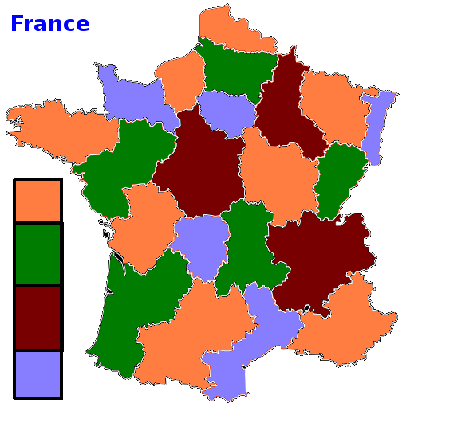 |  | 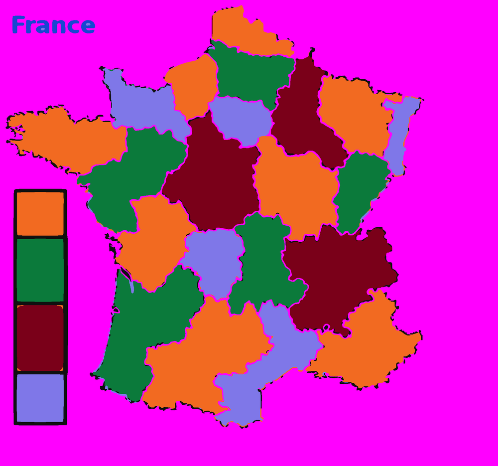 |

| Detectado | `#FF7D41` | `#007D00` | `#790000` | `#867DFF` | `#000000` | `#0000FF` |
|---|---|---|---|---|---|---|
| **Salida** | `#F26A21` | `#0B7A3B` | `#7A0019` | `#7F77E8` | `#101010` | `#1747D1` |

Cada color detectado se convierte en el más cercano de tu lista, y todas las capas usan exactamente esos valores. Aparecen avisos si un color detectado queda lejos de todos los tuyos, como aquí el azul, o si uno de los tuyos no coincide con nada, lo que suele indicar un valor mal escrito.

**Comprueba.** La lista `layers` de la salida debe mostrar solo tus colores.

## 5. Conservar una imagen completa, sin fondo que quitar

**Situación.** Un cartel que ocupa toda la imagen y se va a reimprimir en grande.

```sh
unpixel poster/input.jpg --background keep -o poster/result.svg
```

| Entrada | Salida: ocho tonos planos |
|---|---|
| 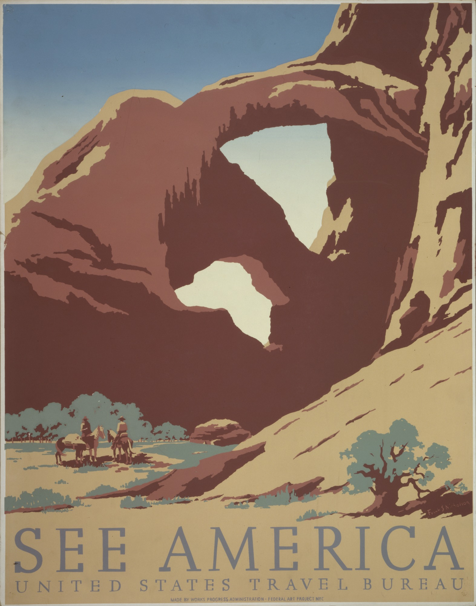 | 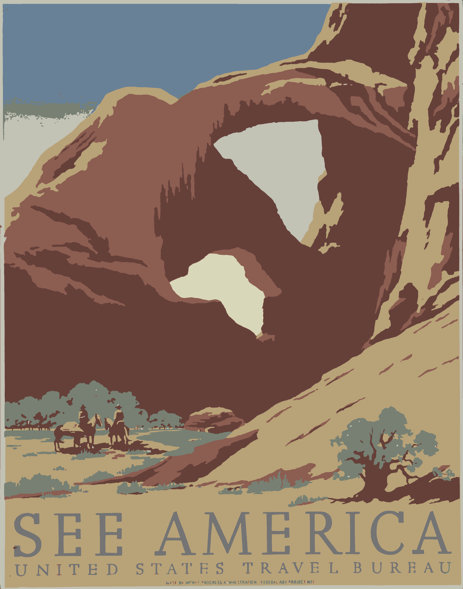 |

Sin la opción, unpixel detecta que el borde no es de un color uniforme, no quita nada y te avisa. Con `--background keep` indicas que eso es lo que quieres.

**Comprueba.** Los degradados reales se convierten en bandas. A la izquierda del cielo, la transición tiene un borde ruidoso, que de lejos no molesta pero puede necesitar un retoque.

## 6. Preparar un archivo para plóter de corte o serigrafía

**Situación.** Cada color se cortará en vinilo o se imprimirá con su propia pantalla, así que un color no debe continuar debajo de otro.

```sh
unpixel airmail/input.jpg --background keep --colors 4 --layers cutout -o airmail/cutout.svg
python plates.py airmail/cutout.svg airmail/plates.png
```

| Entrada | Los cuatro colores, cada uno por separado |
|---|---|
| 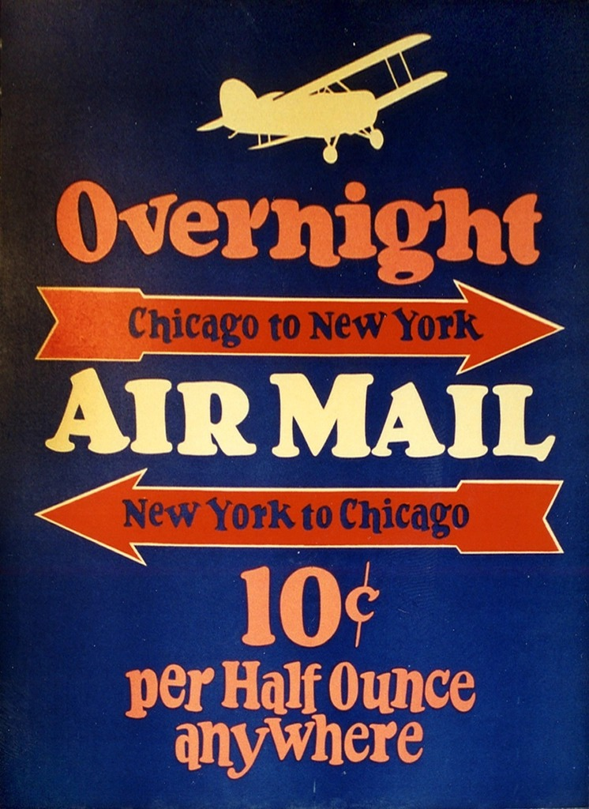 | 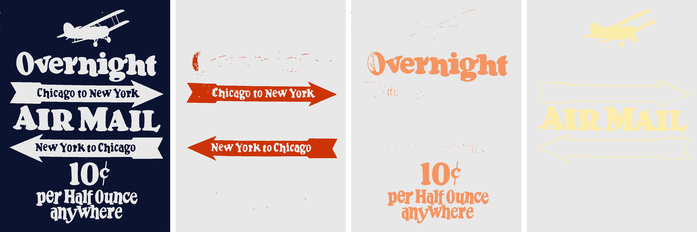 |

Cada color aparece solo donde es visible: en la plancha azul, todas las demás formas son huecos. Cada grupo `<g id="color-N">` del SVG se puede seleccionar y enviar por separado, y [`plates.py`](../examples/plates.py) los dibuja así.

**Comprueba.** Las capas recortadas dejan huecos diminutos donde se tocan los colores, porque cada forma se curva por separado. Aquí suman el 0,06 % de la imagen, y unpixel avisa de ello. Los impresos envejecidos también dejan motas: mira las pequeñas marcas de las planchas y el rojo de la «O», donde el papel está gastado. Límpialas a mano antes de producir, y añade el reventado que pida tu imprenta. Para imprimir o para pantalla, usa mejor el modo por defecto, `stacked`.

## 7. Reducir el número de colores

**Situación.** Un impreso envejecido tiene decenas de tonos casi idénticos, y pagas por cuatro tintas.

```sh
unpixel airmail/input.jpg --background keep -o airmail/result.svg
# unpixel: error: image not suitable for flat-color tracing: 17 colors found; ...
# código de salida 3
unpixel airmail/input.jpg --background keep --colors 4 -o airmail/four-colors.svg
```

| Entrada | Salida: cuatro colores |
|---|---|
|  | 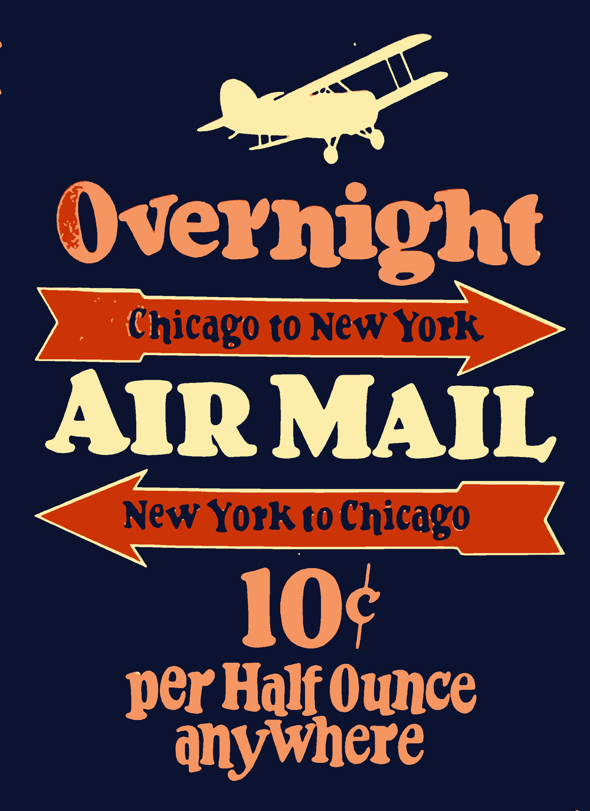 |

El envejecimiento del papel hace que unpixel vea 17 colores, así que por defecto se detiene. Con `--colors 4`, los colores más cercanos se fusionan hasta que quedan cuatro. El fondo no cuenta, y las manchas desaparecen con los tonos fusionados.

**Comprueba.** Al fusionar, dos zonas vecinas pueden quedar del mismo color y perderse el límite entre ellas. Si ocurre, indica tú los colores como en el caso 4.

## 8. Corregir detalle perdido o bordes dentados

**Situación.** Las líneas finas salen rotas o el detalle fino empastado, o bien los contornos se ven ondulados.

```sh
unpixel ornament/input.png --detail low -o ornament/low.svg
unpixel ornament/input.png -o ornament/medium.svg
unpixel ornament/input.png --detail high -o ornament/high.svg
```

De izquierda a derecha: entrada, `low`, `medium` y `high`, ampliados ×3.

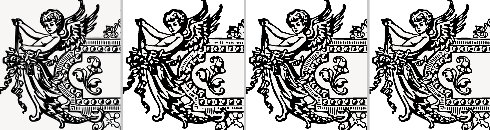

`low` da formas más tranquilas y gruesas y elimina marcas pequeñas: mira el ala y la cinta. `high` conserva más del rayado fino y de la cara, y también más ondulación. Aquí, la capa negra del ornamento completo pasa de 155 formas en `low` a 293 en `medium` y 332 en `high`.

**Comprueba.** Compara recortes ampliados, como este. Las métricas pueden pasar por alto líneas rotas, así que míralo.

## 9. Cuándo unpixel no es la herramienta adecuada

**Situación.** Una foto, una pintura con sombreado, una ilustración suave con aerógrafo.

```sh
unpixel shaded-painting/input.png -o shaded-painting/result.svg
# unpixel: error: image not suitable for flat-color tracing: 20 colors found; ...
# código de salida 3
unpixel shaded-painting/input.png --colors 6 -o shaded-painting/forced.svg
```

| Entrada: rechazada por defecto | Forzada con `--colors 6` |
|---|---|
|  |  |

unpixel se detiene en lugar de aplanar el sombreado sin avisar. Forzar una paleta reducida funciona y puede quedar bien, pero es una versión estilizada de cartel, no una copia fiel: el sombreado suave de la piel desaparece. Si necesitas una copia fiel, conserva la imagen en formato de mapa de bits.

**Comprueba.** Decide si ese aspecto de cartel es lo que quieres.

## 10. Comprobar y recolorear para la superficie de destino

**Situación.** Un logo oscuro para una pegatina en un portátil oscuro. La vista previa por defecto usa un color elegido para mostrar defectos, así que puede verse bien aunque el logo apenas se note en la superficie real.

```sh
unpixel family/input.png --also-transparent '#F8F6F5' --preview-background '#1C1C1E' -o family/on-dark.svg
unpixel family/input.png --also-transparent '#F8F6F5' --colors '#F2F2F2' --preview-background '#1C1C1E' -o family/light-on-dark.svg
```

| Entrada | Sobre la superficie real: apenas se ve | Recoloreado |
|---|---|---|
|  |  |  |

El primer comando muestra el diseño sobre esa superficie. El segundo lo aclara: con un solo valor en `--colors`, todos los colores pasan a ser ese valor. Con varios colores, indica un sustituto por color o edita el `fill` de cada grupo en el SVG. `--preview-background` nunca cambia el SVG.

**Comprueba.** La vista previa debe leerse con claridad sobre el color real de la superficie. unpixel no mide el contraste.

## 11. Diseños con marca de agua

**Situación.** Tu propio diseño, o uno sobre el que tienes derechos, aún lleva una marca «SAMPLE» de borrador, y quieres saber qué le ocurrirá.

unpixel no tiene ninguna función para marcas de agua. La marca son simplemente más píxeles, así que el resultado depende de su intensidad. Estas entradas llevan una marca añadida para este proyecto, en tres intensidades:

```sh
unpixel watermark/faint.png -o watermark/faint.svg
unpixel watermark/medium.png -o watermark/medium.svg
unpixel watermark/strong.png -o watermark/strong.svg
```

| Marca | Entrada | Salida | Qué ocurrió |
|---|---|---|---|
| Suave |  |  | Queda dentro de los colores existentes, así que desaparece. |
| Media | 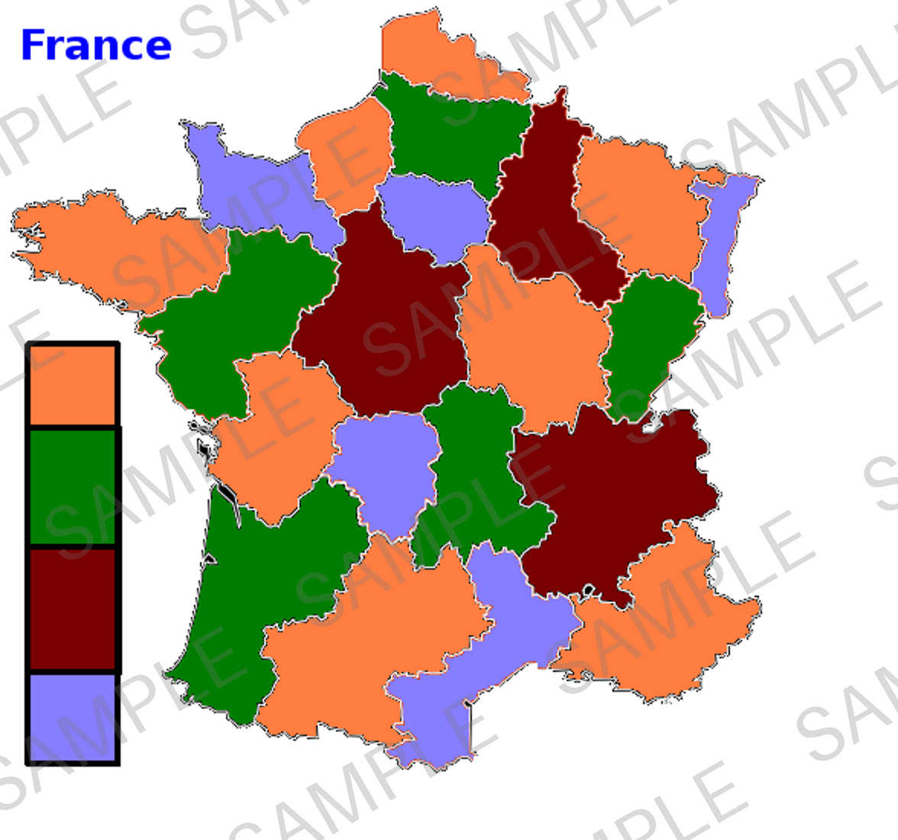 | 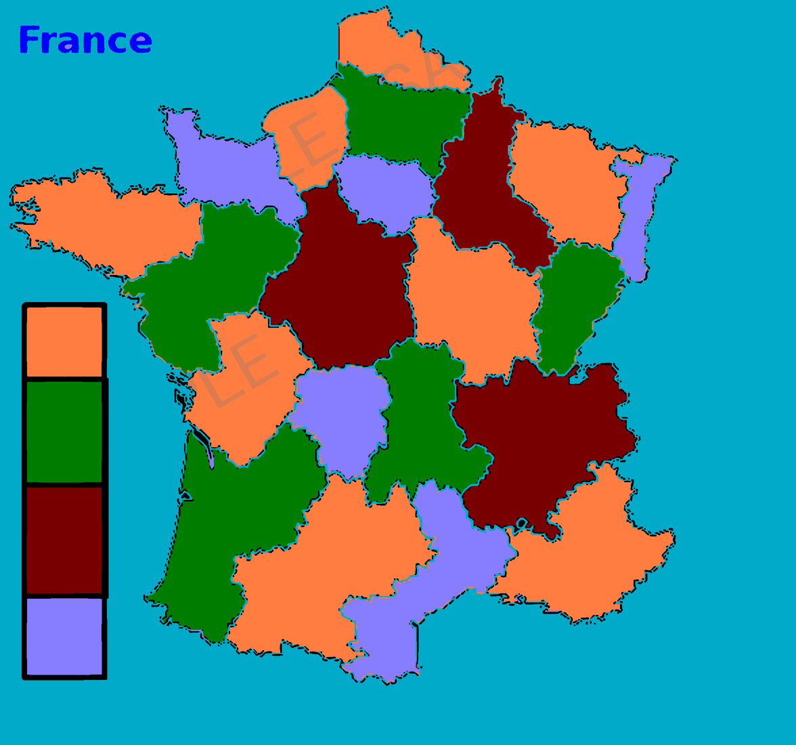 | Se queda a trozos y añade un séptimo color falso. |
| Fuerte | 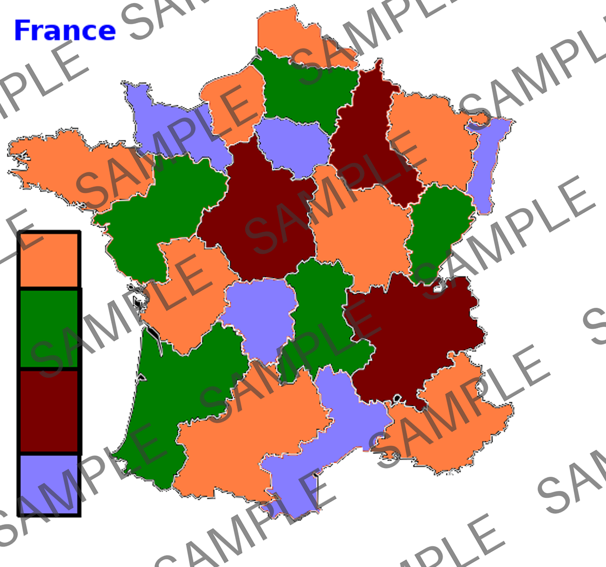 | 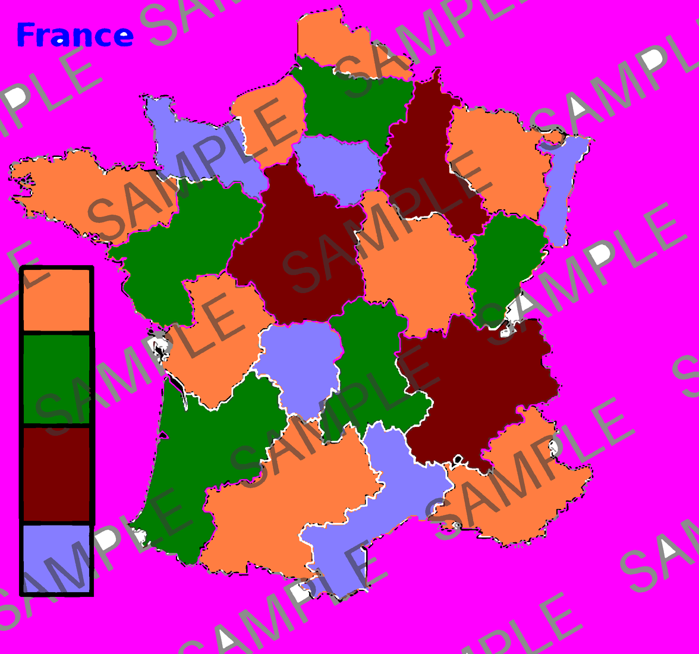 | Se queda entera, trazada como formas, con doce colores en total. |

Indicar la paleta real elimina los colores falsos, aunque no la forma de la marca allí donde es tan fuerte que pasa a otro color:

```sh
unpixel watermark/medium.png --colors '#FF7D41,#007D00,#790000,#867DFF,#000000,#0000FF' -o watermark/medium-palette.svg
```


unpixel no avisa de nada de esto, porque no puede distinguir una marca de agua del dibujo.

**Comprueba.** Mira la vista previa. Si tienes el original sin la marca, úsalo: siempre es mejor punto de partida.

**Derechos.** Úsalo solo con imágenes propias o que tengas permiso para usar. Una marca de agua suele indicar que la imagen necesita licencia, y perder la marca al trazarla no te la concede. Quitarla de una obra ajena puede ser ilegal por sí mismo.

## Para scripts y asistentes de IA

Añade `--json` a cualquier comando y lee el código de salida. El README incluye el [procedimiento a seguir](../README.md#using-unpixel-from-an-ai-assistant).

```sh
for archivo in logos/*.png; do
  unpixel "$archivo" --json > "${archivo%.png}.result.json" || echo "falló: $archivo"
done
```

Revisa cada vista previa. Que un lote termine sin errores no significa que el resultado sea bueno.
