# Ejemplos y casos de uso

Cada ejemplo muestra la entrada real, la salida real y el comando exacto. La instalación y la lista completa de opciones están en el [README principal](../README.md), en inglés. [English version](README.md).

Casi todas las imágenes son variantes de la mascota de unpixel, y la mayoría viene de la [batería de imágenes](../battery/README.md) con la que se juzgan los cambios en la salida. Los comandos se ejecutan desde esta carpeta, y [`build.sh`](build.sh) lo regenera todo con un solo comando. Los créditos de las imágenes están en [`CREDITS.md`](CREDITS.md).

Las salidas se muestran sobre un color de prueba, que no forma parte del SVG. `build.sh` añade `--preview-background '#C9D2FF'` a todos los comandos, lo que cambia la vista previa y nada más, así que los comandos de abajo lo omiten salvo cuando la superficie es lo importante. Sin él, estas vistas previas salen sobre magenta.

## Por defecto: sin ninguna opción

Casi todo el arte de colores planos solo necesita el nombre del archivo.

```sh
unpixel ../battery/leaves.png -o leaves/result.svg
unpixel ../battery/watchmaker.png -o watchmaker/result.svg
unpixel ../battery/float.png -o float/result.svg
```

| Entrada | Salida | Detectado |
|---|---|---|
| 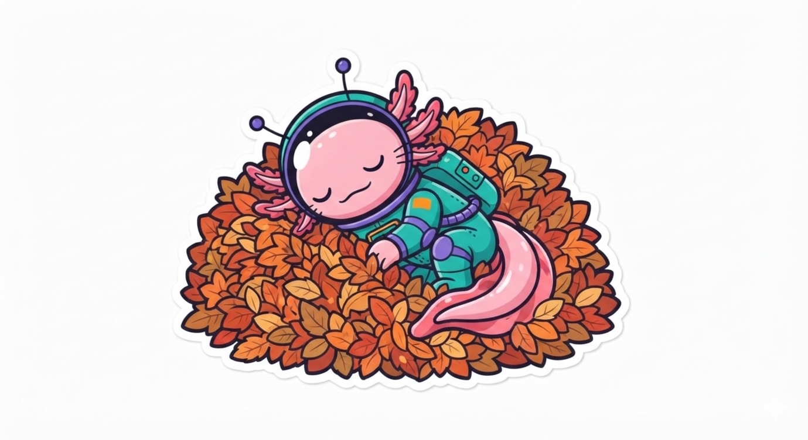 |  | Diecisiete colores, con cientos de hojas pequeñas en tonos parecidos. Los brillos pálidos de la piel salen grises. |
| 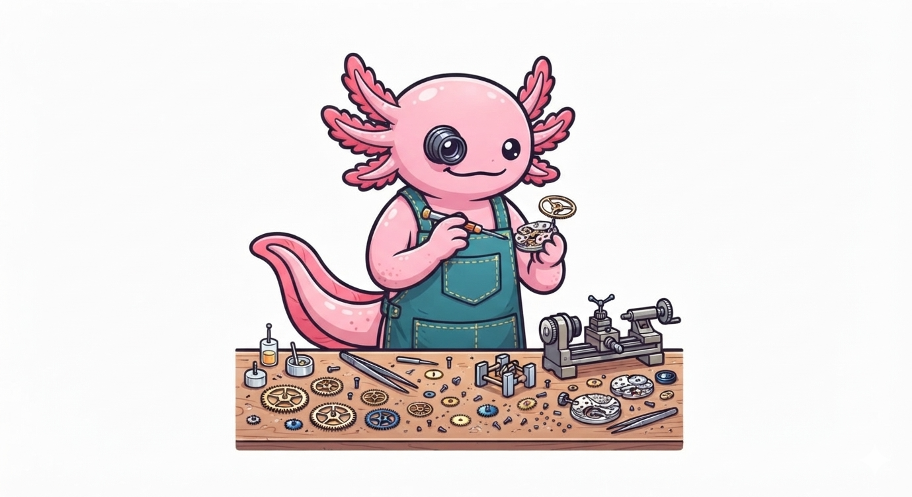 | 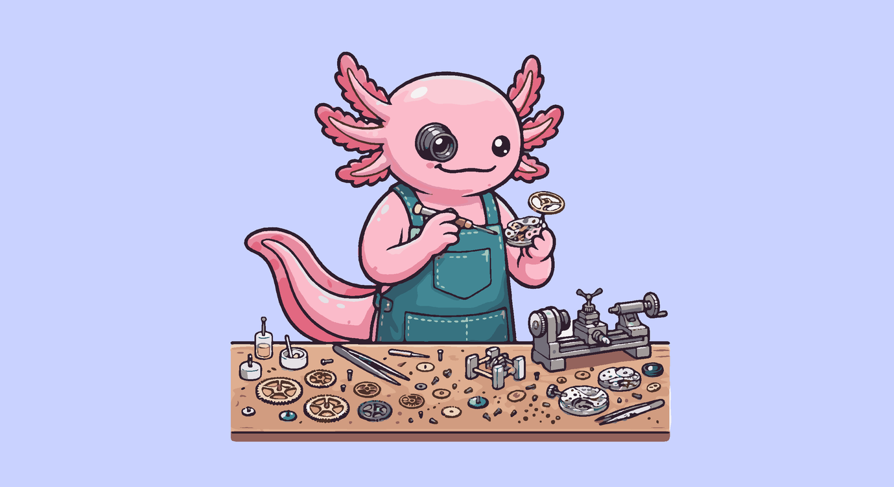 | Diecinueve colores, hasta los tornillos del banco. |
| 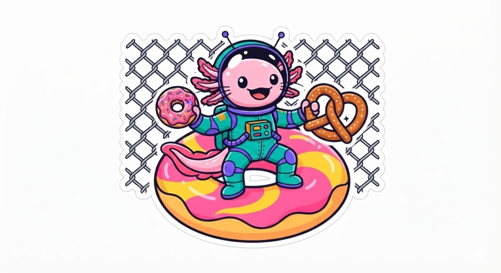 | 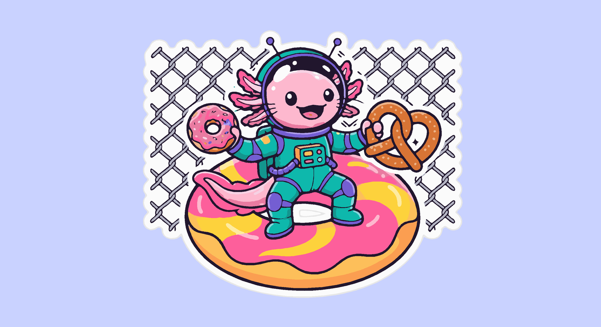 | Diecinueve colores. El blanco de dentro de la valla se queda. Para quitarlo, mira el [caso 2](#2-hacer-transparente-también-el-blanco-interior). |

## Cómo elegir

| Tienes | Quieres | Ve a |
|---|---|---|
| Un diseño sobre fondo blanco o liso | Solo el diseño, para cualquier fondo | [1](#1-quitar-el-fondo-y-conservar-todo-lo-demás) |
| Un diseño con blanco dentro, como una valla o unas letras | Que ese interior sea transparente | [2](#2-hacer-transparente-también-el-blanco-interior) |
| Un logo pequeño o una captura | Una versión que escale | [3](#3-rescatar-un-logo-pequeño-o-borroso) |
| Un diseño con colores corporativos exactos | Esos valores exactos en el archivo | [4](#4-usar-colores-corporativos-exactos) |
| Un cartel o diseño a sangre | Una copia vectorial, con su fondo | [5](#5-conservar-una-imagen-completa-sin-fondo-que-quitar) |
| Un archivo para plóter de corte o serigrafía | Colores que nunca se solapen | [6](#6-preparar-un-archivo-para-plóter-de-corte-o-serigrafía) |
| Demasiados tonos parecidos | Una paleta más simple | [7](#7-reducir-el-número-de-colores) |
| Un resultado roto o dentado | Uno mejor | [8](#8-corregir-detalle-perdido-o-bordes-dentados) |
| Una pintura, una foto o un escaneo con ruido | Saber qué esperar | [9](#9-fotos-pinturas-y-ruido) |
| Un diseño para una superficie oscura o de color | Verlo ahí y recolorearlo | [10](#10-comprobar-y-recolorear-para-la-superficie-de-destino) |
| Tu propio diseño con una marca de agua de borrador | Saber qué le ocurrirá | [11](#11-diseños-con-marca-de-agua) |
| Cualquier diseño | Solo sus líneas, para colorear o cortar | [12](#12-quedarte-solo-con-las-líneas) |
| Pixel art | Que sus bloques sigan cuadrados | [13](#13-pixel-art) |

Antes de enviar nada a imprenta o producción, abre la vista previa, y también el informe si el diseño tiene detalles finos.

## 1. Quitar el fondo y conservar todo lo demás

**Situación.** Un personaje sobre una página blanca, vestido de blanco. Quieres el personaje sin la página. Quitar «todos los píxeles claros» se llevaría también la chaqueta y el gorro.

```sh
unpixel ../battery/chef.png -o chef/result.svg
```

| Entrada | Salida |
|---|---|
|  | 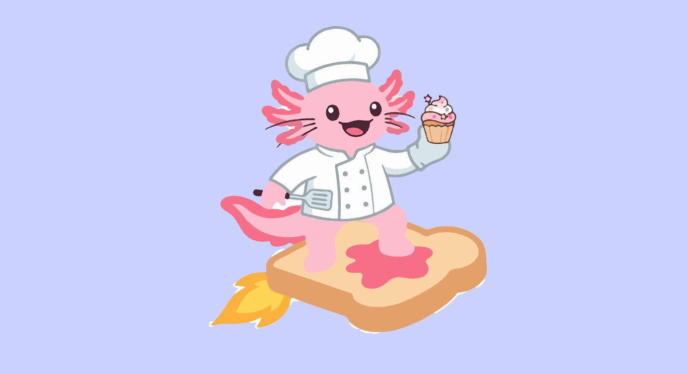 |

Solo se quita el color conectado con el borde de la imagen. La chaqueta y el gorro son tan blancos como la página, pero los encierra un suave contorno gris, así que se quedan.

**Comprueba.** El exterior debe mostrar el color de prueba, y las zonas pálidas encerradas deben verse sólidas. Mira también los bordes: aquí quedan finas esquirlas blancas en el borde inferior de la tostada y entre las llamas. Sobre una superficie oscura se notan, así que quítalas a mano si va a ir ahí.

**Los límites de esta regla.** El contorno tiene que ser lo bastante fuerte para frenar el fondo. Las dos pegatinas de la batería muestran los dos lados: el borde de `float.png` se queda, como en la tabla de arriba, mientras que el de `leaves.png` tiene un aro más tenue y se va con la página. Suele ser lo que quieres, pero ninguna opción lo cambia.

Un resplandor suave no tiene borde, así que unpixel tiene que dibujárselo:

```sh
unpixel ../battery/diver.png -o diver/result.svg
```

| Entrada | Salida: el resplandor se convierte en anillos planos |
|---|---|
| 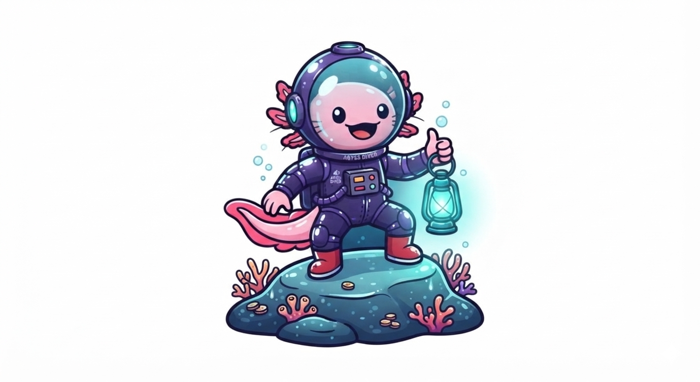 | 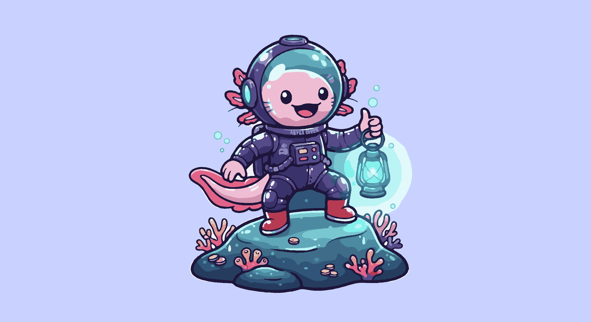 |

El resplandor del farol se funde con la página, y sale como unos cuantos anillos pálidos que acaban en un borde duro. En una imagen así, quita el resplandor a mano o parte de una versión sin él.

## 2. Hacer transparente también el blanco interior

**Situación.** Un diseño de pegatina para una camiseta de color. El blanco encerrado por el dibujo también debe desaparecer, o el diseño mostrará manchas blancas: aquí, los huecos de una valla de alambre.

```sh
unpixel ../battery/float.png -o float/result.svg
```

unpixel mantiene opacas las zonas encerradas que parecen fondo, y te dice qué hacer:

```
Warning: Interior areas colored #FBFBFB look like the background but stayed opaque. To make them transparent too, add --also-transparent '#FBFBFB'.
  Run: unpixel ../battery/float.png -o float/result.svg --force --also-transparent '#FBFBFB'
Warning: Interior areas colored #E7E7E7 look like the background but stayed opaque. To make them transparent too, add --also-transparent '#E7E7E7'.
  Run: unpixel ../battery/float.png -o float/result.svg --force --also-transparent '#E7E7E7'
```

```sh
unpixel ../battery/float.png --also-transparent '#FBFBFB' -o float/knockout.svg
```

| Por defecto: el blanco encerrado se queda | Con `--also-transparent` |
|---|---|
|  | 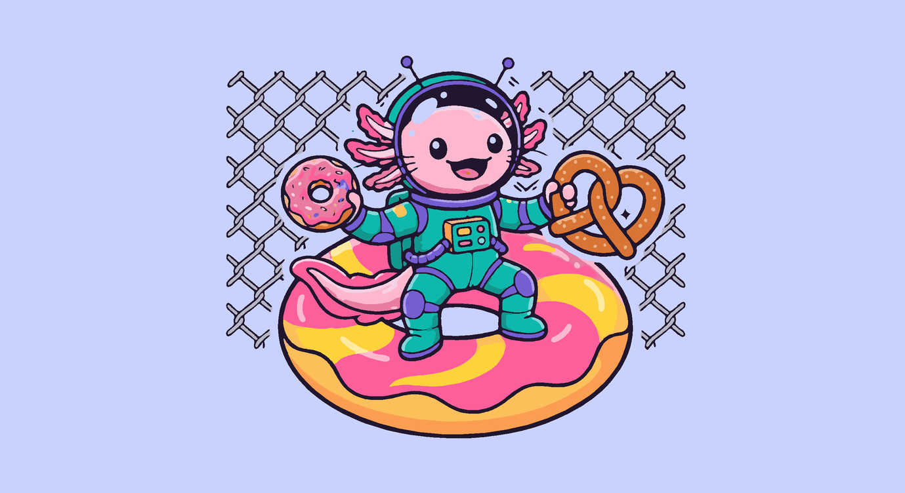 |

La valla ya está abierta, el donut tiene un agujero de verdad y el hueco entre las piernas queda libre. También se va el borde de la pegatina, y con él su aro gris, `#E7E7E7`, que está lo bastante cerca del color que has nombrado. Por eso aquí ha bastado con una sola opción.

**Comprueba.** La opción va por color y no por lugar, así que se va todo el blanco. Los brillos de los ojos y del casco también se vuelven transparentes: abre la vista previa y mira la cara. Si tienen que seguir blancos, quédate con el resultado por defecto, o píntalos de nuevo en un programa de diseño. Solo se van los colores cercanos al que nombras: el alambre gris y cualquier marca gris fina sobre el blanco se quedan, como colores propios.

## 3. Rescatar un logo pequeño o borroso

**Situación.** Lo único que tienes es un JPEG pequeño de una web antigua. Estos dos son el cocinero guardado en pequeño a propósito, con [`derive.py`](derive.py), porque la batería solo tiene imágenes grandes.

```sh
unpixel small/chef-480.jpg -o small/chef-480.svg
unpixel small/chef-220.jpg -o small/chef-220.svg
```

| Entrada, ampliada aquí | Salida |
|---|---|
|  | 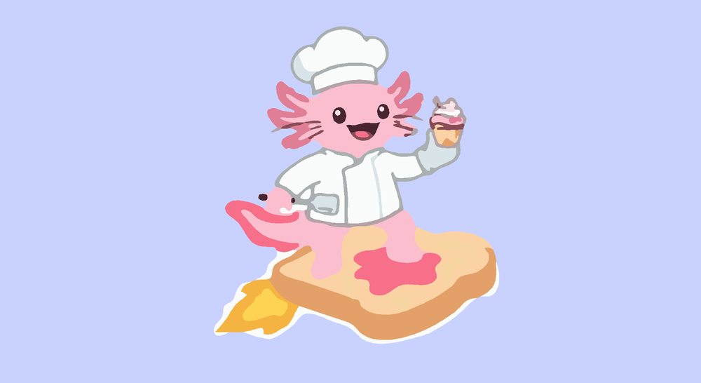 |
|  | 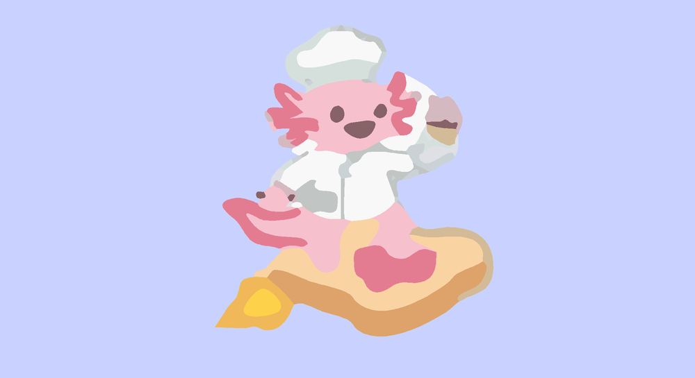 |

Las imágenes pequeñas se amplían antes de trazarlas y los bordes se suavizan, para que el resultado escale limpiamente. unpixel no puede inventar lo que el archivo no contiene. A 480 px las formas salen limpias, aunque se pierden los botones y la espátula, y el halo pálido del JPEG se queda alrededor de la tostada. A 220 px obtienes un boceto de la idea: es fiel al archivo, y no sustituye al logo.

**Comprueba.** Compara los detalles ampliados del informe, y busca un aro blanco alrededor del dibujo. Plantéate redibujar o reescribir las partes pequeñas sobre el resultado en un programa de diseño. Una fuente más grande siempre gana.

## 4. Usar colores corporativos exactos

**Situación.** Necesitas valores exactos en el archivo, como los de tu marca, y no los medidos en la imagen.

```sh
unpixel axolotl/input.png --colors '#FFB800,#FFC2D6,#00B8D4,#0090A8,#FF2E7E,#6A3DF0,#14102A,#FFFFFF,#FF8A00' -o axolotl/brand.svg
```

| Entrada | Tus colores |
|---|---|
|  | 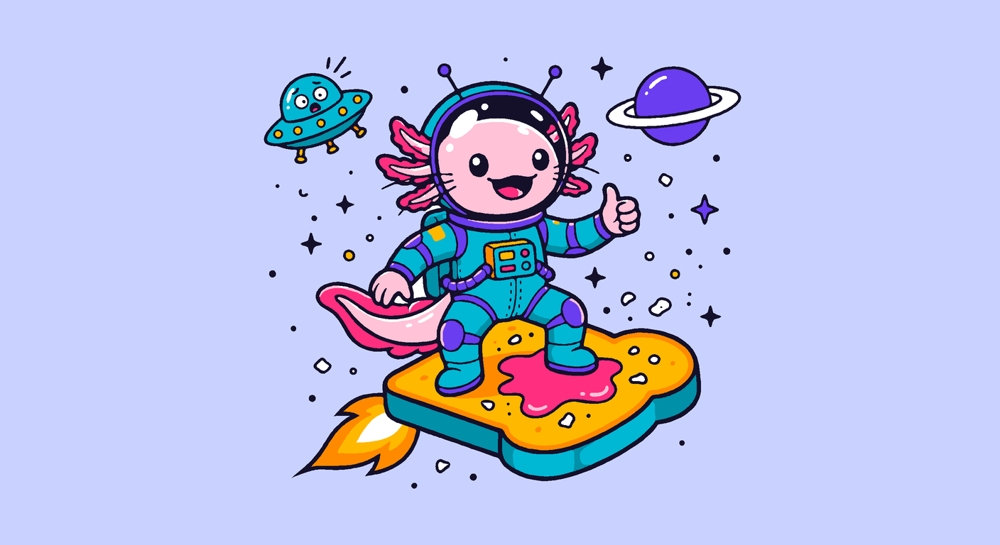 |

Cada color detectado se convierte en el más cercano de tu lista, y todas las capas usan exactamente esos valores: aquí, el traje verde azulado pasa a cian. Más cercano significa más cercano, así que el sustituto tiene que quedar cerca del color que sustituye. En un primer intento con un azul cielo, el verde azulado estaba más cerca del blanco, y el traje salió blanco.

Los avisos te dicen cuándo un color detectado queda lejos de todos los tuyos, y en qué se ha convertido, o cuándo uno de los tuyos no coincide con nada, lo que suele indicar un valor mal escrito. Aquí aparecen cinco, por tonos pequeños como los brillos.

**Comprueba.** La lista `layers` de la salida debe mostrar solo tus colores. Lee los avisos, y mira en qué se ha convertido cada color lejano.

## 5. Conservar una imagen completa sin fondo que quitar

**Situación.** Una ilustración que ocupa toda la imagen, para reimprimirla en grande.

```sh
unpixel ../battery/principito.jpeg --background keep -o principito/result.svg
```

| Entrada | Salida: diecinueve tonos planos |
|---|---|
| 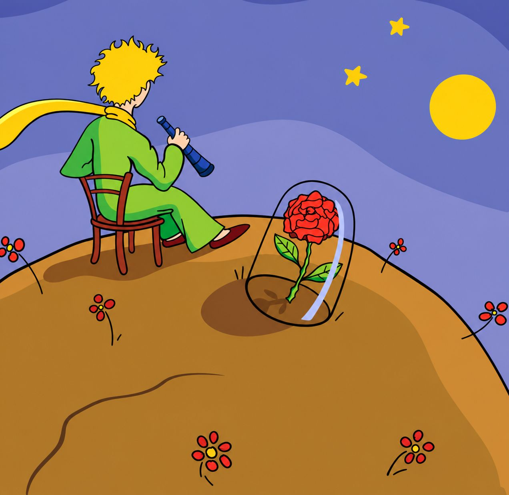 | 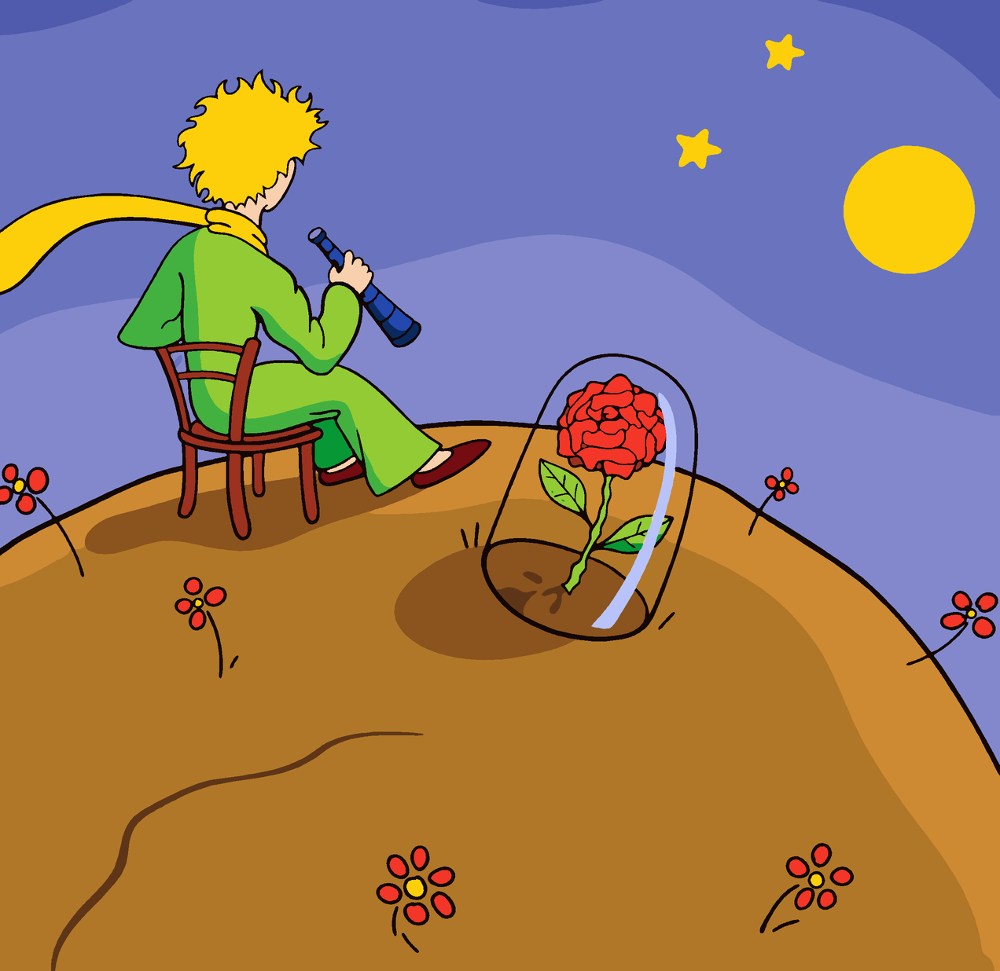 |

Sin la opción, unpixel detecta que el borde no es de un color uniforme, no quita nada y te avisa. Usa `--background keep` para decir que eso es lo que quieres.

El aviso también ofrece el otro camino: nombra un color, y se va allí donde toca el borde, junto con los tonos de alrededor.

```sh
unpixel ../battery/principito.jpeg --background '#6A73BE' -o principito/no-sky.svg
```

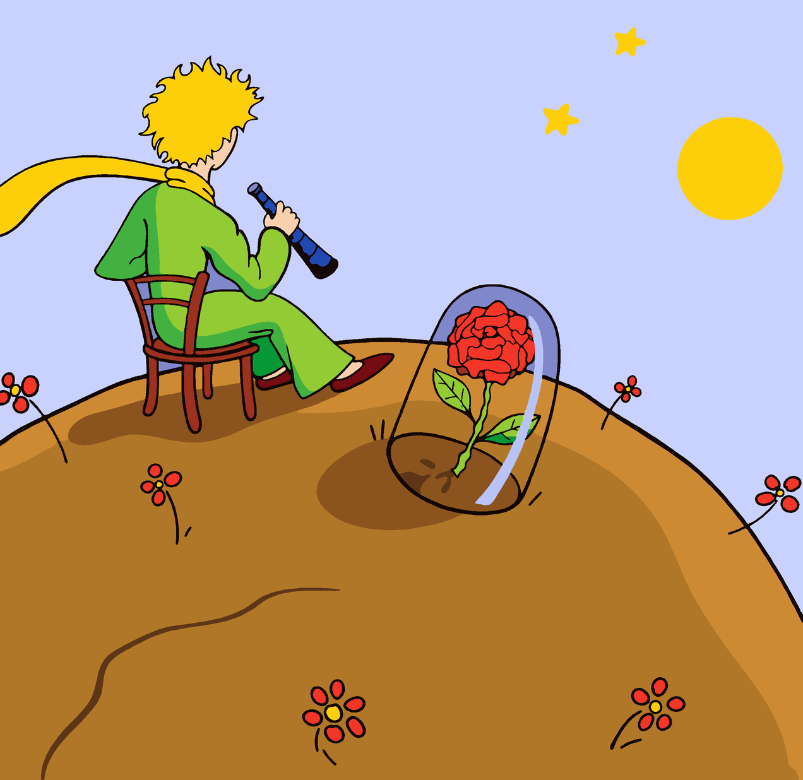

Las dos franjas de cielo desaparecen, y el trozo que se ve a través del cristal se queda, porque el cristal lo encierra.

**Comprueba.** Las sombras suaves del suelo se convierten en formas planas, lo que a esta imagen le sienta bien. A un fondo aerografiado no le va tan bien: mira el [caso 9](#9-fotos-pinturas-y-ruido).

## 6. Preparar un archivo para plóter de corte o serigrafía

**Situación.** Cada color se cortará en vinilo o se imprimirá con su propia pantalla, así que un color no debe continuar por debajo de otro.

```sh
unpixel axolotl/input.png --colors 6 --layers cutout -o axolotl/cutout.svg
python plates.py axolotl/cutout.svg axolotl/plates.png
```

| Entrada | Los seis colores, cada uno por separado |
|---|---|
|  | 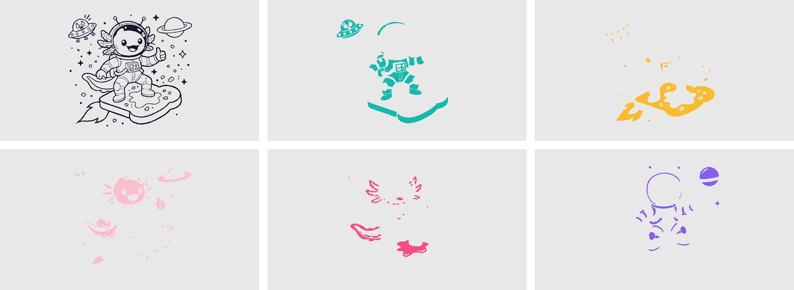 |

Cada color aparece solo donde se ve: en la plancha verde azulada, las líneas y el panel son agujeros. Cada grupo `<g id="color-N">` del SVG se puede seleccionar y enviar por separado, y [`plates.py`](plates.py) los dibuja así. Con seis colores, el blanco de los ojos y del casco se funde con el rosa pálido, así que nombra los colores si el blanco tiene que tener su propia plancha.

**Comprueba.** Las capas cutout se tocan borde con borde, así que puede verse una junta tenue en un renderizador que suavice cada forma, y unpixel avisa de ello. Esta mascota tiene demasiado detalle para vinilo a cualquier tamaño pequeño: las migas, las estrellas y los bigotes son más finos de lo que se puede pelar, así que quítalos antes o simplifica el diseño. Añade el reventado que pida tu imprenta. Para impresión o pantalla, mejor el valor por defecto, `stacked`.

## 7. Reducir el número de colores

**Situación.** Una imagen tiene muchos tonos casi idénticos, y pagas por cada tinta, o quieres un aspecto más sereno.

```sh
unpixel ../battery/leaves.png --colors 10 -o leaves/ten-colors.svg
unpixel ../battery/leaves.png --colors 6 -o leaves/six-colors.svg
```

| Entrada | `--colors 10` | `--colors 6` |
|---|---|---|
|  | 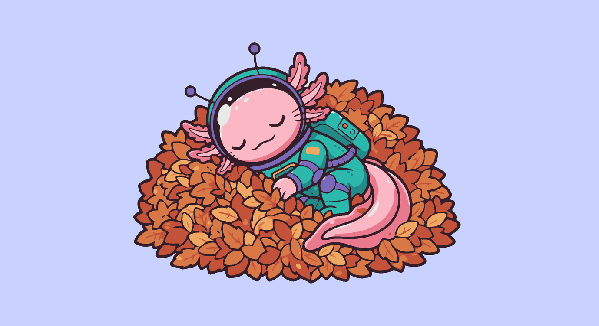 |  |

Un número fusiona los colores más cercanos hasta que quedan esos. Es rápido, pero sigue la distancia entre colores y no el significado. Diez da un resultado limpio. Seis es demasiado para esta imagen: las hojas se quedan en dos colores, y aparecen líneas rosas sueltas alrededor del montón, donde estaba el aro tenue de la pegatina. Con diez colores ese aro se descarta, y vuelve cuando tiene que tomar un color más fuerte.

Para tener control, nombra los colores, como en el [caso 4](#4-usar-colores-corporativos-exactos).

**Comprueba.** Al fusionar, dos zonas vecinas pueden quedar del mismo color y perder su frontera. Mira también fuera del dibujo, por si quedan restos que han cambiado de color.

### Una ilustración con sombreado suave

**Situación.** Una ilustración parece plana, pero sus brillos y bordes suaves suman más tonos de los que quieres. Es habitual en imágenes generadas. Aquí está la mascota de unpixel, que por defecto da dieciséis colores, y el buzo, que da veinte.

```sh
unpixel axolotl/input.png --colors 8 -o axolotl/result.svg
unpixel ../battery/diver.png --colors 8 -o diver/eight-colors.svg
```

| Entrada | `--colors 8` |
|---|---|
|  |  |
|  | 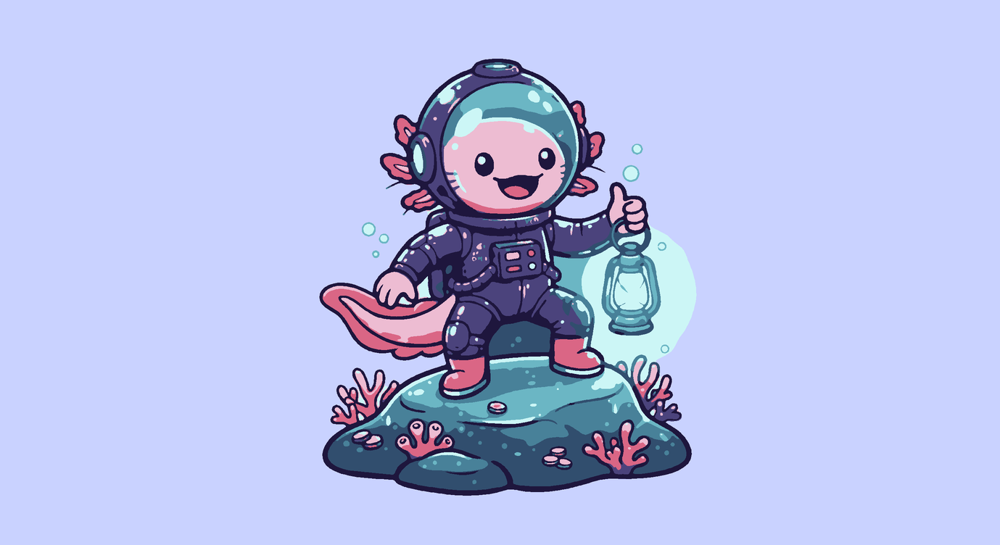 |

Un número funciona bien con la mascota, porque sus tonos están claramente agrupados. Los bigotes finos, las estrellas y las migas se quedan, mientras que el sombreado del pan y de la llama se funde en color plano. El resultado avisa de que las zonas blancas dentro del dibujo siguen opacas, lo que es correcto para los ojos y los brillos, así que aquí se quedan.

El buzo pierde más, porque sus colores no están agrupados. Las botas rojas pasan a rosa, los botones del panel del pecho se apagan, y desaparece el centro brillante del farol.

El logo del [README principal](../README.md) es este mismo `axolotl/result.svg`, con su `viewBox` recortado al dibujo y nada más.

## 8. Corregir detalle perdido o bordes dentados

**Situación.** Las líneas finas salen rotas o el detalle fino se empasta, o bien los contornos se ven ondulados.

```sh
unpixel ../battery/watchmaker.png --detail low -o watchmaker/low.svg
unpixel ../battery/watchmaker.png -o watchmaker/result.svg
unpixel ../battery/watchmaker.png --detail high -o watchmaker/high.svg
```

De izquierda a derecha: entrada, `low`, `medium` y `high`, en el banco del relojero, ampliados 3×.

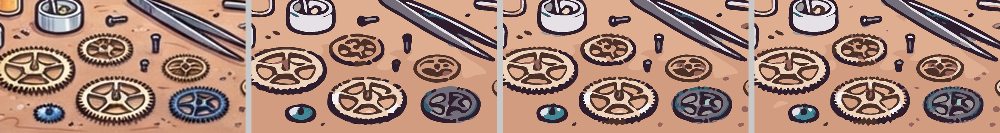

`low` da formas más tranquilas y elimina marcas pequeñas: mira los dientes de los engranajes. `high` conserva más, y también más ondulación. El SVG crece de 664 KB a 731 KB y 886 KB. Aquí ningún nivel recupera las partes más finas: los radios y dientes de los engranajes más pequeños son manchas en los tres, porque miden pocos píxeles de origen.

**Comprueba.** Compara recortes ampliados, como arriba. Las métricas pueden pasar por alto líneas rotas, así que mira.

## 9. Fotos, pinturas y ruido

**Situación.** Una pintura aerografiada, una foto, un escaneo con mucho grano. unpixel nunca rechaza una imagen, así que la pregunta es si te gusta lo que obtienes.

```sh
unpixel ../battery/sunset.png --background keep -o sunset/result.svg
unpixel ../battery/sunset.png --background keep --colors 6 -o sunset/six-colors.svg
```

| Entrada | Por defecto: dieciséis colores planos | `--colors 6` |
|---|---|---|
| 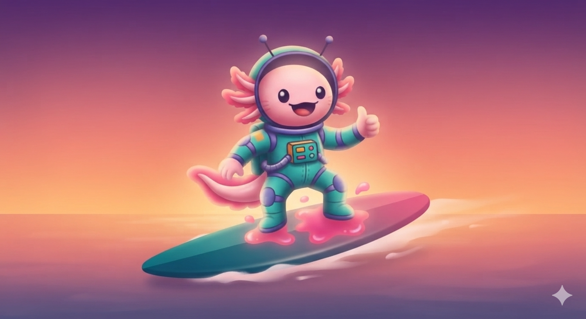 | 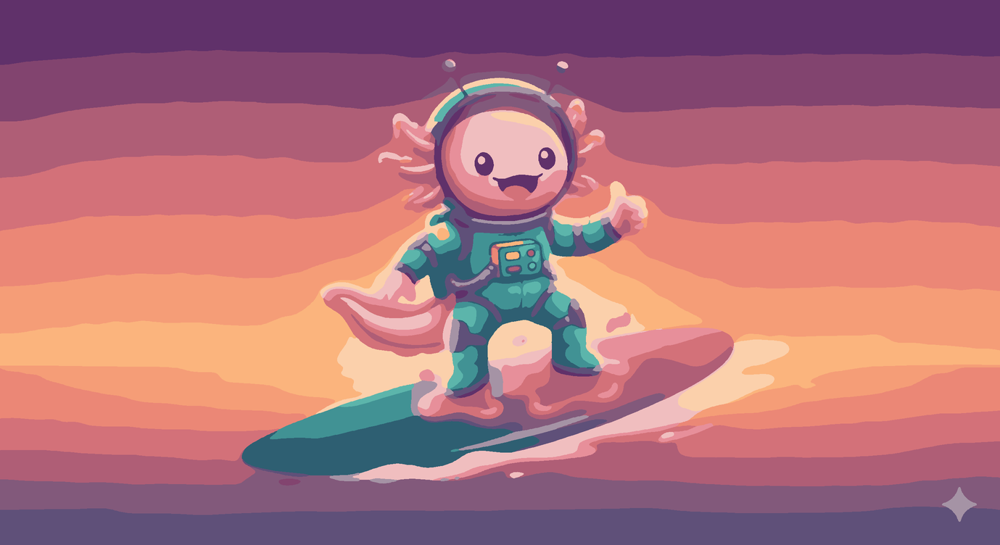 | 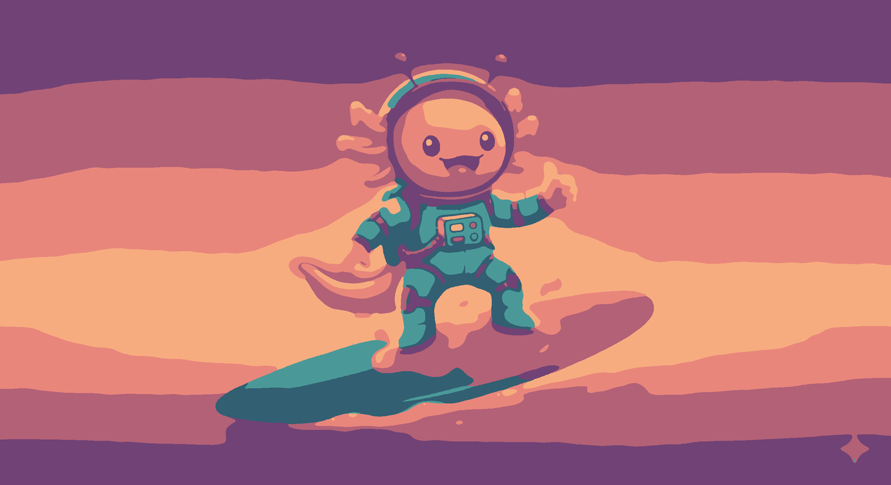 |

Los degradados se convierten en franjas con bordes ondulados, y ningún aviso lo dice. El personaje es quien más sufre: las antenas casi desaparecen y el contorno se funde con el fondo, porque esta imagen no tiene bordes duros que seguir. La versión de seis colores queda bien como cartel estilizado, pero no es una copia: la cara toma el color del cielo. Si necesitas una copia fiel, deja la imagen en ráster.

Una imagen demasiado cargada para trazarla, como una con ruido, se suaviza primero, con un aviso. Este es el cocinero, con ruido fuerte añadido por [`derive.py`](derive.py):

```sh
unpixel grain/input.png -o grain/result.svg
```

```
Warning: This image is very busy, like a photo or noise, so it was smoothed first to keep the result usable.
```

| Entrada | Salida |
|---|---|
| 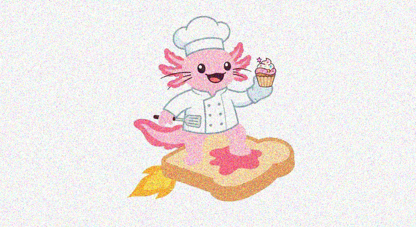 | 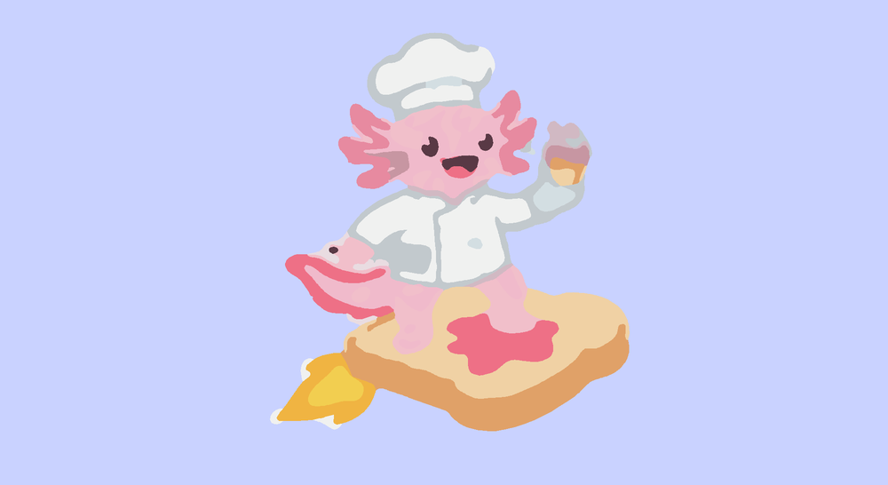 |

El grano desaparece y todo lo pequeño también: bigotes, botones, los contornos de la magdalena. Es una imagen utilizable, y borrosa. Con un ruido aún más fuerte tampoco se quita el fondo, porque el borde deja de ser de un color uniforme.

**Comprueba.** Decide si el aspecto de cartel es lo que quieres. Mira los avisos, y lo que se ha llevado el suavizado.

## 10. Comprobar y recolorear para la superficie de destino

**Situación.** Un diseño oscuro para una pegatina en un portátil oscuro. El color de prueba de una vista previa puede hacer que parezca correcto, aunque en la superficie real apenas se vea.

```sh
unpixel ../battery/diver.png --preview-background '#1C1C1E' -o diver/on-dark.svg
unpixel ../battery/diver.png --outline lines --outline-color '#F2F2F2' --preview-background '#1C1C1E' -o diver/light-lines.svg
```

| Entrada | En la superficie real: el traje se hunde en ella | Recoloreado en líneas claras |
|---|---|---|
|  | 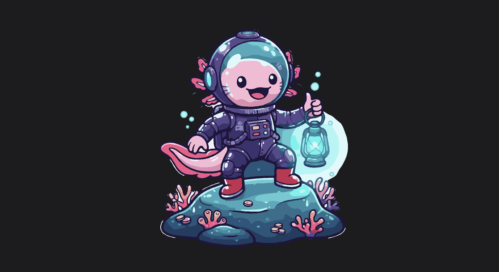 | 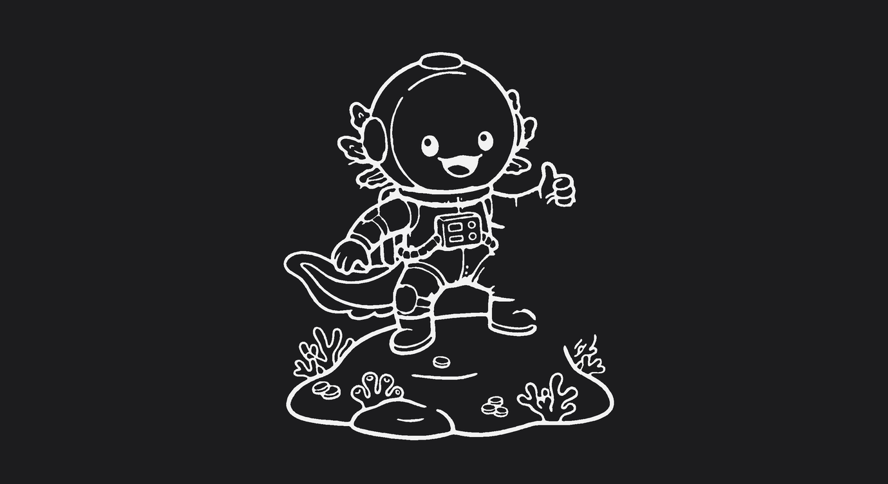 |

El primer comando muestra el diseño sobre esa superficie. El segundo se queda solo con sus líneas, en un color claro. Son las formas del color más oscuro, así que lo que era oscuro sale claro, como se ve en los ojos. `--preview-background` nunca cambia el SVG.

Para recolorear sin pasar a líneas, indica un sustituto por color en `--colors`, o edita el `fill` de cada grupo en el SVG, y el `stroke` de cualquier trazado `class="trap"` que contenga. Con un solo valor en `--colors`, todos los colores pasan a ese valor, lo que va bien con letras de una tinta y convierte un diseño como este en una silueta.

También ocurre al revés. Un diseño pálido desaparece en una superficie clara y se lee en una oscura:

```sh
unpixel ../battery/ghost.png -o ghost/result.svg
unpixel ../battery/ghost.png --preview-background '#1C1C1E' -o ghost/on-dark.svg
```

| Entrada, sobre blanco | En una superficie clara | En una superficie oscura |
|---|---|---|
| 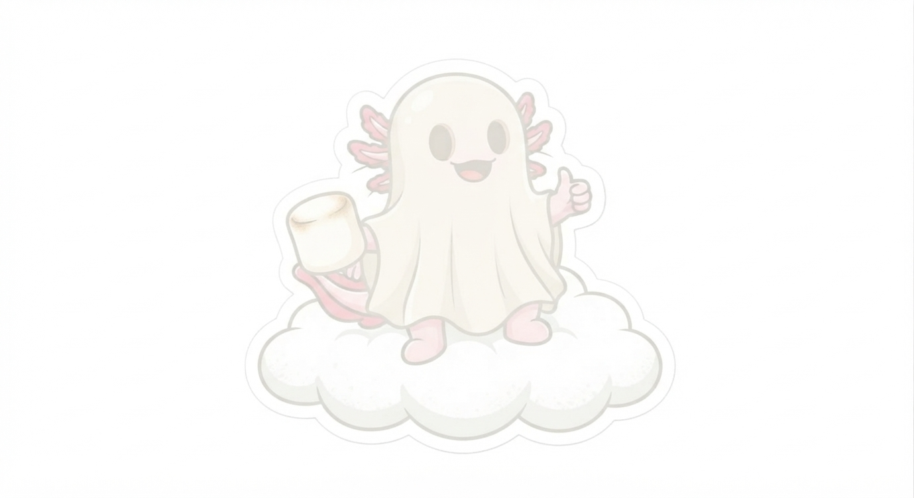 | 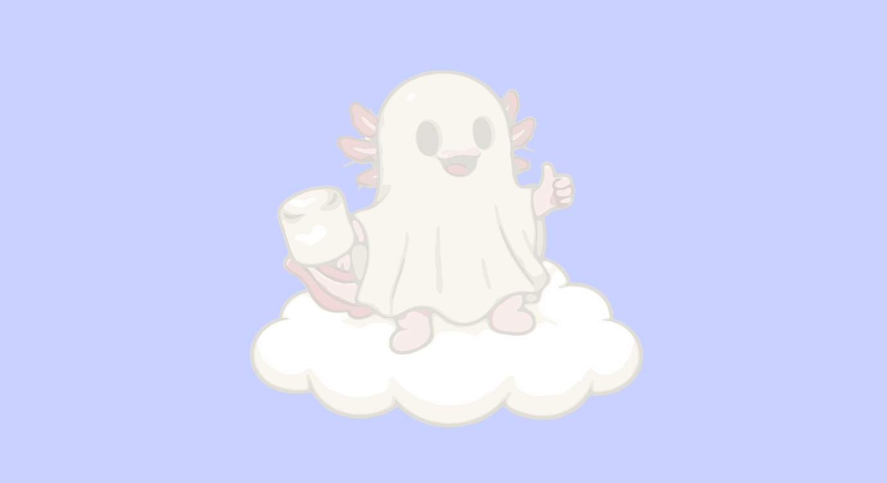 | 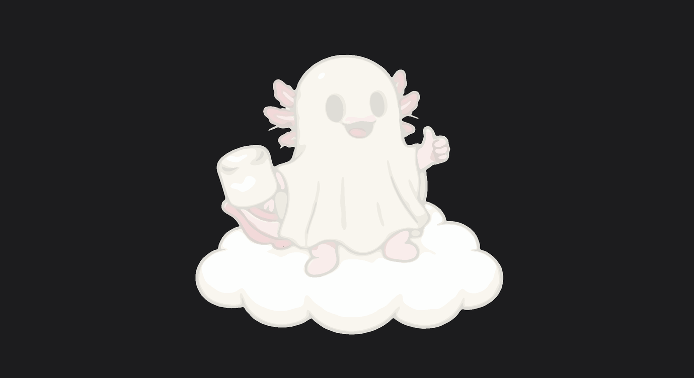 |

Sus ocho colores pálidos sobreviven, aunque el aro tenue de la pegatina se va con la página.

**Comprueba.** La vista previa debe leerse bien sobre el color real de la superficie. unpixel no mide el contraste.

## 11. Diseños con marca de agua

**Situación.** Un diseño propio, o del que tienes los derechos, aún lleva una marca «SAMPLE» de borrador, y quieres saber qué le ocurrirá.

unpixel no tiene ninguna función de marca de agua. La marca son más píxeles sin más, así que el resultado depende de su intensidad. Estas entradas son el cocinero, con una marca añadida por [`derive.py`](derive.py) en tres intensidades:

```sh
unpixel watermark/faint.png -o watermark/faint.svg
unpixel watermark/medium.png -o watermark/medium.svg
unpixel watermark/strong.png -o watermark/strong.svg
```

| Marca | Entrada | Salida | Qué ha pasado |
|---|---|---|---|
| Tenue |  |  | Cae dentro de los colores existentes, así que desaparece. |
| Media |  |  | Se queda a trozos, como letras pálidas a las que les faltan partes. |
| Fuerte |  |  | Se queda entera, trazada como formas. |

Nombrar la paleta real quita el color de más, pero no la forma de la marca donde es lo bastante fuerte para pasar a otro color:

```sh
unpixel watermark/medium.png --colors '#FAD3A4,#E3A169,#FDD453,#FBBECD,#F67087,#FBB13D,#FDFDFD,#D7E4EA,#9AA7AD,#4A2636' -o watermark/medium-palette.svg
```


Aquí también hay una real: el destello que Gemini dejó en la esquina de `sunset.png` se traza como cualquier otra forma, en el [caso 9](#9-fotos-pinturas-y-ruido). unpixel no avisa de nada de esto, porque no distingue una marca de agua de un dibujo.

**Comprueba.** Mira la vista previa. Si tienes el original sin la marca, úsalo, porque siempre es la mejor fuente.

**Derechos.** Usa esto solo con imágenes tuyas o para las que tengas permiso. Una marca de agua suele significar que la imagen necesita una licencia, y perder la marca al trazar no la concede. Quitarla de la obra de otra persona puede ser ilegal en sí mismo.

## 12. Quedarte solo con las líneas

**Situación.** Quieres una página para colorear, una plantilla o un trazado para un plóter, sin rellenos.

```sh
unpixel axolotl/input.png --colors 8 --outline lines -o axolotl/lines.svg
unpixel axolotl/input.png --colors 8 --outline edges -o axolotl/edges.svg
```

| Entrada | `--outline lines` | `--outline edges` |
|---|---|---|
|  |  |  |

- **`lines`** se queda solo con las formas del color más oscuro. Va bien con un dibujo que ya tiene contorno, como este. En uno sin contorno, el color más oscuro es un relleno, y unpixel te avisa.
- **`edges`** dibuja una línea allí donde se tocan dos colores, así que funciona con dibujos sin contorno oscuro. Un contorno existente tiene dos lados, así que sale como línea doble, como aquí.

El cocinero solo tiene contornos grises suaves, así que `edges` es el que conviene. Ajusta el grosor con `--outline-width`, en píxeles de origen, y el color con `--outline-color`:

```sh
unpixel ../battery/chef.png --colors 8 --outline edges -o chef/edges.svg
unpixel ../battery/chef.png --colors 8 --outline edges --outline-width 4 --outline-color '#7A3CFF' -o chef/thick-edges.svg
```

| Entrada | Por defecto: grosor 2, negro | Grosor 4, en color |
|---|---|---|
|  | 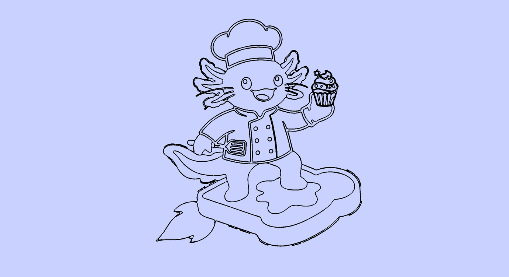 | 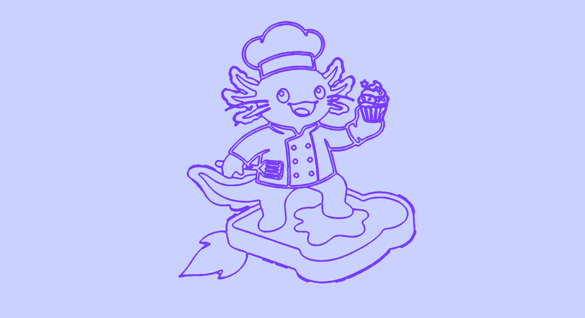 |

Los dos modos escriben una sola capa, en negro salvo que elijas un color. En el cocinero, los contornos grises siguen saliendo dobles, y la tostada lleva una segunda línea algo temblorosa, porque su sombreado tiene un borde suave.

**Comprueba.** Las líneas finas en una vista previa pequeña pueden ocultar cortes. Abre el informe si las líneas deben ser continuas, como para un plóter. `lines` depende de que la fuente tenga un único color oscuro para sus líneas: en `leaves.png`, las líneas entre las hojas son de otro color, así que solo pasa el contorno exterior.

## 13. Pixel art

**Situación.** Un sprite o icono en una cuadrícula de bloques cuadrados, ampliado con bordes duros. Suavizarlo derretiría los bloques.

```sh
unpixel pixel-art/input.png -o pixel-art/result.svg
```

| Entrada: 176 bloques de ancho, de 6 px cada uno | Salida |
|---|---|
| 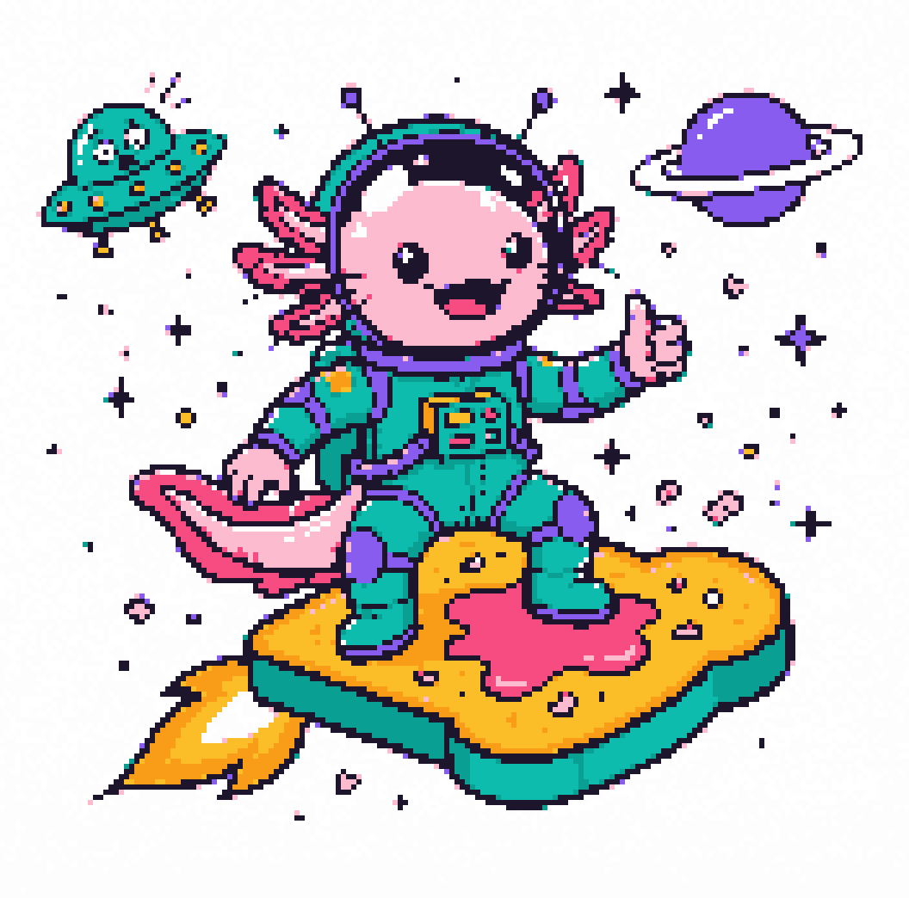 | 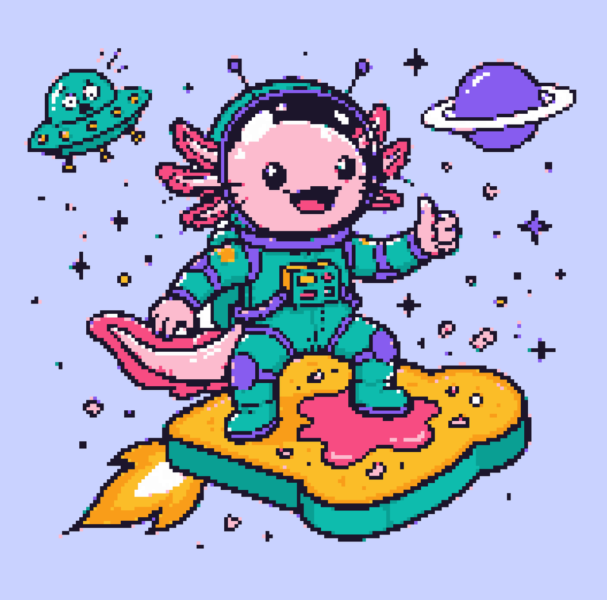 |

unpixel encuentra la cuadrícula por sí mismo y no necesita ninguna opción. Mantiene un color por bloque, con paredes rectas y sin suavizado, así que los colores de la fuente se conservan exactos. Esta entrada es la mascota reducida a una cuadrícula y a sus propios colores con [`derive.py`](derive.py), y por eso se ven unos cuantos bloques sueltos alrededor de las branquias: están en la fuente.

**Comprueba.** Amplía la vista previa: los bordes deben ser escalones cuadrados. Si se ven redondos, la fuente no estaba en una cuadrícula limpia, como un sprite redimensionado o comprimido en JPEG, y se ha tratado como un dibujo normal.

## Para scripts y asistentes de IA

Añade `--json` a cualquier comando, y lee el código de salida. El README tiene el [flujo de trabajo a seguir](../README.md#using-unpixel-from-an-ai-assistant).

```sh
for file in logos/*.png; do
  unpixel "$file" --json > "${file%.png}.result.json" || echo "failed: $file"
done
```

Revisa cada vista previa. Que un lote termine sin errores no significa que se vea bien.
