# Examples and use cases

Every example here shows the real input, the real output and the exact command. Installation and the full list of options are in the [main README](../README.md). [Versión en español](README.es.md).

Almost every image is a variant of unpixel's mascot, and most come from the [image battery](../battery/README.md) used to judge changes to the output. Commands run from this folder, and [`build.sh`](build.sh) regenerates everything with one command. Image credits are in [`CREDITS.md`](CREDITS.md).

Outputs are shown on a check color, which is not part of the SVG. `build.sh` adds `--preview-background '#C9D2FF'` to every command, which changes the preview and nothing else, so the commands below leave it out unless the surface is the point. Without it, these previews come out on magenta.

## The default: no options at all

Most flat-color artwork needs nothing but the file name.

```sh
unpixel ../battery/leaves.png -o leaves/result.svg
unpixel ../battery/watchmaker.png -o watchmaker/result.svg
unpixel ../battery/float.png -o float/result.svg
```

| Input | Output | Detected |
|---|---|---|
| 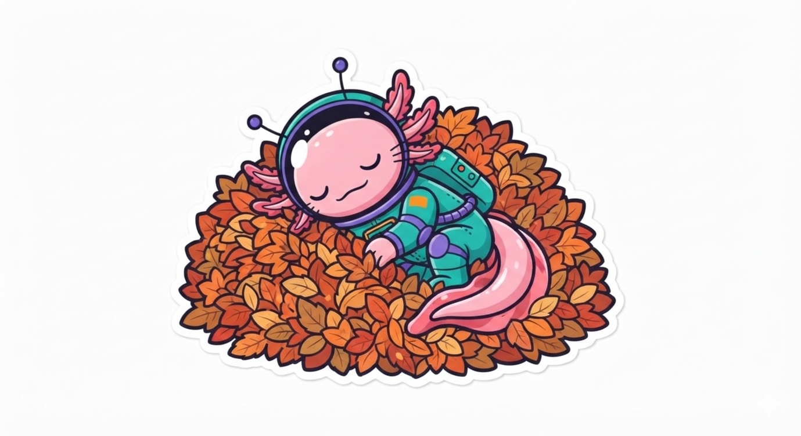 |  | Seventeen colors, with hundreds of small leaves in close shades. The pale highlights on the skin come out grey. |
| 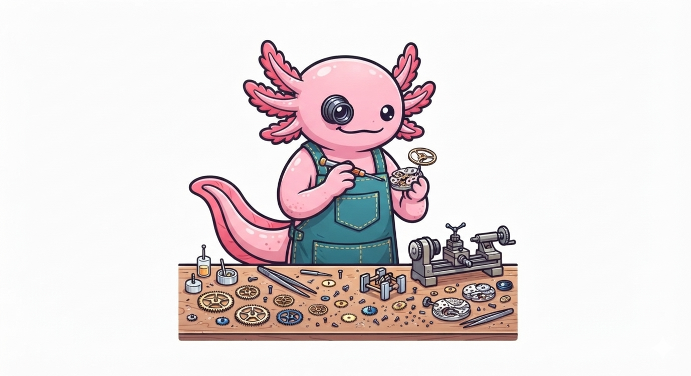 | 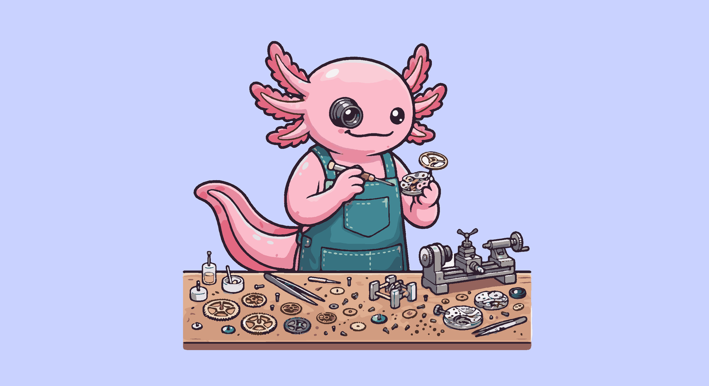 | Nineteen colors, down to the screws on the bench. |
| 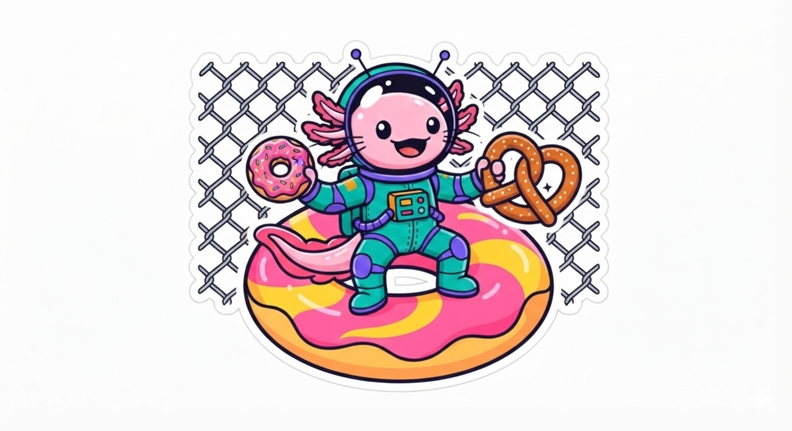 | 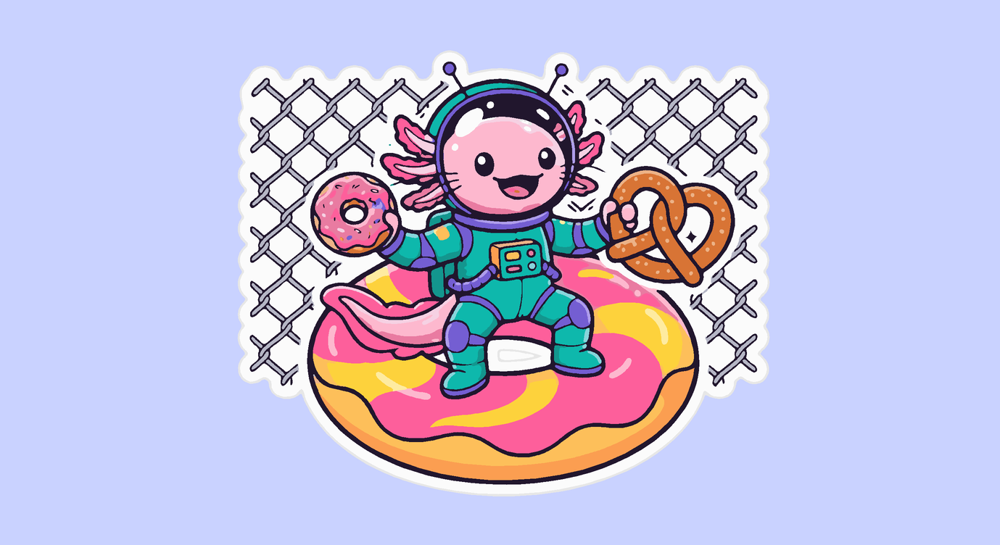 | Nineteen colors. The white inside the fence stays. To remove it, see [case 2](#2-make-enclosed-white-see-through-too). |

## Choosing a case

| You have | You want | Go to |
|---|---|---|
| A design on a white or plain background | The design alone, for any background | [1](#1-remove-the-background-and-keep-everything-else) |
| A design with white inside it, such as a fence or lettering | Those insides see-through | [2](#2-make-enclosed-white-see-through-too) |
| A small logo or a screenshot of one | A version that scales | [3](#3-rescue-a-small-or-blurry-logo) |
| A design with exact brand colors | Those exact values in the file | [4](#4-use-exact-brand-colors) |
| A poster or full-bleed design | A vector copy, background included | [5](#5-keep-a-full-image-with-no-background-to-remove) |
| A file for a cutter, plotter or screen printer | Colors that never overlap | [6](#6-prepare-a-file-for-a-cutter-plotter-or-screen-printing) |
| Too many similar tones | A simpler palette | [7](#7-reduce-the-number-of-colors) |
| A broken or jagged result | A better one | [8](#8-fix-lost-detail-or-jagged-edges) |
| A painting, a photo or a noisy scan | To know what to expect | [9](#9-photos-paintings-and-noise) |
| A design for a dark or colored surface | To see it there, and recolor it | [10](#10-check-and-recolor-for-the-surface-it-goes-on) |
| Your own artwork with a draft watermark | To know what will happen to it | [11](#11-artwork-with-a-watermark) |
| Any design | Only its lines, for coloring or cutting | [12](#12-keep-only-the-lines) |
| Pixel art | Its blocks kept square | [13](#13-pixel-art) |

Before sending anything to print or production, open the preview, and the report if the design has fine detail.

## 1. Remove the background and keep everything else

**Situation.** A character on a white page, wearing white. You want the character without the page. Removing "all light pixels" would take the jacket and the hat with it.

```sh
unpixel ../battery/chef.png -o chef/result.svg
```

| Input | Output |
|---|---|
|  | 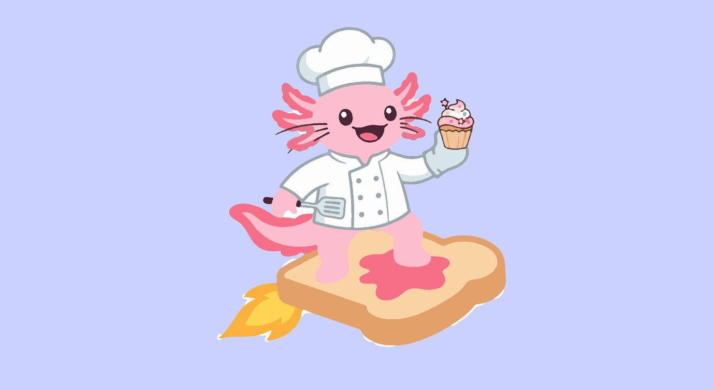 |

Only the color connected to the image border is removed. The jacket and the hat are as white as the page, but their soft grey outline encloses them, so they stay.

**Check.** The outside should show the check color, and enclosed pale areas should be solid. Look along the edges too: here, thin white slivers stay along the lower edge of the toast and between the flames. On a dark surface they show, so remove them by hand if that is where it goes.

**The limits of this rule.** An outline has to be strong enough to stop the background. The two stickers in the battery show both sides: the border of `float.png` stays, as in the table above, while the border of `leaves.png` has a fainter ring and goes with the page. That is usually what you want, but no option changes it.

A soft glow has no edge at all, so unpixel has to draw one:

```sh
unpixel ../battery/diver.png -o diver/result.svg
```

| Input | Output: the glow turns into flat rings |
|---|---|
| 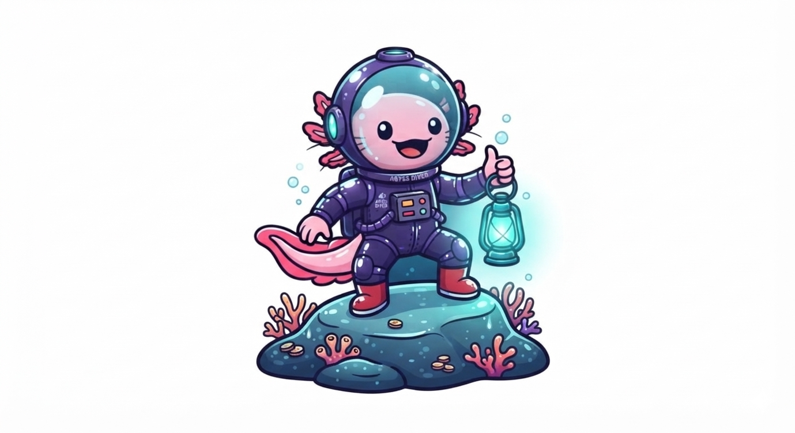 | 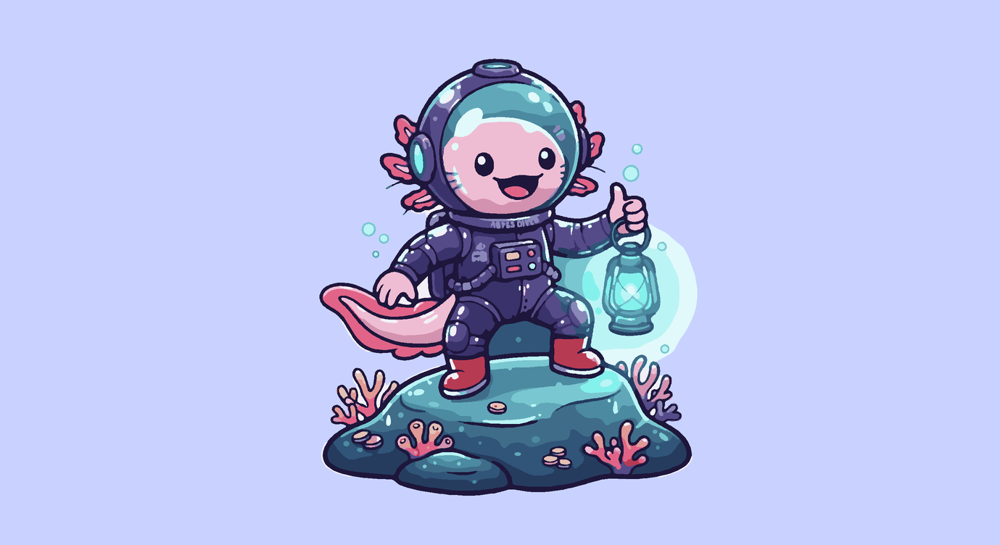 |

The lantern's glow fades into the page, and it comes out as a few pale rings ending in a hard edge. For an image like this one, either remove the glow by hand or start from a version without it.

## 2. Make enclosed white see-through too

**Situation.** A sticker design for a colored shirt. White enclosed by the artwork must disappear too, or the design shows white patches: here, the gaps in a wire fence.

```sh
unpixel ../battery/float.png -o float/result.svg
```

unpixel keeps enclosed areas that look like the background opaque, and tells you what to do:

```
Warning: Interior areas colored #FBFBFB look like the background but stayed opaque. To make them transparent too, add --also-transparent '#FBFBFB'.
  Run: unpixel ../battery/float.png -o float/result.svg --force --also-transparent '#FBFBFB'
Warning: Interior areas colored #E7E7E7 look like the background but stayed opaque. To make them transparent too, add --also-transparent '#E7E7E7'.
  Run: unpixel ../battery/float.png -o float/result.svg --force --also-transparent '#E7E7E7'
```

```sh
unpixel ../battery/float.png --also-transparent '#FBFBFB' -o float/knockout.svg
```

| Default: enclosed white stays | With `--also-transparent` |
|---|---|
|  | 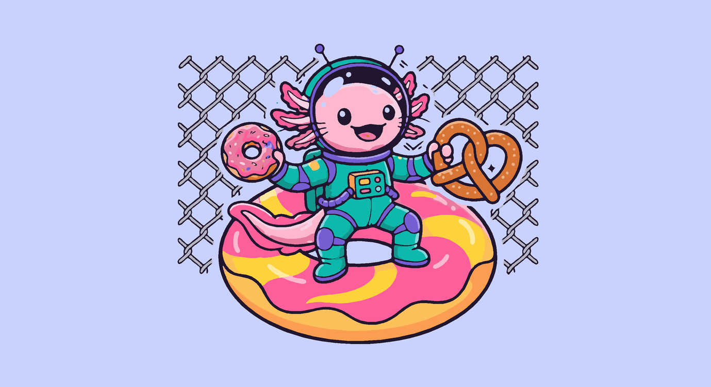 |

The fence is open now, the donut has a real hole, and the gap between the legs is clear. The sticker border goes as well, and so does its grey ring, `#E7E7E7`, which is close enough to the color you named. That is why one flag was enough here.

**Check.** The flag goes by color and not by place, so every white goes. The highlights in the eyes and on the helmet are see-through too: open the preview and look at the face. If they must stay white, keep the default, or paint them back in a design program. Only colors close to the one you name go: the grey wire and a thin grey mark on the white stay, as colors of their own.

## 3. Rescue a small or blurry logo

**Situation.** All you have is a small JPEG from an old website. These two are the chef saved small on purpose, by [`derive.py`](derive.py), since the battery holds only large images.

```sh
unpixel small/chef-480.jpg -o small/chef-480.svg
unpixel small/chef-220.jpg -o small/chef-220.svg
```

| Input, enlarged here | Output |
|---|---|
|  | 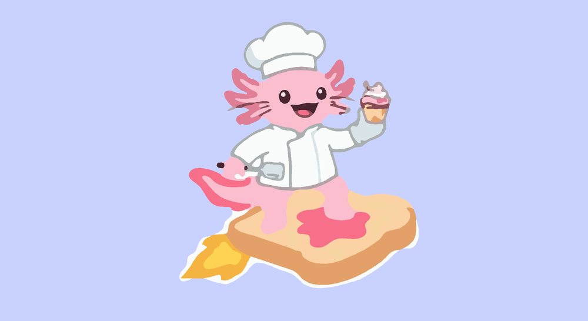 |
|  | 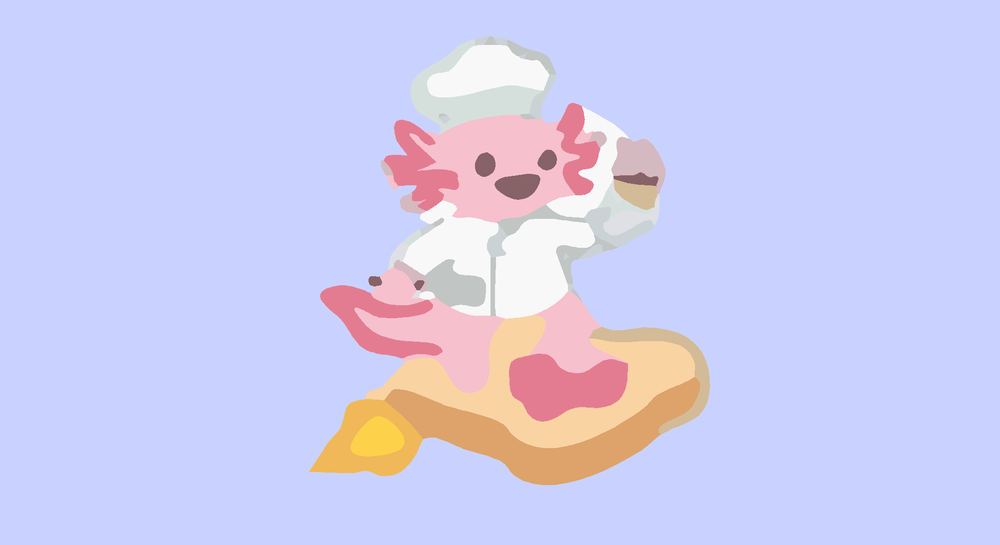 |

Small images are enlarged before tracing and edges are smoothed, so the result scales cleanly. unpixel cannot invent what the file does not contain. At 480 px the shapes are clean, though the buttons and the spatula are gone and JPEG's pale halo stays around the toast. At 220 px you get a sketch of the idea: it is honest about the file, and it is no replacement for the logo.

**Check.** Compare the close-ups in the report, and look for a white ring around the artwork. Consider redrawing or retyping small parts over the result in a design program. A larger source always wins.

## 4. Use exact brand colors

**Situation.** You need exact values in the file, such as your brand's, instead of what was measured in the image.

```sh
unpixel axolotl/input.png --colors '#FFB800,#FFC2D6,#00B8D4,#0090A8,#FF2E7E,#6A3DF0,#14102A,#FFFFFF,#FF8A00' -o axolotl/brand.svg
```

| Input | Your colors |
|---|---|
| 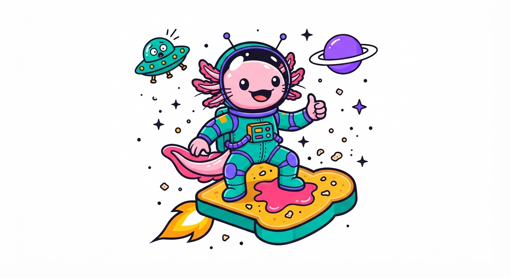 | 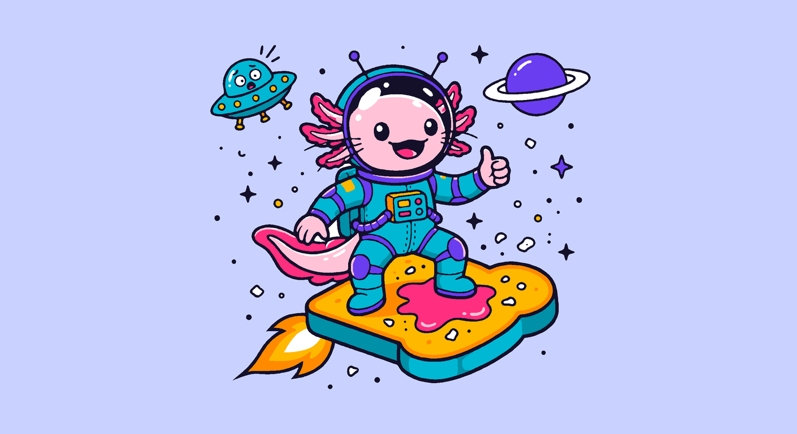 |

Each detected color becomes the closest in your list, and every layer uses exactly those values: here, the teal suit turns cyan. Closest means closest, so a replacement has to stay near the color it replaces. In a first try with a sky blue, the teal was closer to white, and the suit went white.

Warnings tell you when a detected color is far from all of yours, and what it became, or when one of yours matched nothing, which usually means a mistyped value. Five appear here, for small tones such as the highlights.

**Check.** The `layers` list in the output should show only your colors. Read the warnings, and look at what each far color turned into.

## 5. Keep a full image with no background to remove

**Situation.** An illustration that fills the whole image, to be reprinted large.

```sh
unpixel ../battery/principito.jpeg --background keep -o principito/result.svg
```

| Input | Output: nineteen flat tones |
|---|---|
| 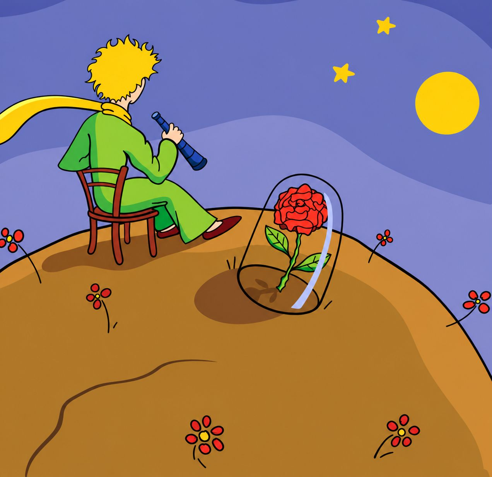 | 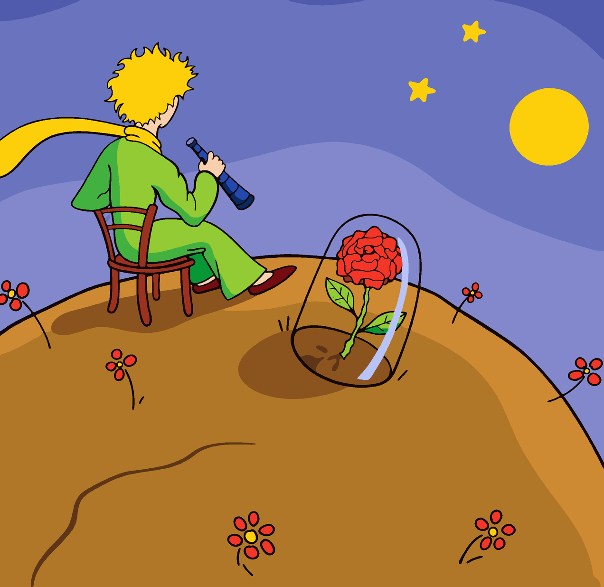 |

Without the flag, unpixel notices that the border is not one uniform color, removes nothing and warns you. Use `--background keep` to say that this is what you want.

The warning also offers the other way: name a color, and it goes wherever it touches the border, along with the tones around it.

```sh
unpixel ../battery/principito.jpeg --background '#6A73BE' -o principito/no-sky.svg
```

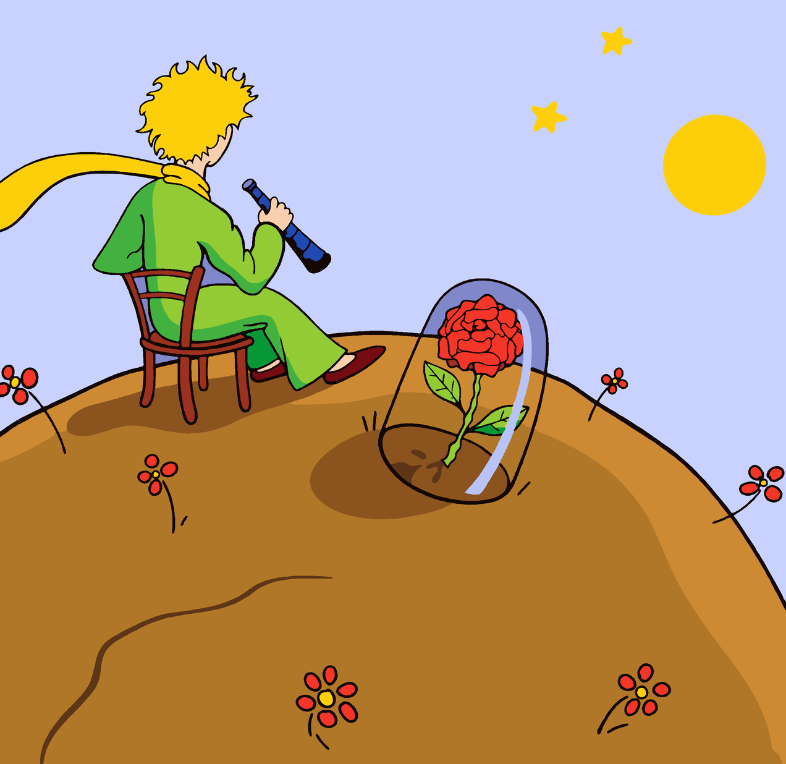

The two bands of sky are gone, and the piece seen through the glass stays, because the glass encloses it.

**Check.** The soft shadows on the ground become flat shapes, which suits this image. An airbrushed background does not fare as well: see [case 9](#9-photos-paintings-and-noise).

## 6. Prepare a file for a cutter, plotter or screen printing

**Situation.** Each color will be cut from vinyl or printed as its own screen, so a color must not continue underneath another.

```sh
unpixel axolotl/input.png --colors 6 --layers cutout -o axolotl/cutout.svg
python plates.py axolotl/cutout.svg axolotl/plates.png
```

| Input | The six colors, each one alone |
|---|---|
|  | 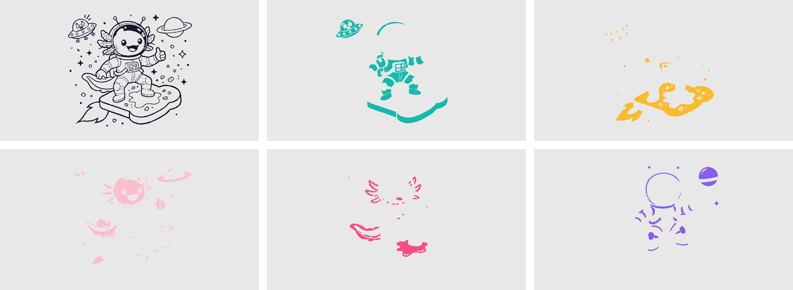 |

Each color appears only where it is visible: on the teal plate, the lines and the panel are holes. Each `<g id="color-N">` group in the SVG can be selected and sent separately, and [`plates.py`](plates.py) draws them like this. With six colors, the white of the eyes and the helmet merges into the pale pink, so name the colors if white must be its own plate.

**Check.** Cutout layers meet edge to edge, so a faint seam can show in a renderer that antialiases each shape, and unpixel warns about it. This mascot is too detailed for vinyl at any small size: the crumbs, stars and whiskers are thinner than a blade can weed, so remove them first or simplify the design. Add the trapping your print shop requires. For print or screen use, prefer the default, `stacked`.

## 7. Reduce the number of colors

**Situation.** An image has many near-identical tones, and you are paying for each ink, or you want a calmer look.

```sh
unpixel ../battery/leaves.png --colors 10 -o leaves/ten-colors.svg
unpixel ../battery/leaves.png --colors 6 -o leaves/six-colors.svg
```

| Input | `--colors 10` | `--colors 6` |
|---|---|---|
|  | 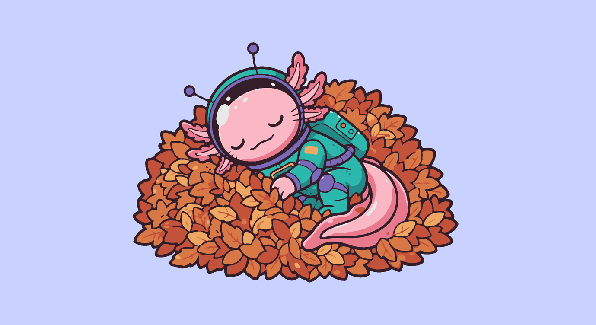 |  |

A number merges the closest colors until that many remain. It is quick, but it follows color distance and not meaning. Ten is a clean result. Six is too far for this image: the leaves come down to two colors, and stray pink lines appear around the pile, where the faint ring of the sticker was. That ring is dropped with ten colors, and comes back when it has to take on a stronger color.

For control, name the colors instead, as in [case 4](#4-use-exact-brand-colors).

**Check.** Merging can make two neighboring areas the same color, losing the boundary between them. Look outside the artwork as well, for leftovers that changed color.

### An illustration with soft shading

**Situation.** An illustration looks flat, but its highlights and soft edges add up to more tones than you want. This is common in generated artwork. Here it is unpixel's mascot, which gets sixteen colors by default, and the diver, which gets twenty.

```sh
unpixel axolotl/input.png --colors 8 -o axolotl/result.svg
unpixel ../battery/diver.png --colors 8 -o diver/eight-colors.svg
```

| Input | `--colors 8` |
|---|---|
|  | 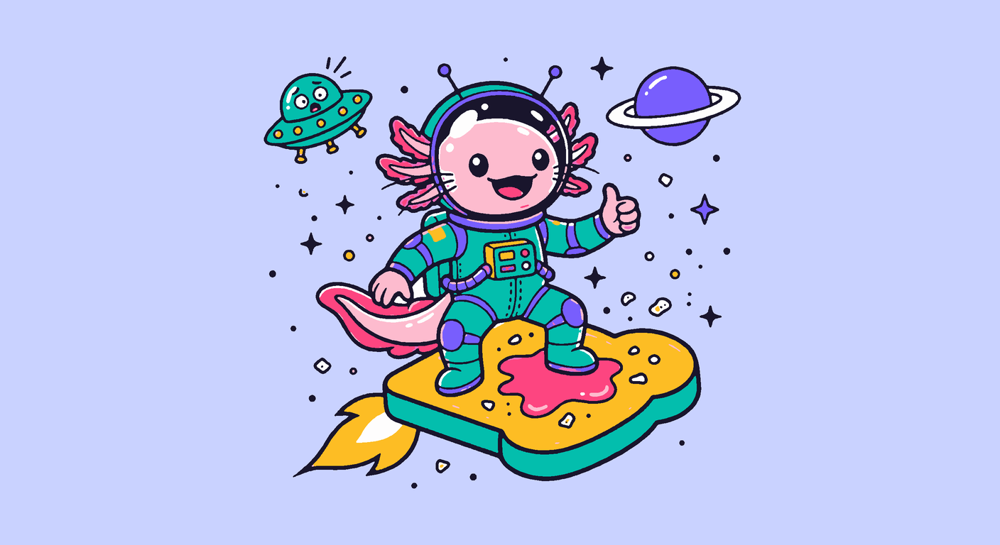 |
|  | 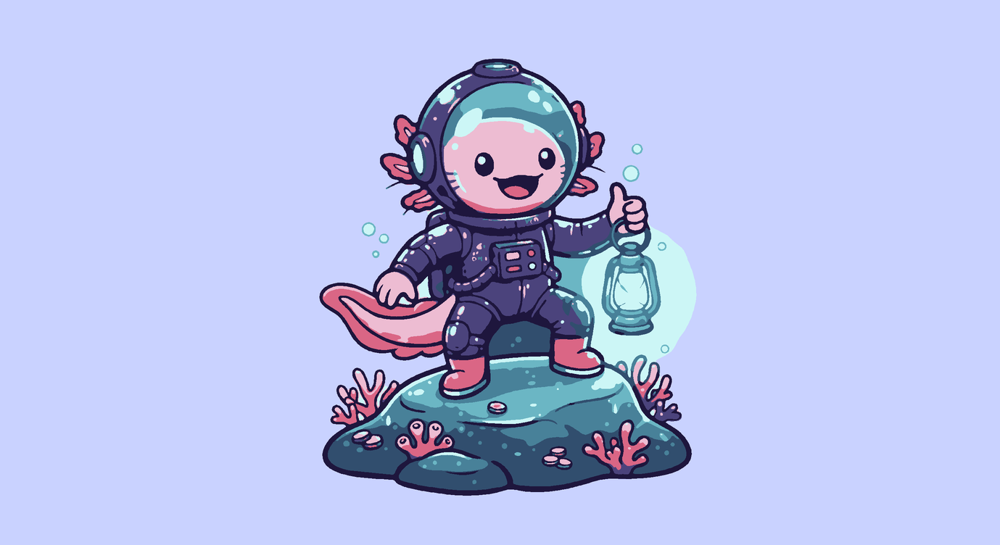 |

A number works well on the mascot, since its tones are clearly grouped. Thin whiskers, stars and crumbs stay, while the shading on the toast and the flame merges into flat color. The result warns that white areas inside the artwork stayed opaque, which is right for the eyes and the highlights, so this one keeps them.

The diver loses more, because its colors are not grouped. The red boots turn pink, the buttons on the chest panel fade, and the bright center of the lantern is gone.

The logo in the [main README](../README.md) is this same `axolotl/result.svg`, with only its `viewBox` cropped to the artwork.

## 8. Fix lost detail or jagged edges

**Situation.** Thin lines are broken or fine detail is clogged, or else outlines are visibly wavy.

```sh
unpixel ../battery/watchmaker.png --detail low -o watchmaker/low.svg
unpixel ../battery/watchmaker.png -o watchmaker/result.svg
unpixel ../battery/watchmaker.png --detail high -o watchmaker/high.svg
```

From left to right: input, `low`, `medium` and `high`, on the watchmaker's bench, enlarged 3×.

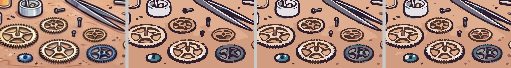

`low` gives calmer shapes and drops small marks: see the teeth of the gears. `high` keeps more of them, and it also keeps more wobble. The SVG grows from 664 KB to 731 KB and 886 KB. No level brings back the finest parts here: the spokes and the teeth of the smallest gears are blobs in all three, since they are a few source pixels wide.

**Check.** Compare enlarged crops, as above. Metrics can miss broken lines, so look.

## 9. Photos, paintings and noise

**Situation.** An airbrushed painting, a photo, a very grainy scan. unpixel never refuses an image, so the question is whether you like what you get.

```sh
unpixel ../battery/sunset.png --background keep -o sunset/result.svg
unpixel ../battery/sunset.png --background keep --colors 6 -o sunset/six-colors.svg
```

| Input | Default: sixteen flat colors | `--colors 6` |
|---|---|---|
| 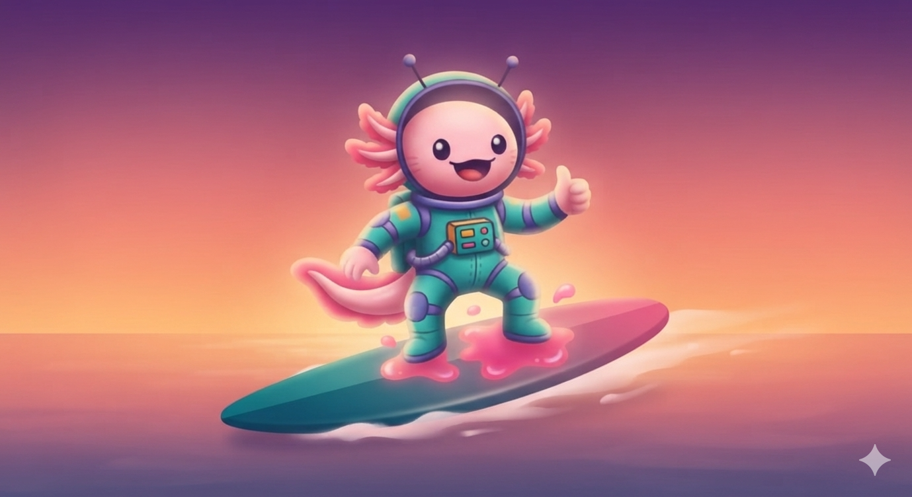 | 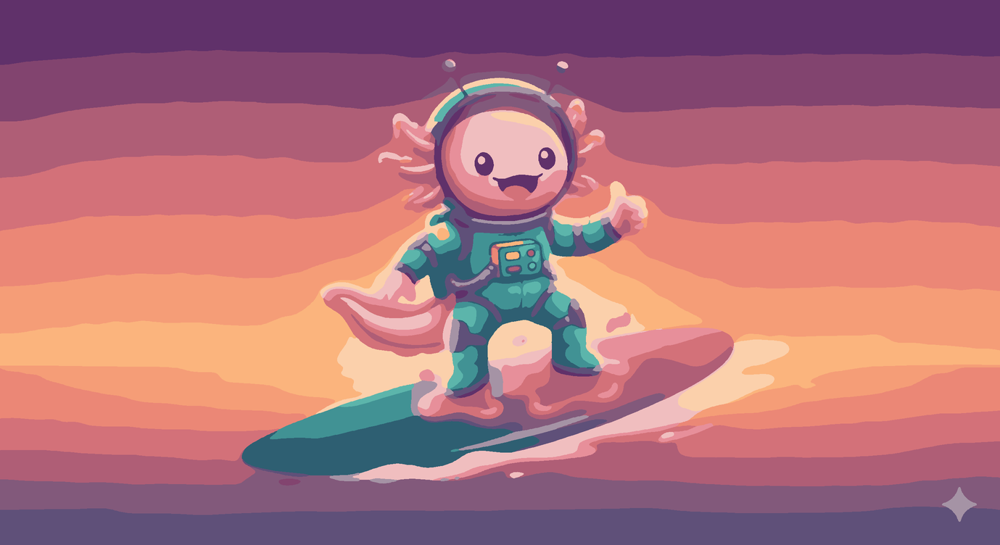 | 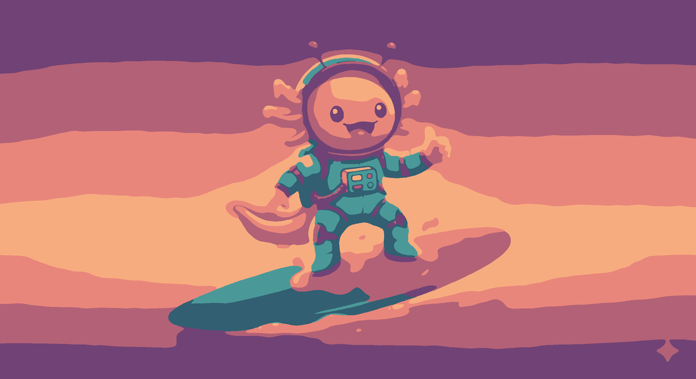 |

Gradients become bands with wavy edges, and no warning says so. The character suffers most: the antennas nearly vanish, and the outline melts into the background, because this image has no hard edges to follow. The six-color version looks good as a stylized poster, but it is not a copy: the face takes the color of the sky. If you need a faithful copy, keep the image as raster.

An image too busy to trace, such as a noisy one, is smoothed first, with a warning. This is the chef, with strong noise added by [`derive.py`](derive.py):

```sh
unpixel grain/input.png -o grain/result.svg
```

```
Warning: This image is very busy, like a photo or noise, so it was smoothed first to keep the result usable.
```

| Input | Output |
|---|---|
| 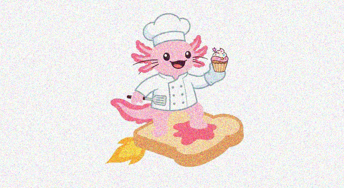 | 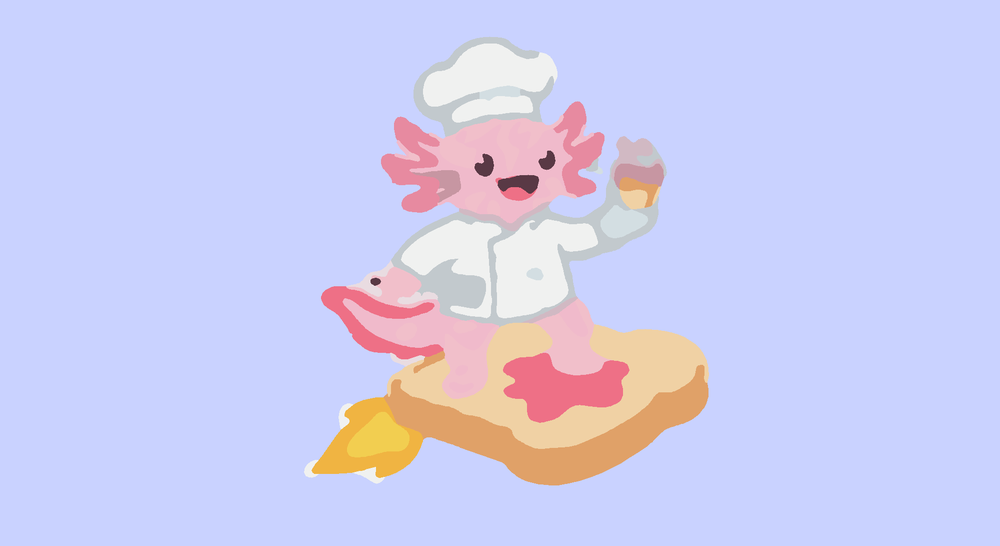 |

The grain is gone and so is everything else small: whiskers, buttons, the outlines of the cupcake. It is a usable picture, and a blurry one. With even stronger noise the background is not removed either, because the border stops being one uniform color.

**Check.** Decide whether the poster look is what you want. Look at the warnings, and at what the smoothing took.

## 10. Check and recolor for the surface it goes on

**Situation.** A dark design for a sticker on a dark laptop. The check color in a preview can make it look fine, even though it will barely show on the real surface.

```sh
unpixel ../battery/diver.png --preview-background '#1C1C1E' -o diver/on-dark.svg
unpixel ../battery/diver.png --outline lines --outline-color '#F2F2F2' --preview-background '#1C1C1E' -o diver/light-lines.svg
```

| Input | On the real surface: the suit sinks into it | Recolored as light lines |
|---|---|---|
|  | 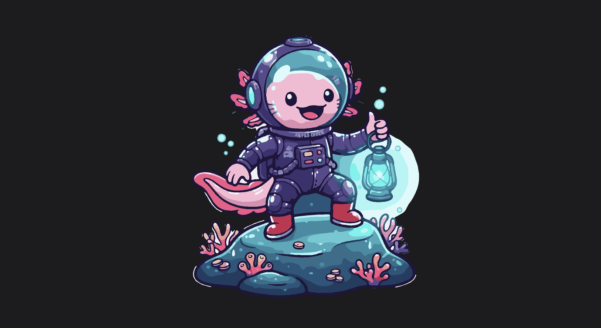 | 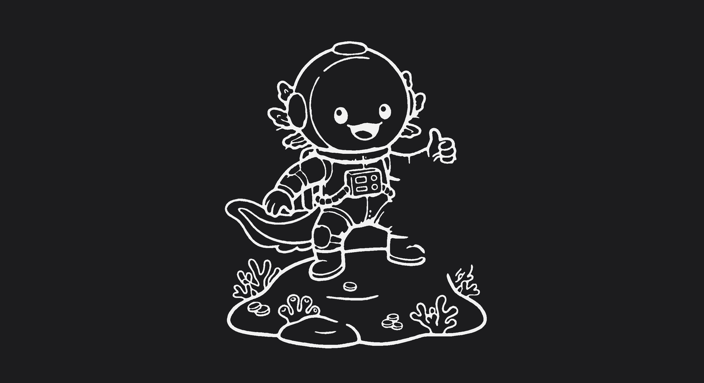 |

The first command shows the design on that surface. The second keeps only its lines, in a light color. These are the darkest color's own shapes, so what was dark comes out light, as you can see in the eyes. `--preview-background` never changes the SVG.

To recolor without going to lines, list one replacement per color in `--colors`, or edit each group's `fill` in the SVG, and the `stroke` of any `class="trap"` path in it. With one value in `--colors`, every color becomes that value, which suits one-color lettering and turns a design like this into a silhouette.

The reverse also happens. A pale design vanishes on a light surface and reads on a dark one:

```sh
unpixel ../battery/ghost.png -o ghost/result.svg
unpixel ../battery/ghost.png --preview-background '#1C1C1E' -o ghost/on-dark.svg
```

| Input, on white | On a light surface | On a dark surface |
|---|---|---|
| 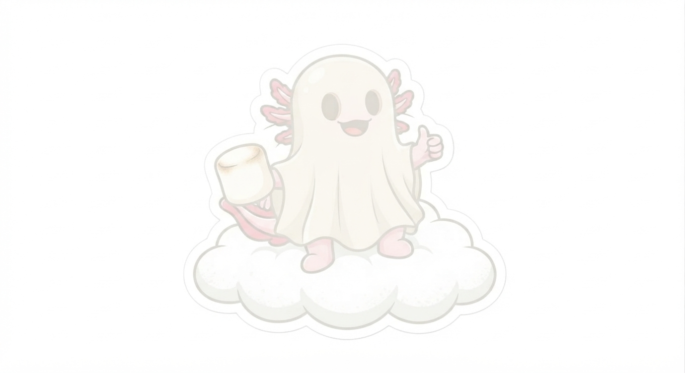 | 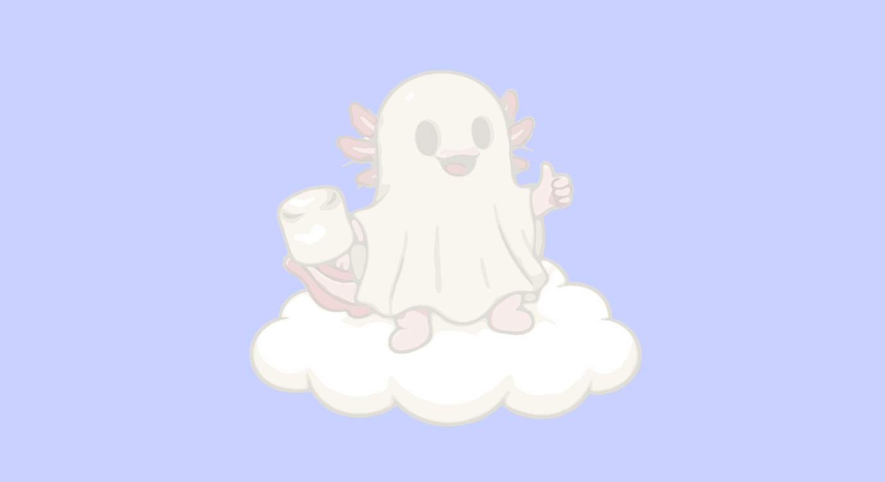 | 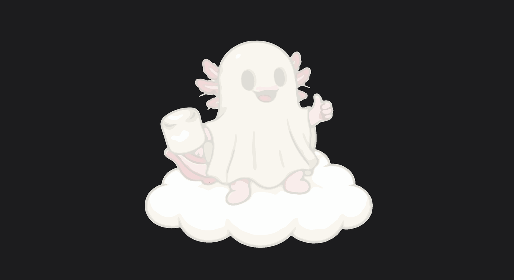 |

Its eight pale colors all survive, though the faint ring of the sticker goes with the page.

**Check.** The preview should read clearly on the real surface color. unpixel does not measure contrast.

## 11. Artwork with a watermark

**Situation.** Your own design, or one you have the rights to, still has a draft "SAMPLE" overlay, and you want to know what will happen to it.

unpixel has no watermark feature. The overlay is just more pixels, so the result depends on its strength. These inputs are the chef, with an overlay added by [`derive.py`](derive.py) at three strengths:

```sh
unpixel watermark/faint.png -o watermark/faint.svg
unpixel watermark/medium.png -o watermark/medium.svg
unpixel watermark/strong.png -o watermark/strong.svg
```

| Overlay | Input | Output | What happened |
|---|---|---|---|
| Faint | 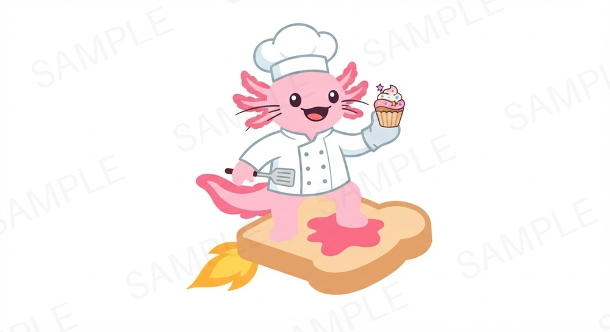 |  | Falls within the existing colors, so it vanishes. |
| Medium | 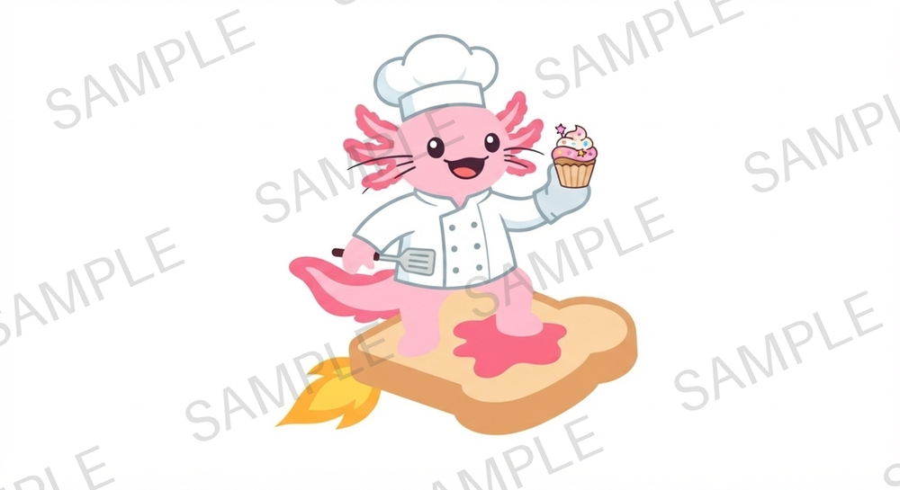 | 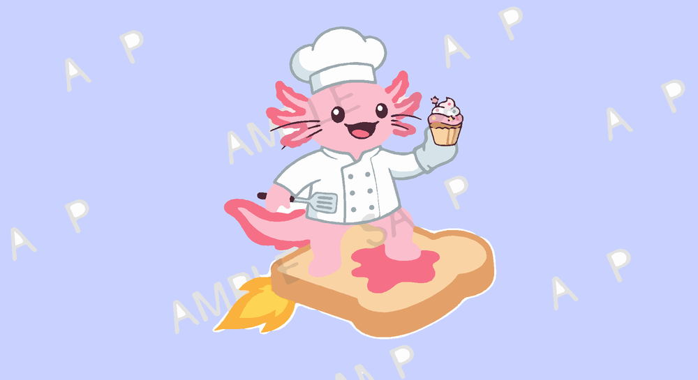 | Stays in pieces, as pale letters with parts missing. |
| Strong | 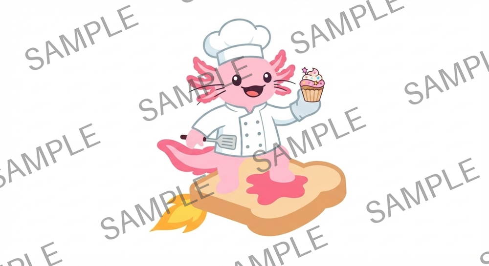 | 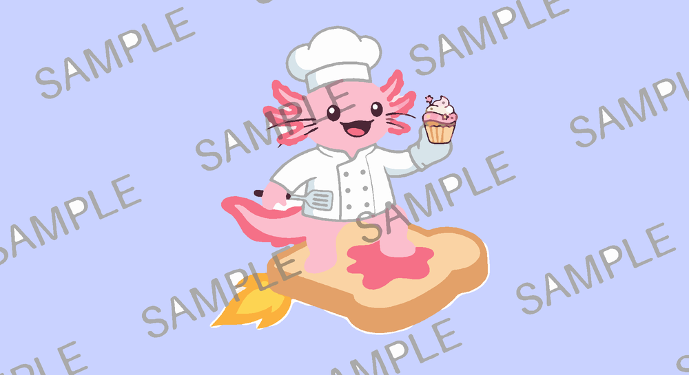 | Stays whole, traced as shapes. |

Naming the real palette removes the extra color, though not the shape of the overlay where it is strong enough to cross into another color:

```sh
unpixel watermark/medium.png --colors '#FAD3A4,#E3A169,#FDD453,#FBBECD,#F67087,#FBB13D,#FDFDFD,#D7E4EA,#9AA7AD,#4A2636' -o watermark/medium-palette.svg
```


A real one is in this folder too: the sparkle Gemini left in the corner of `sunset.png` is traced like any other shape, in [case 9](#9-photos-paintings-and-noise). unpixel gives no warning about any of this, because it cannot tell a watermark from artwork.

**Check.** Look at the preview. If you have the original without the overlay, use it, as that is always the better source.

**Rights.** Use this only on images you own or have permission to use. A watermark usually means the image needs a license, and losing the mark during tracing does not grant one. Removing one from someone else's work can be illegal in itself.

## 12. Keep only the lines

**Situation.** You want a coloring page, a stencil or a path for a cutter, with no fills.

```sh
unpixel axolotl/input.png --colors 8 --outline lines -o axolotl/lines.svg
unpixel axolotl/input.png --colors 8 --outline edges -o axolotl/edges.svg
```

| Input | `--outline lines` | `--outline edges` |
|---|---|---|
|  | 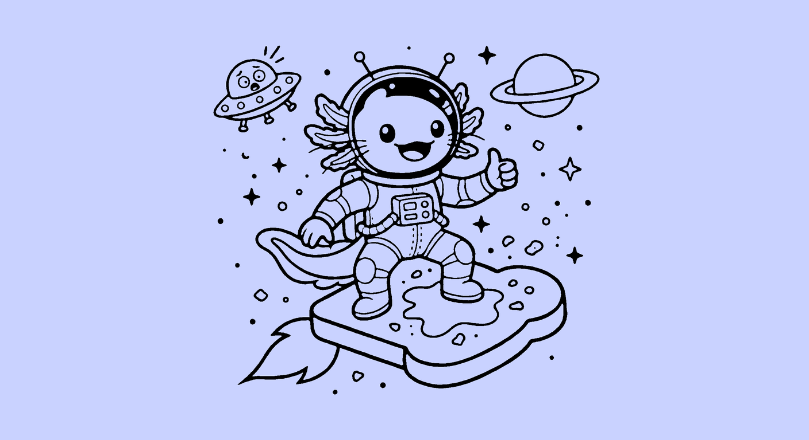 | 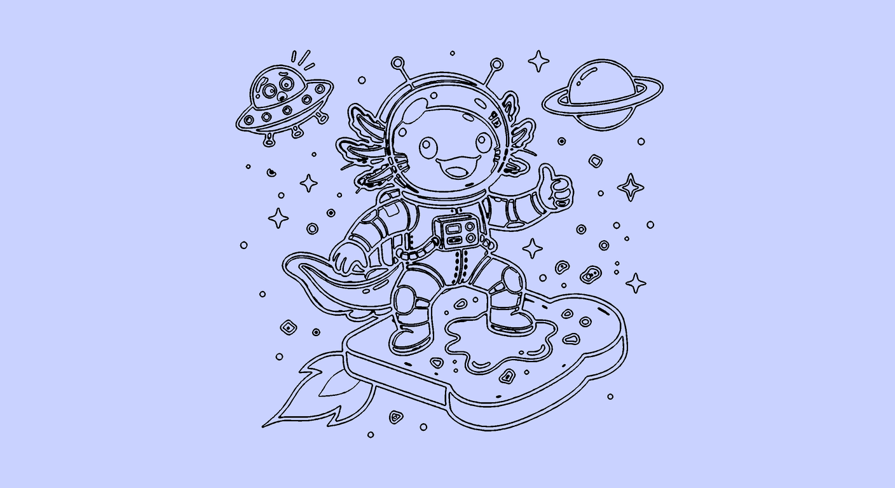 |

- **`lines`** keeps only the darkest color's shapes. It suits artwork that already has an outline, like this one. On artwork with none, the darkest color is a fill, and unpixel warns you.
- **`edges`** draws a line wherever two colors meet, so it works on artwork with no dark outline. An existing outline has two sides, so it comes out as a double line, as it does here.

The chef has only soft grey outlines, so `edges` is the one to use. Set the thickness with `--outline-width`, in source pixels, and the color with `--outline-color`:

```sh
unpixel ../battery/chef.png --colors 8 --outline edges -o chef/edges.svg
unpixel ../battery/chef.png --colors 8 --outline edges --outline-width 4 --outline-color '#7A3CFF' -o chef/thick-edges.svg
```

| Input | Default: width 2, black | Width 4, in a color |
|---|---|---|
|  | 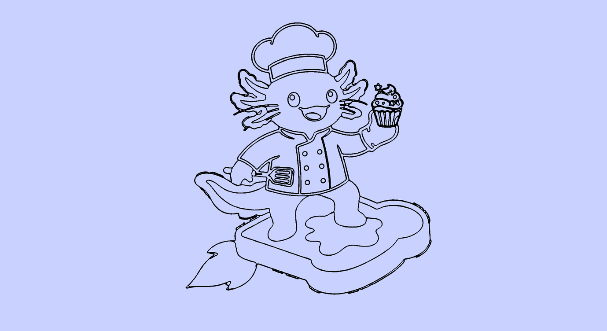 | 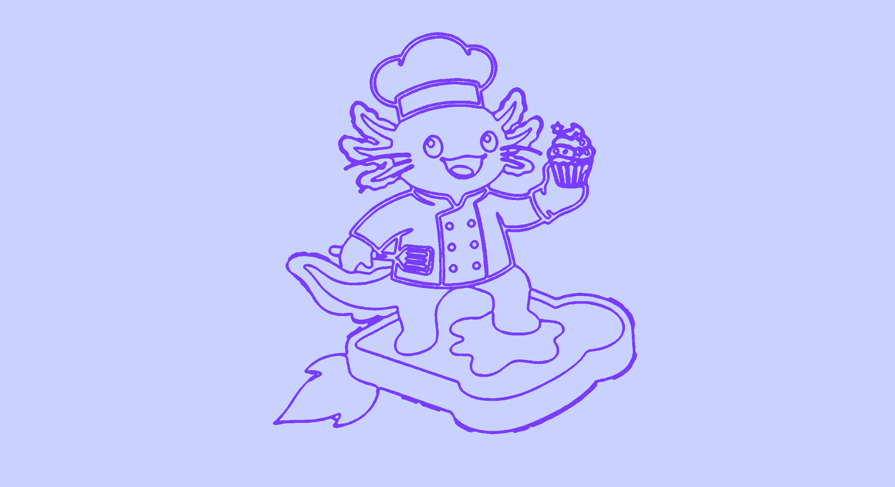 |

Both modes write one layer, in black unless you choose a color. On the chef, the grey outlines still double, and the toast comes out with a slightly wobbly second line, since its shading has a soft edge.

**Check.** Thin lines shown on a small preview can hide gaps. Open the report if the lines must be continuous, such as for a cutter. `lines` depends on the source having one dark color for its lines: on `leaves.png`, the lines between the leaves are a color of their own, so only the outer contour comes through.

## 13. Pixel art

**Situation.** A sprite or icon on a grid of square blocks, enlarged with hard edges. Smoothing it would melt the blocks.

```sh
unpixel pixel-art/input.png -o pixel-art/result.svg
```

| Input: 176 blocks across, 6 px each | Output |
|---|---|
| 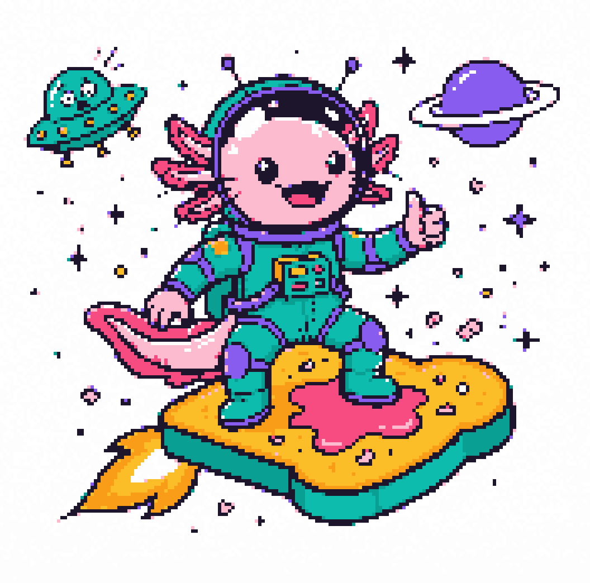 | 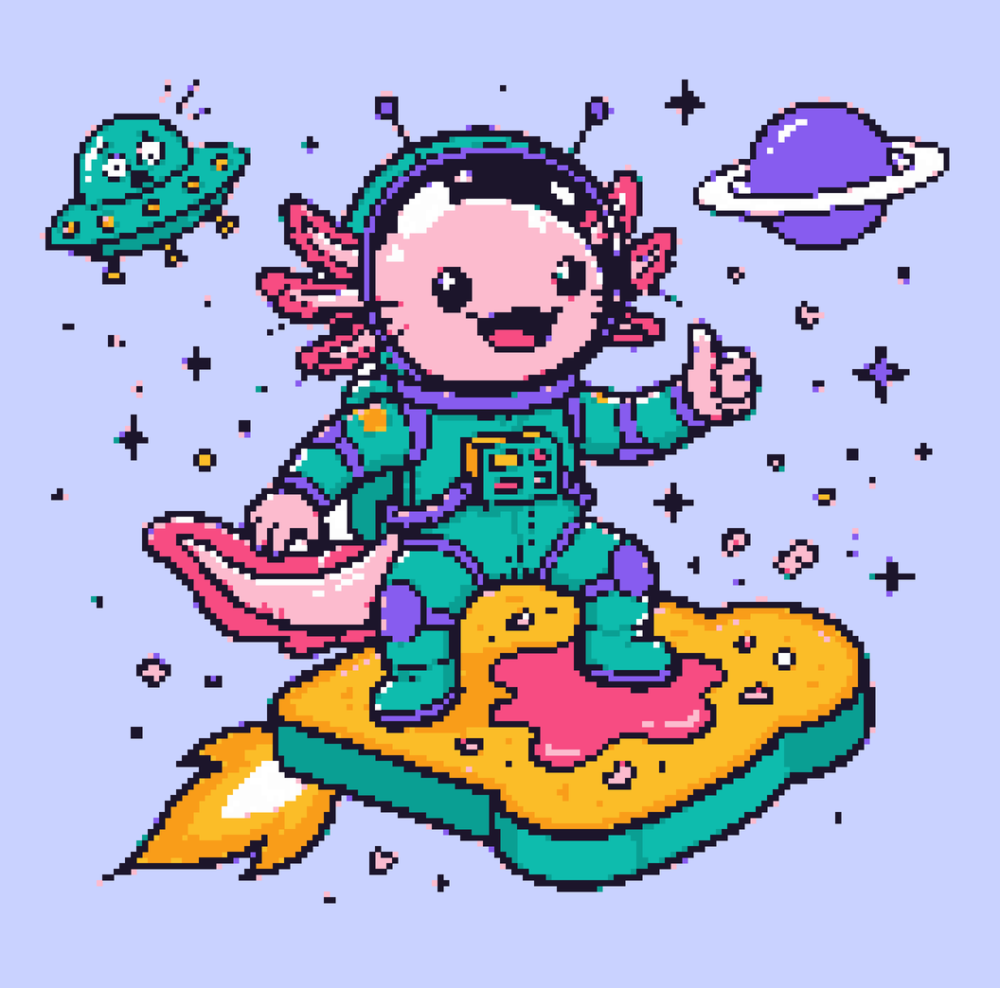 |

unpixel finds the grid by itself and needs no option. It keeps one color per block, with straight walls and no smoothing, so the colors of the source stay exact. This input is the mascot reduced to a grid and to its own colors by [`derive.py`](derive.py), which is why a few stray blocks show around the gills: they are in the source.

**Check.** Zoom in on the preview: edges should be square steps. If they look round, the source was not on a clean grid, such as a resized or JPEG-compressed sprite, and it was treated as ordinary artwork.

## For scripts and AI assistants

Add `--json` to any command, and read the exit code. The README has the [workflow to follow](../README.md#using-unpixel-from-an-ai-assistant).

```sh
for file in logos/*.png; do
  unpixel "$file" --json > "${file%.png}.result.json" || echo "failed: $file"
done
```

Review each preview. A batch that finishes cleanly is not the same as a batch that looks right.
